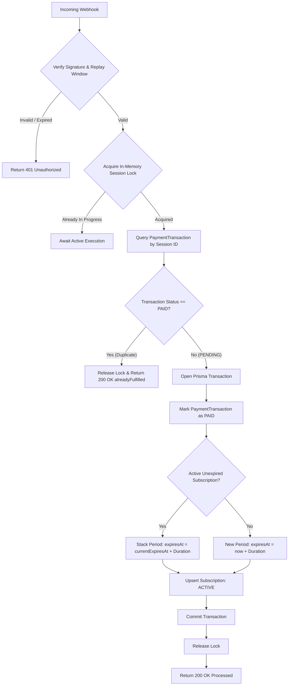

# Webhooks API Contract

**Feature Branch**: `001-paymongo-sgws-integration`  
**Date**: 2026-10-26  
**Status**: Completed  
**Spec Reference**: [`spec.md`](../spec.md) | **Research Reference**: [`research.md`](../research.md) | **Data Model**: [`data-model.md`](../data-model.md)  

---

## 1. Overview
The Webhooks API processes asynchronous payment notification events delivered by PayMongo to automatically and idempotently provision student subscriptions upon successful payment capture.

- **URL**: `/api/v1/webhooks/paymongo`
- **Method**: `POST`
- **Authentication**: Cryptographic HMAC-SHA256 Signature (`Paymongo-Signature` header)
- **Content-Type**: `application/json`

---

## 2. Request Security & Verification

### 2.1 Request Headers
| Header | Value | Required | Description |
|:---|:---|:---|:---|
| `Content-Type` | `application/json` | Yes | Event JSON payload. |
| `Paymongo-Signature` | `t=1729340050,te=8f9a2b...,li=6c4e1d...` | Yes | PayMongo HMAC-SHA256 cryptographic signature header. |

### 2.2 Signature Header Parameters
- `t`: Epoch timestamp in seconds when the webhook was signed by PayMongo.
- `te`: Test-mode signature hash.
- `li`: Live-mode signature hash.

### 2.3 Verification Algorithm
1. Read the raw request body as an unparsed string using `await req.text()`.
2. Extract `t`, `te`, and `li` from `Paymongo-Signature`.
3. Verify timestamp freshness:
   $$\lvert \text{nowSeconds} - t \rvert \le 300$$
   Reject with `401 Unauthorized` if timestamp exceeds 300 seconds to protect against replay attacks.
4. Compute the expected HMAC-SHA256:
   $$\text{expectedHash} = \text{HMAC-SHA256}(\text{PAYMONGO\_WEBHOOK\_SECRET}, t + "." + \text{rawBody})$$
5. Perform timing-safe equality comparison using `crypto.timingSafeEqual`:
   ```typescript
   const expectedBuffer = Buffer.from(computedHash, "hex");
   const receivedBuffer = Buffer.from(signatureToCompare, "hex");
   const isValid =
     expectedBuffer.length === receivedBuffer.length &&
     crypto.timingSafeEqual(expectedBuffer, receivedBuffer);
   ```
6. If invalid, reject immediately with `401 Unauthorized`.

---

## 3. Webhook Event Payload Structure

### 3.1 Supported Event Types
- `checkout_session.payment.paid`: Fired when a hosted checkout session payment succeeds.
- `payment.paid`: Direct payment capture notification.

### 3.2 Sample Payload (`checkout_session.payment.paid`)
```json
{
  "data": {
    "id": "evt_abc123456789",
    "type": "event",
    "attributes": {
      "type": "checkout_session.payment.paid",
      "livemode": false,
      "data": {
        "id": "cs_test_abc123xyz",
        "type": "checkout_session",
        "attributes": {
          "billing": {
            "name": "Juan Dela Cruz",
            "email": "juan@example.com"
          },
          "client_key": "client_key_abc",
          "line_items": [
            {
              "name": "HighSchool Tutor - Annual Unlimited Pass",
              "amount": 249900,
              "currency": "PHP",
              "quantity": 1
            }
          ],
          "payment_method_used": "gcash",
          "payments": [
            {
              "id": "pay_test_987xyz",
              "type": "payment",
              "attributes": {
                "amount": 249900,
                "currency": "PHP",
                "status": "paid",
                "source": {
                  "type": "gcash"
                }
              }
            }
          ],
          "reference_number": "SGWS-highschool-tutor-SGWS-A001-1729340000",
          "status": "active"
        }
      },
      "previous_data": {},
      "created_at": 1729340050,
      "updated_at": 1729340050
    }
  }
}
```

---

## 4. Fulfillment & Idempotency Pipeline



---

## 5. HTTP Response Specifications

### 5.1 Success - Payment Processed (`200 OK`)
```json
{
  "received": true,
  "processed": true,
  "transactionId": "tx_cm7xyz123",
  "subscriptionId": "sub_cm7abc123",
  "status": "PAID"
}
```

### 5.2 Success - Duplicate Webhook Idempotently Handled (`200 OK`)
```json
{
  "received": true,
  "alreadyFulfilled": true,
  "transactionId": "tx_cm7xyz123",
  "subscriptionId": "sub_cm7abc123",
  "status": "PAID"
}
```

### 5.3 Error - Replay Attack or Invalid Signature (`401 Unauthorized`)
```json
{
  "error": "Invalid webhook signature or timestamp outside tolerance window."
}
```

### 5.4 Error - Malformed Body (`400 Bad Request`)
```json
{
  "error": "Malformed webhook payload."
}
```

### 5.5 Error - Database Failure (`500 Internal Server Error`)
```json
{
  "error": "Internal fulfillment error. Webhook retry expected."
}
```
*(PayMongo will retry webhooks with exponential backoff upon receiving a 500 status code).*
