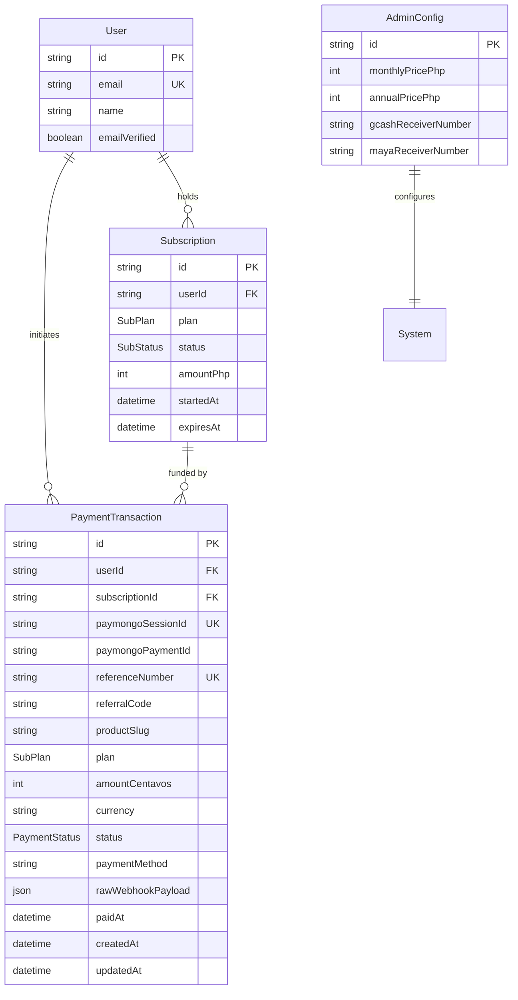
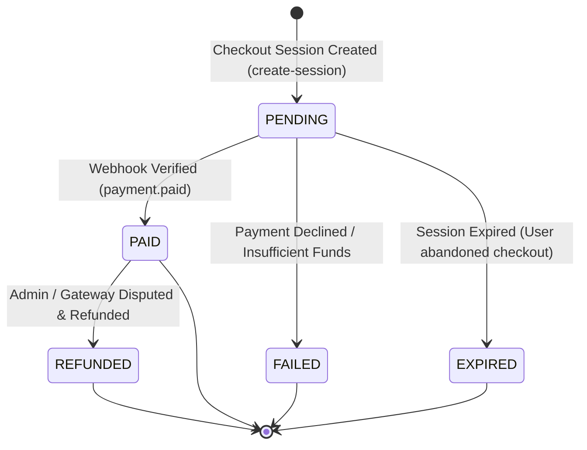
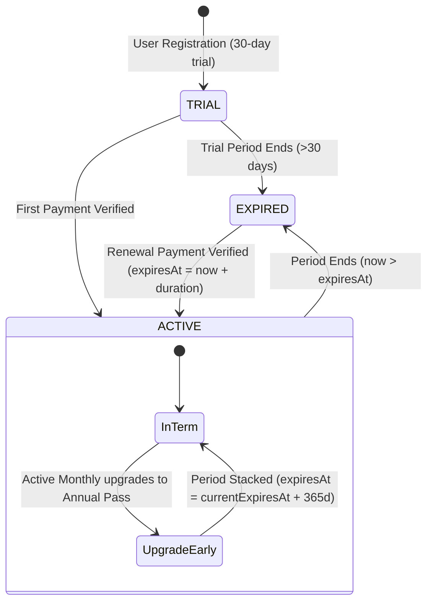

# Data Model: PayMongo & SGWS Affiliate Integration

**Feature Branch**: `001-paymongo-sgws-integration`  
**Date**: 2026-10-26  
**Status**: Completed  
**Spec Reference**: [`spec.md`](./spec.md) | **Research Reference**: [`research.md`](./research.md)  

---

## 1. Entity Architecture & Relationships

This data model defines the schema additions and relationship enhancements required to support automated PayMongo hosted checkout, SGWS affiliate referral attribution, and subscription period stacking.

The existing legacy `Payment` model is maintained unchanged for historical audit compliance, while all automated payment gateway records are tracked in a dedicated `PaymentTransaction` model.



---

## 2. Entities & Field Definitions

### 2.1 `PaymentTransaction` (New Entity)
Represents a financial checkout session and payment lifecycle managed via PayMongo.

| Field Name | Type | Modifiers / Constraints | Description |
|:---|:---|:---|:---|
| `id` | `String` | `@id @default(cuid())` | Unique internal transaction identifier. |
| `userId` | `String` | Foreign Key → `User.id` | Authenticated student/parent initiating the checkout. |
| `subscriptionId` | `String?` | Foreign Key → `Subscription.id` (Optional) | Target subscription being created or renewed. Set upon creation or linked during fulfillment. |
| `paymongoSessionId` | `String` | `@unique` | PayMongo checkout session ID (`cs_...`). Unique identifier returned by PayMongo API. |
| `paymongoPaymentId` | `String?` | Optional | PayMongo payment ID (`pay_...`) populated when payment is captured via webhook. |
| `referenceNumber` | `String` | `@unique` | Collision-free reference number (`SGWS-highschool-tutor-{code}-{ts}` or `HST-DIRECT-{ts}`). |
| `referralCode` | `String?` | Optional, indexed | Inbound affiliate referral code attributed to the checkout. |
| `productSlug` | `String` | `@default("highschool-tutor")` | Standardized SGWS product slug for affiliate portal attribution. |
| `plan` | `SubPlan` | Enum: `MONTHLY`, `ANNUAL`, etc. | Subscription plan tier selected by user. |
| `amountCentavos` | `Int` | Integer (> 0) | Monetary total in integer centavos (e.g. `29900` for ₱299.00, `249900` for ₱2,499.00). |
| `currency` | `String` | `@default("PHP")` | Three-letter ISO currency code (`PHP`). |
| `status` | `PaymentStatus` | `@default(PENDING)` | Current status: `PENDING`, `PAID`, `FAILED`, `EXPIRED`, `REFUNDED`. |
| `paymentMethod` | `String?` | Optional | Captured payment rail (`card`, `gcash`, `paymaya`, `qrph`, `grab_pay`, `dob`). |
| `rawWebhookPayload` | `Json?` | Optional | Full unparsed JSON webhook payload received for audit trail. |
| `paidAt` | `DateTime?` | Optional | Timestamp when payment was verified and completed. |
| `createdAt` | `DateTime` | `@default(now())` | Checkout session creation timestamp. |
| `updatedAt` | `DateTime` | `@updatedAt` | Record last modification timestamp. |

**Indexes**:
- `@@index([userId])`
- `@@index([subscriptionId])`
- `@@index([referenceNumber])`
- `@@index([paymongoSessionId])`
- `@@index([referralCode])`
- `@@index([status])`

---

### 2.2 `Subscription` (Updated Entity)
Represents access entitlements to HighSchool Tutor lessons, quizzes, and Socratic AI tutoring.

| Field Name | Type | Modifiers / Constraints | Description |
|:---|:---|:---|:---|
| `id` | `String` | `@id @default(cuid())` | Unique subscription identifier. |
| `userId` | `String` | Foreign Key → `User.id` | Student holding the subscription entitlement. |
| `plan` | `SubPlan` | Enum | Plan tier: `MONTHLY` (30 days) or `ANNUAL` (365 days). |
| `status` | `SubStatus` | Enum: `TRIAL`, `PENDING`, `ACTIVE`, `EXPIRED` | Access status evaluated by gatekeepers. |
| `amountPhp` | `Int` | Standard whole currency | Plan cost in Philippine Pesos (`299` or `2499`). |
| `startedAt` | `DateTime?` | Optional | When the active period started. |
| `expiresAt` | `DateTime?` | Optional | When the subscription expires. Updated via period stacking logic. |
| `paymentTransactions` | `PaymentTransaction[]` | Relation (1:N) | PayMongo transactions that funded this subscription. |
| `payments` | `Payment[]` | Relation (1:N) | Legacy manual payments (preserved for backward compatibility). |

---

### 2.3 `AdminConfig` (Updated Defaults & Configuration)
Controls platform pricing and operational settings.

| Field Name | Type | Modifiers / Constraints | Description |
|:---|:---|:---|:---|
| `id` | `String` | `@id @default(cuid())` | Unique configuration row identifier. |
| `monthlyPricePhp` | `Int` | `@default(299)` | Monthly Access Pass price in PHP. |
| `annualPricePhp` | `Int` | `@default(2499)` | Annual Unlimited Pass price in PHP (₱1,089 savings vs. monthly). |
| `gcashReceiverNumber` | `String` | *(Deprecated UI)* | Kept for legacy DB compatibility. |
| `mayaReceiverNumber` | `String` | *(Deprecated UI)* | Kept for legacy DB compatibility. |
| `trialDurationDays` | `Int` | `@default(30)` | Default free trial length. |
| `maxTrialSubjects` | `Int` | `@default(3)` | Number of subjects accessible on trial. |

---

## 3. Enumerations

### 3.1 `PaymentStatus`
```prisma
enum PaymentStatus {
  PENDING
  PAID
  FAILED
  EXPIRED
  REFUNDED
}
```

### 3.2 `SubPlan`
```prisma
enum SubPlan {
  MONTHLY
  ANNUAL
  GRADE_7
  GRADE_8
  GRADE_9
  GRADE_10
  GRADE_11
  GRADE_12
  ALL_LEVELS
}
```

### 3.3 `SubStatus`
```prisma
enum SubStatus {
  TRIAL
  PENDING
  ACTIVE
  EXPIRED
}
```

---

## 4. State Machine & Lifecycle Transitions

### 4.1 PaymentTransaction Lifecycle


### 4.2 Subscription Lifecycle & Period Stacking


---

## 5. Prisma Schema Diff

The following diff reflects the exact schema additions to be applied to `prisma/schema.prisma`:

```diff
--- prisma/schema.prisma (original)
+++ prisma/schema.prisma (updated)
@@ -40,6 +40,7 @@
   reminderNotices      ReminderNotice[]
   aiCreditUsages       AiCreditUsage[]
   quizSessions         QuizSession[]
+  paymentTransactions  PaymentTransaction[]
 
   @@map("user")
 }
@@ -163,6 +164,7 @@
   user     User      @relation(fields: [userId], references: [id], onDelete: Cascade)
   payments Payment[]
+  paymentTransactions PaymentTransaction[]
 
   @@index([userId])
   @@map("subscriptions")
@@ -174,6 +176,38 @@
   REJECTED
 }
 
+model PaymentTransaction {
+  id                String        @id @default(cuid())
+  userId            String
+  user              User          @relation(fields: [userId], references: [id], onDelete: Cascade)
+  subscriptionId    String?
+  subscription      Subscription? @relation(fields: [subscriptionId], references: [id], onDelete: SetNull)
+  paymongoSessionId String        @unique
+  paymongoPaymentId String?
+  referenceNumber   String        @unique
+  referralCode      String?
+  productSlug       String        @default("highschool-tutor")
+  plan              SubPlan       @default(MONTHLY)
+  amountCentavos    Int
+  currency          String        @default("PHP")
+  status            PaymentStatus @default(PENDING)
+  paymentMethod     String?
+  rawWebhookPayload Json?
+  paidAt            DateTime?
+  createdAt         DateTime      @default(now())
+  updatedAt         DateTime      @updatedAt
+
+  @@index([userId])
+  @@index([subscriptionId])
+  @@index([referenceNumber])
+  @@index([paymongoSessionId])
+  @@index([referralCode])
+  @@index([status])
+  @@map("payment_transactions")
+}
+
 model Payment {
   id             String        @id @default(cuid())
   userId         String
@@ -376,7 +410,7 @@
 model AdminConfig {
   id                   String   @id @default(cuid())
   monthlyPricePhp      Int      @default(299)
-  annualPricePhp       Int      @default(2999)
+  annualPricePhp       Int      @default(2499)
   maxTrialSubjects     Int      @default(3)
   maxFreeLessons       Int      @default(3)
   targetLessonsPerSubject Int   @default(8)
```

---

## 6. Migration & Deployment Strategy

1. **Non-Destructive Schema Expansion**:
   - The addition of `PaymentTransaction` introduces no breaking changes or column deletions to existing tables.
   - The `Payment` model and existing rows remain completely intact.
2. **Prisma Client Generation**:
   - Execute `npx prisma generate` to update `@prisma/client` types.
3. **Database Push / Migration**:
   - Run `npx prisma db push` or `npx prisma migrate dev --name add_payment_transactions` to sync the PostgreSQL schema.
4. **Data Integrity Checks**:
   - Unique constraints on `paymongoSessionId` and `referenceNumber` prevent duplicate checkout submissions and ensure collision-free records.
   - Nullable foreign key `subscriptionId` allows creating the transaction prior to subscription fulfillment if required.
