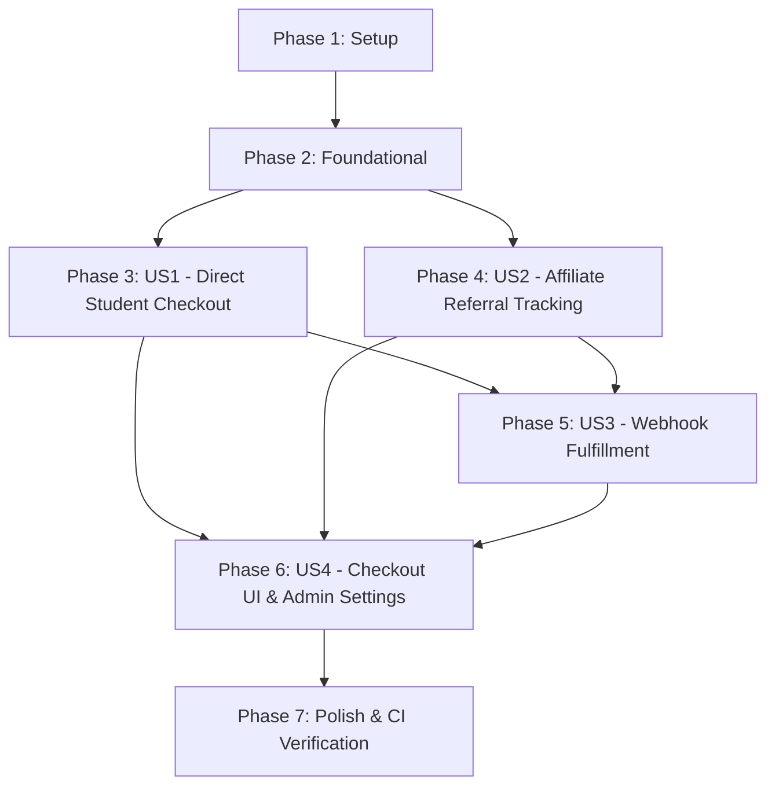

# Tasks: PayMongo Payment Gateway & SGWS Affiliate Integration

**Input**: Design documents from `/specs/001-paymongo-sgws-integration/`  
**Prerequisites**: [`plan.md`](./plan.md), [`spec.md`](./spec.md), [`data-model.md`](./data-model.md), [`research.md`](./research.md), [`contracts/`](./contracts/), [`quickstart.md`](./quickstart.md)  
**Governance**: [`.specify/memory/constitution.md`](../../.specify/memory/constitution.md) | Next Task Tracking: `TASK-025`  
**Tests Included**: Yes (Contract, Unit, and Idempotency tests mapped to each User Story)

---

## Format: `[TaskID] [P?] [Story?] Description with exact file path`

- **[P]**: Parallelizable task (independent file, zero uncommitted dependencies)
- **[Story]**: User story identifier (`[US1]`, `[US2]`, `[US3]`, `[US4]`) — omitted for Setup, Foundational, and Polish phases
- All tasks reference explicit repository file paths.

---

## Phase 1: Setup (Shared Infrastructure & Environment)

**Purpose**: Environment variable configuration, dependency verification, and shared pricing/affiliate constants.

- [X] T001 [P] Verify environment variable definitions in `.env.example` and runtime configuration for `PAYMONGO_SECRET_KEY`, `PAYMONGO_PUBLIC_KEY`, `PAYMONGO_WEBHOOK_SECRET`, `SGWS_AFFILIATES_API_URL`, `NEXT_PUBLIC_PRODUCT_SLUG`, and `NEXT_PUBLIC_APP_URL`
- [X] T002 [P] Create affiliate constants and configuration definitions in `lib/affiliate/constants.ts` (`SGWS_COOKIE_NAME = "sgws_ref"`, `SGWS_COOKIE_MAX_AGE_DAYS = 30`, `SGWS_PRODUCT_SLUG = "highschool-tutor"`, `SGWS_API_TIMEOUT_MS = 2500`)
- [X] T003 [P] Create pricing utilities and integer centavos converters in `features/billing/utils/pricing.ts` (`MONTHLY_PRICE_PHP = 299`, `ANNUAL_PRICE_PHP = 2499`, annual savings calculation of ₱1,089, `toCentavos`, and `fromCentavos`)

---

## Phase 2: Foundational (Blocking Prerequisites)

**Purpose**: Database schema expansion with `PaymentTransaction`, Prisma client generation, core types, and validation schemas.

> **CRITICAL**: All user story implementation is blocked until this phase completes.

- [X] T004 Update Prisma schema in `prisma/schema.prisma` with `PaymentTransaction` model (`id`, `userId`, `subscriptionId`, `paymongoSessionId`, `paymongoPaymentId`, `referenceNumber`, `referralCode`, `productSlug`, `plan`, `amountCentavos`, `currency`, `status`, `paymentMethod`, `rawWebhookPayload`, `paidAt`, timestamps, indexes), update `User` and `Subscription` relations, and update `AdminConfig.annualPricePhp` default to 2499
- [X] T005 Sync database schema and generate Prisma client types using `npx prisma db push` and `npx prisma generate`
- [X] T006 [P] Create TypeScript types, interfaces, and enums for billing sessions, payment transactions, and reconciliation responses in `features/billing/types/billingTypes.ts`
- [X] T007 [P] Create Zod request validation schemas for checkout session creation (`CreateCheckoutSessionSchema`) and referral validation (`ValidateReferralSchema`) in `features/billing/schemas/checkoutSchemas.ts`

**Checkpoint**: Database entities and core TypeScript types ready. User story implementation can now begin.

---

## Phase 3: User Story 1 - Direct Student Subscription Checkout via Hosted Gateway (Priority: P1) 🎯 MVP

**Goal**: Authenticated students can select the Monthly Pass (₱299, 30 days) or Annual Unlimited Pass (₱2,499, 365 days, saving ₱1,089 vs. monthly), initiate a PayMongo hosted checkout session (`/v2/checkout_sessions`) with server-calculated integer centavos, and be redirected to Philippine domestic payment rails (QR Ph, GCash, Maya, Cards, GrabPay, Online Banking).

**Independent Test**: Initiate checkout for Monthly (₱299) and Annual (₱2,499) passes via `POST /api/v1/billing/checkout/create-session`, assert that the PayMongo API returns a valid `checkout_url` and session ID, verify that a `PaymentTransaction` record is persisted in `PENDING` status with the correct `amountCentavos` (`29900` or `249900`), and verify session reconciliation via `GET /api/v1/billing/checkout/verify-session`.

### Tests for User Story 1

- [X] T008 [P] [US1] Create unit and contract tests for PayMongo checkout session creation and verify session responses in `tests/unit/paymongoCheckout.test.ts`

### Implementation for User Story 1

- [X] T009 [US1] Implement PayMongo API client with Basic Auth (`PAYMONGO_SECRET_KEY`), `/v2/checkout_sessions` payload builder, payment method types (`["qrph", "card", "gcash", "paymaya", "grab_pay", "dob"]`), and error handling in `lib/paymongo/client.ts`
- [X] T010 [US1] Implement checkout session creation API route `POST /api/v1/billing/checkout/create-session` in `app/api/v1/billing/checkout/create-session/route.ts` with session authentication (`getCurrentUser()`), Zod payload validation, server-authoritative centavos pricing, `PaymentTransaction` creation in `PENDING` status, and `sgws_ref` cookie propagation
- [X] T011 [US1] Implement session verification and reconciliation route `GET /api/v1/billing/checkout/verify-session` in `app/api/v1/billing/checkout/verify-session/route.ts` with user session validation, transaction status checks, and fallback gateway status reconciliation
- [X] T012 [P] [US1] Create client-side checkout API request helpers in `features/billing/api/checkoutApi.ts` for calling `/api/v1/billing/checkout/create-session` and `/api/v1/billing/checkout/verify-session`
- [X] T013 [P] [US1] Implement TanStack Query mutation hook `useCheckoutSession` in `features/billing/hooks/useCheckoutSession.ts` to manage loading states, toast notifications, and gateway redirection

**Checkpoint**: User Story 1 is functional. Direct checkout sessions can be generated and tested independently.

---

## Phase 4: User Story 2 - Affiliate Referral Tracking & Real-Time Partner Validation (Priority: P2)

**Goal**: Visitors arriving via `?ref=CODE` or `?referral=CODE` have their referral code captured in a secure 30-day cookie (`sgws_ref`). Referral codes are validated via a resilient proxy against the SGWS Affiliates Portal (`sgws-affiliates.sgws.tech`) with an `AbortController` 2,500ms timeout guardrail, and formatted into standardized collision-free reference numbers (`SGWS-highschool-tutor-{code}-{timestamp}` vs. `HST-DIRECT-{timestamp}`).

**Independent Test**: Visit the application with `?ref=SGWS-A001`, verify `sgws_ref` cookie is set with a 30-day TTL and is not cleared on subsequent route visits, validate the code via `POST /api/v1/referrals/validate` to assert the verified affiliate name, trigger a simulated 3,000ms upstream latency to confirm graceful fallback within 2,500ms, and verify that the created checkout session reference number adheres to `SGWS-highschool-tutor-{code}-{timestamp}`.

### Tests for User Story 2

- [X] T014 [P] [US2] Create unit tests for reference number generation and parsing in `tests/unit/referenceNumber.test.ts` and SGWS affiliate service timeout handling with mock `AbortController` in `tests/unit/sgwsAffiliateService.test.ts`

### Implementation for User Story 2

- [X] T015 [P] [US2] Implement reference number builder and parser in `lib/affiliate/referenceNumber.ts` supporting `SGWS-highschool-tutor-{code}-{timestamp}` for affiliate checkouts and `HST-DIRECT-{timestamp}` for direct purchases
- [X] T016 [P] [US2] Implement cookie extraction, serialization, and non-destructive retention utilities in `lib/affiliate/cookies.ts` (`getReferralCookie`, `setReferralCookie`, `hasReferralCookie`)
- [X] T017 [US2] Implement SGWS Affiliates Portal validation service with `AbortController` 2,500ms timeout, Zod response parsing, and graceful degradation fallback in `lib/affiliate/sgwsService.ts`
- [X] T018 [US2] Implement referral code validation proxy route `POST /api/v1/referrals/validate` in `app/api/v1/referrals/validate/route.ts` validating inbound requests against `ValidateReferralSchema` and querying `lib/affiliate/sgwsService.ts`
- [X] T019 [US2] Enhance `proxy.ts` middleware to inspect incoming query parameters `?ref=` and `?referral=`, set the `sgws_ref` cookie (30-day TTL, `SameSite=Lax`, `Path=/`), and preserve existing cookies without overwriting when query params are absent
- [X] T020 [P] [US2] Create client-side marketing referral tracker observer in `shared/components/marketing/ReferralTracker.tsx` to handle client-side SPA route navigation and referral query parameter capture

**Checkpoint**: User Stories 1 and 2 work together. Inbound affiliate traffic persists attribution and validates partner status without blocking checkout.

---

## Phase 5: User Story 3 - Automated Webhook Fulfillment & Idempotent Provisioning (Priority: P3)

**Goal**: When PayMongo delivers a payment notification webhook (`checkout_session.payment.paid` or `payment.paid`), the system cryptographically validates the HMAC-SHA256 signature using `crypto.timingSafeEqual` and a 300-second replay tolerance window, acquires an in-memory session lock, and executes an atomic `prisma.$transaction` updating `PaymentTransaction` to `PAID`, provisioning the `Subscription` to `ACTIVE`, and stacking period expiration dates (`currentExpiresAt + durationDays`). Duplicate webhooks are acknowledged idempotently with zero redundant writes.

**Independent Test**: Dispatch simulated PayMongo webhook payloads to `POST /api/v1/webhooks/paymongo` with valid HMAC-SHA256 signatures, verify that the transaction transitions from `PENDING` to `PAID`, assert that the student's subscription is set to `ACTIVE` with correct period stacking, test timestamp > 300s to verify `401 Unauthorized` rejection, and dispatch the identical webhook a second time to verify `200 OK alreadyFulfilled` with zero duplicate subscription extensions.

### Tests for User Story 3

- [X] T021 [P] [US3] Create unit tests for HMAC-SHA256 signature verification, 300-second replay window rejection, and tampered body detection in `tests/unit/paymongoSignature.test.ts`
- [X] T022 [P] [US3] Create integration tests for idempotent fulfillment, subscription period stacking math, and concurrent session locking in `tests/unit/paymentFulfillmentService.test.ts`

### Implementation for User Story 3

- [X] T023 [US3] Implement PayMongo webhook signature verification service in `lib/paymongo/webhook.ts` (`verifyPaymongoSignature`, parsing `t`, `te`, `li`, validating 300s window, and comparing hashes via `crypto.timingSafeEqual`)
- [X] T024 [US3] Implement idempotent payment fulfillment service in `lib/services/paymentFulfillmentService.ts` (`fulfillPayMongoCheckoutPayment`) with in-memory execution lock keyed by session ID, `prisma.$transaction` atomic boundary, payment method capture, and subscription period stacking logic (`expiresAt = (active && expiresAt > now ? expiresAt : now) + planDurationDays`)
- [X] T025 [US3] Implement PayMongo webhook receiver endpoint `POST /api/v1/webhooks/paymongo` in `app/api/v1/webhooks/paymongo/route.ts` with unparsed raw text parsing (`req.text()`), signature verification guardrail, event type discrimination (`checkout_session.payment.paid`), and fulfillment invocation

**Checkpoint**: User Stories 1, 2, and 3 are complete. End-to-end automated payment capture, partner attribution, and idempotent subscription fulfillment operate reliably.

---

## Phase 6: User Story 4 - In-App Subscription Management & Checkout UI (Priority: P4)

**Goal**: Overhaul the subscription checkout UI by replacing legacy manual GCash/Maya phone numbers and 24-hour verification delay with an automated PayMongo experience. Features include live debounced partner code checking (`useValidateReferralCode`), verified partner badge display, prominent Annual Pass savings callouts (₱1,089 savings vs. monthly), post-checkout celebratory modal on `/dashboard?payment=success&session_id=...`, and modernized admin settings with PayMongo status badges.

**Independent Test**: Open the upgrade modal as an unsubscribed student, verify live debounced validation when entering a referral code with the "Verified Partner" badge, confirm that the Annual Pass displays the ₱1,089 savings badge, click "Proceed to Payment" to verify seamless redirect to PayMongo, navigate to `/dashboard?payment=success&session_id=cs_test_123` to verify the celebratory modal opens and reconciles status, and verify that `AdminSettingsPage.tsx` renders PayMongo integration status cards instead of manual GCash/Maya inputs.

### Implementation for User Story 4

- [X] T026 [P] [US4] Implement live debounced referral code query hook `useValidateReferralCode` in `features/billing/hooks/useValidateReferralCode.ts` with TanStack Query and 400ms debounce
- [X] T027 [P] [US4] Implement post-redirect session status reconciliation hook `useVerifySession` in `features/billing/hooks/useVerifySession.ts` with 3-second interval polling (up to 5 attempts) to query `GET /api/v1/billing/checkout/verify-session`
- [X] T028 [US4] Refactor `shared/components/ui/UpgradeModal.tsx`: completely remove legacy manual GCash/Maya mobile numbers and 24-hour verification delay text, integrate PayMongo checkout session creation, embed live referral code input with verified partner badge, and prominently display Annual Pass with ₱1,089 savings vs. monthly
- [X] T029 [P] [US4] Create dedicated modular checkout modal component in `features/billing/components/CheckoutModal.tsx` displaying plan selection cards, domestic payment rail badges (QR Ph, GCash, Maya, Cards, GrabPay, Online Banking), and referral attribution badge
- [X] T030 [P] [US4] Create celebratory payment success dialog component in `features/billing/components/PaymentCelebrationDialog.tsx` and integrate into `features/dashboard/components/StudentDashboardView.tsx` triggering upon `payment=success` URL search parameters with query parameter cleanup
- [X] T031 [US4] Modernize `features/admin/components/settings/AdminSettingsPage.tsx`: replace legacy manual GCash/Maya receiver inputs with PayMongo Gateway Integration status badges (API Mode, Webhook URL, SGWS Product Slug, PayMongo Hosted Checkout active status)

**Checkpoint**: Complete in-app subscription and admin management UI operational with full PayMongo automation and zero manual transfer instructions.

---

## Phase 7: Polish & Cross-Cutting Concerns

**Purpose**: Quickstart verification, documentation updates, and CI verification (lint, typecheck, unit tests, production build).

- [X] T032 [P] Validate all 6 runnable scenarios from `specs/001-paymongo-sgws-integration/quickstart.md` (direct checkout, referral tracking, webhook fulfillment, idempotent retry, period stacking, and failure handling)
- [X] T033 Update API reference documentation in `docs/api-reference/api-endpoints.md` with `/api/v1/billing/checkout/create-session`, `/api/v1/billing/checkout/verify-session`, `/api/v1/referrals/validate`, and `/api/v1/webhooks/paymongo`
- [X] T034 Run full test suite, lint, and TypeScript validation using `npm run test`, `npx tsc --noEmit`, and `npm run lint`
- [X] T035 Execute full Next.js production build verification using `npm run build`

---

## Dependencies & Execution Order

### Phase Dependencies

### User Story Dependencies

- **User Story 1 (P1 - Direct Checkout)**: Depends only on Phase 2 (Foundational). Can be built and tested independently as the platform's core MVP payment pipeline.
- **User Story 2 (P2 - Affiliate Tracking)**: Depends on Phase 2 (Foundational). Can be developed in parallel with US1. Integrates with US1 checkout payload.
- **User Story 3 (P3 - Webhook Fulfillment)**: Depends on US1 (to fulfill created `PaymentTransaction` records) and Phase 2. Provides backend automation.
- **User Story 4 (P4 - Checkout UI & Admin Settings)**: Depends on US1, US2, and US3 hooks and endpoints to render complete user-facing workflows.
- **Phase 7 (Polish)**: Depends on all user stories completing.

### Parallel Execution Opportunities

| Phase | Parallelizable Tasks | Max Concurrency |
|:---|:---|:---|
| **Phase 1: Setup** | `T001`, `T002`, `T003` | 3 parallel tasks |
| **Phase 2: Foundational** | `T006`, `T007` (after `T004`, `T005`) | 2 parallel tasks |
| **Phase 3: User Story 1** | `T008`, `T012`, `T013` | 3 parallel tasks |
| **Phase 4: User Story 2** | `T014`, `T015`, `T016`, `T020` | 4 parallel tasks |
| **Phase 5: User Story 3** | `T021`, `T022` | 2 parallel tasks |
| **Phase 6: User Story 4** | `T026`, `T027`, `T029`, `T030` | 4 parallel tasks |
| **Phase 7: Polish** | `T032`, `T033` | 2 parallel tasks |

---

## Implementation Strategy & Incremental Delivery

### MVP Milestone (User Story 1 Only)
1. Complete Phase 1 (Setup) and Phase 2 (Foundational).
2. Complete Phase 3 (User Story 1: Direct Student Checkout).
3. **Validate MVP**: Create checkout sessions via API and test PayMongo hosted payment page redirects.

### Second Increment (User Story 2 & 3: Attribution & Webhook Automation)
1. Implement Phase 4 (Affiliate referral capture, SGWS proxy validation, reference numbers).
2. Implement Phase 5 (Cryptographic webhook verification, period stacking, and idempotent fulfillment).
3. **Validate End-to-End Backend**: Test payment simulation and automated subscription provisioning.

### Final Increment (User Story 4 & Polish: Modernized UI & Deprecation)
1. Overhaul `UpgradeModal.tsx` and admin settings, removing all manual transfer text.
2. Add celebratory redirect modal on `/dashboard?payment=success`.
3. Execute Phase 7 CI verification (`npm run test`, `npm run lint`, `npm run build`).
