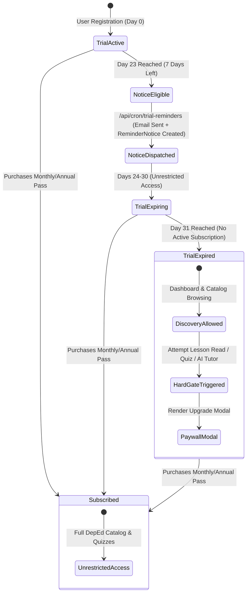
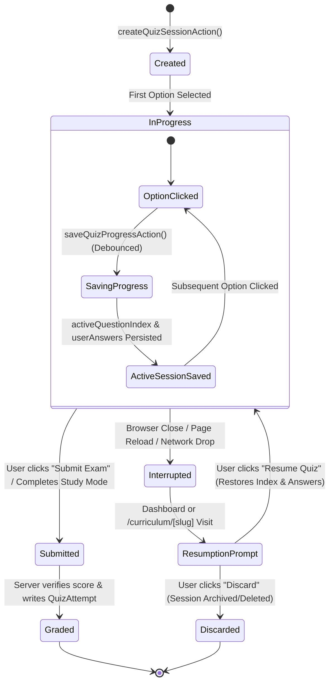
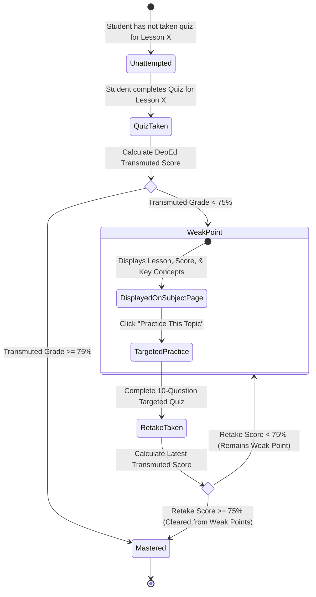

# Phase 1 Data Model: UI Modernization & Diagnostic Learning Enhancements

**Feature Branch**: `002-ui-and-learning-enhancements`  
**Date**: 2026-10-26  
**Status**: Completed  
**Spec Reference**: `specs/002-ui-and-learning-enhancements/spec.md`  

---

## 1. Prisma Schema Modifications & Additions

### 1.1 Updated Model: `QuizSession`
To support auto-persistence, cursor resumption, and the "Continue Quiz" experience across tabs and devices, the `QuizSession` model in `prisma/schema.prisma` is updated to include `activeQuestionIndex`.

```prisma
model QuizSession {
  id                  String    @id @default(cuid())
  userId              String?
  subjectSlug         String
  lessonNumber        Int
  lessonTitle         String    @default("")
  mode                String    @default("study") // "study" | "exam"
  questionCount       Int       @default(10)
  questions           Json                        // Array of QuizQuestion
  userAnswers         Json?                       // Record<number, "A" | "B" | "C" | "D">
  activeQuestionIndex Int       @default(0)       // Cursor: Index of active question (0-based)
  score               Int?
  total               Int?
  completedAt         DateTime?
  createdAt           DateTime  @default(now())

  user User? @relation(fields: [userId], references: [id], onDelete: Cascade)

  @@index([userId, completedAt, createdAt])
  @@index([subjectSlug, lessonNumber])
  @@map("quiz_sessions")
}
```

#### Field Specifications:
- `activeQuestionIndex` (`Int`, `@default(0)`): Stores the 0-based index of the question currently being viewed or answered by the student. Upon resumption, the quiz runner immediately loads this cursor.
- `userAnswers` (`Json?`): Stores the incremental map of student answers: `{ [questionIndex: number]: "A" | "B" | "C" | "D" }`.
- `completedAt` (`DateTime?`): When `null`, the session is active and incomplete. When non-null, the session has been submitted or discarded.
- `@@index([userId, completedAt, createdAt])`: Optimizes active session lookups on Dashboard and Subject pages.

---

### 1.2 Model Alignment: `ReminderNotice`
The `ReminderNotice` model enforces absolute idempotency for time-sensitive notifications, specifically the 7-day trial expiration notice dispatched by `/api/cron/trial-reminders`.

```prisma
model ReminderNotice {
  id          String   @id @default(cuid())
  userId      String
  kind        String                            // e.g., "trial_expiring_7d"
  periodKey   String   @default("")             // e.g., "day_7"
  channel     String   @default("email")        // "email" | "sms"
  destination String   @default("")             // recipient email address
  result      String   @default("sent")         // "sent" | "failed" | "skipped"
  detail      String   @default("")             // Metadata JSON string
  createdAt   DateTime @default(now())

  user User @relation(fields: [userId], references: [id], onDelete: Cascade)

  @@unique([userId, kind, periodKey, channel])
  @@index([userId, kind])
  @@map("reminder_notices")
}
```

#### Idempotency Invariants:
- `@@unique([userId, kind, periodKey, channel])`: Ensures that for a given user, notice kind (`"trial_expiring_7d"`), and period (`"day_7"`), only a single email notice can ever be dispatched.
- A duplicate cron run on the same day encountering an existing record immediately skips execution with zero repeated emails.

---

## 2. TypeScript Domain Types & Interfaces

### 2.1 Diagnostic Weak Points Types
Defined in `features/curriculum/types/curriculum.types.ts`:

```typescript
export interface WeakPointTopic {
  lessonNumber: number;
  lessonTitle: string;
  latestScore: number;
  totalQuestions: number;
  transmutedScore: number;
  rawPercentage: number;
  status: "Needs Review";
  attemptedAt: Date;
  keyConcepts: string[];
  practiceUrl: string;
}

export interface SubjectWeakPointsResult {
  hasWeakPoints: boolean;
  totalTopicsAnalyzed: number;
  weakTopics: WeakPointTopic[];
  masteredTopicsCount: number;
}
```

### 2.2 Quiz Resumption State Types
Defined in `features/curriculum/types/quiz-session.types.ts`:

```typescript
export interface ActiveQuizSessionInfo {
  sessionId: string;
  subjectSlug: string;
  subjectName: string;
  lessonNumber: number;
  lessonTitle: string;
  mode: "study" | "exam";
  questionCount: number;
  answeredCount: number;
  activeQuestionIndex: number;
  createdAt: Date;
  resumeUrl: string;
}

export interface SaveQuizProgressInput {
  sessionId: string;
  activeQuestionIndex: number;
  userAnswers: Record<number, "A" | "B" | "C" | "D">;
}
```

### 2.3 Filter State Model
Defined in `features/curriculum/types/curriculum.types.ts`:

```typescript
export type CurriculumLevel = "all" | "Junior High School" | "Senior High School";
export type JhsQuarter = "all" | "Quarter 1" | "Quarter 2" | "Quarter 3" | "Quarter 4";
export type ShsSemester = "all" | "Semester 1" | "Semester 2";
export type ShsStrand = "all" | "STEM" | "ABM" | "HUMSS" | "GAS" | "TVL";

export interface CatalogFilterState {
  level: CurriculumLevel;
  jhsQuarter: JhsQuarter;
  shsSemester: ShsSemester;
  shsStrand: ShsStrand;
  searchQuery: string;
}

export interface CatalogFilterStats {
  totalCount: number;
  filteredCount: number;
  activeFiltersCount: number;
}
```

### 2.4 Subject Card Presentation Model
Defined in `features/curriculum/types/curriculum.types.ts`:

```typescript
export interface SubjectCardPresentation {
  id: string;
  code: string;
  name: string;
  grade: string;
  level: "Junior High School" | "Senior High School";
  term: string;
  strand?: string;
  defaultSlug: string;
  lessonCount: number;
  monogram: string;
  isStudentGradeMatch: boolean;
}
```

### 2.5 Translation Item Contract
Defined in `features/curriculum/types/curriculum.types.ts`:

```typescript
export interface TranslatableQuizQuestion {
  question: string;
  options: {
    A: string;
    B: string;
    C: string;
    D: string;
  };
  explanation: string;
}

export interface BatchTranslateResult {
  question: string;
  options: {
    A: string;
    B: string;
    C: string;
    D: string;
  };
  explanation: string;
  language: string;
}
```

---

## 3. State Transition Models

### 3.1 Trial Entitlement & Hard Gate Lifecycle


#### State Transition Rules:
| Current State | Event / Trigger | Next State | Access Rules |
| :--- | :--- | :--- | :--- |
| **TrialActive** | Account created (`age ≤ 22 days`) | `TrialActive` | Unrestricted access to all subjects, lessons, quizzes, and AI tutor. |
| **TrialActive** | Account age reaches Day 23 (`23 ≤ age < 24`) | `NoticeEligible` | Unrestricted access; eligible for 7-day reminder cron trigger. |
| **NoticeEligible** | Cron executes `/api/cron/trial-reminders` | `NoticeDispatched` | Email notice sent; `ReminderNotice` record written idempotently. |
| **NoticeDispatched**| Account age reaches Day 24–30 | `TrialExpiring` | Unrestricted access; countdown badge updates dynamically. |
| **TrialExpiring** | Account age exceeds 30 days (`age > 30`) | `TrialExpired` | Discovery allowed; lessons, quizzes, and AI tutor strictly hard-gated. |
| **Any State** | Checkout completed (`status: ACTIVE`) | `Subscribed` | Full unrestricted access to all current and future curriculum. |

---

### 3.2 Quiz Session & Auto-Persistence Lifecycle


#### State Transition Rules:
| Current State | Trigger | Next State | Database Mutations |
| :--- | :--- | :--- | :--- |
| `Created` | `createQuizSessionAction()` | `InProgress` | `QuizSession` created with sampled questions, `completedAt: null`, `activeQuestionIndex: 0`. |
| `InProgress` | Student clicks option `A\|B\|C\|D` or advances cursor | `InProgress` | `saveQuizProgressAction()` updates `userAnswers` and `activeQuestionIndex`. |
| `InProgress` | Browser tab closed or refreshed | `Interrupted` | No data lost; latest state already stored in PostgreSQL. |
| `Interrupted` | User visits `/dashboard` or `/curriculum/[slug]` | `ResumptionPrompt` | `getActiveQuizSessionAction()` surfaces resumption card. |
| `ResumptionPrompt`| Student clicks "Resume Quiz" | `InProgress` | Loads session: `currentIndex` set to `activeQuestionIndex`, answers pre-selected. |
| `ResumptionPrompt`| Student clicks "Discard" | `Discarded` | `discardQuizSessionAction()` archives or deletes session. |
| `InProgress` | Student submits quiz | `Submitted` | `submitQuizSessionAction()` verifies answers, sets `completedAt: now()`, records `QuizAttempt`. |

---

### 3.3 Diagnostic Weak Points Lifecycle (Latest Attempt Rule)


#### State Transition Rules:
| Initial State | Event / Trigger | Condition | Resulting State | Diagnostic Effect |
| :--- | :--- | :--- | :--- | :--- |
| `Unattempted` | Complete quiz | Transmuted score < 75% | `WeakPoint` | Flagged as Weak Point; Key Concept tags and "Practice This Topic" CTA rendered. |
| `Unattempted` | Complete quiz | Transmuted score ≥ 75% | `Mastered` | Not in Weak Points; marked "Mastered" or "Practice Passed". |
| `WeakPoint` | Retake quiz | Latest transmuted score ≥ 75% | `Mastered` | **Immediately cleared** from Weak Points list. |
| `WeakPoint` | Retake quiz | Latest transmuted score < 75% | `WeakPoint` | Remains in Weak Points with updated latest score percentage. |
| `Mastered` | Retake quiz | Latest transmuted score < 75% | `WeakPoint` | **Re-flagged** as Weak Point under the Latest Attempt Rule. |
