# Implementation Plan: UI Modernization and Diagnostic Learning Enhancements

**Feature Branch**: `002-ui-and-learning-enhancements`  
**Date**: 2026-10-26  
**Spec Reference**: `specs/002-ui-and-learning-enhancements/spec.md`  
**Parent Plan**: Spec-Kit Feature 002  

---

## 1. Summary

This implementation plan delivers a comprehensive architectural upgrade across 9 critical areas of HighSchool Tutor:
1. **Modernized Subject Cards & Fluid Grid**: Smooth elevation shadows (`hover:shadow-md` / `hover:shadow-xl`) eliminating vertical jump (`translate-y: 0px`), structured Job-Card hierarchy (discipline icon, term pill, title, academic tags, lesson metrics), and fluid responsive columns (1 col mobile, 2 col tablet, 3 col desktop, 4 col ultra-wide).
2. **Consolidated Single-Bar Filter**: Unified sticky toolbar combining primary segmented level switch, contextual popover selects (JHS Quarters, SHS Semesters/Strands), real-time search, active filters count, and 1-click reset, reducing vertical footprint by >50%.
3. **Subject Detail Header Typography**: Decluttered academic eyebrow metadata line (`CODE • Level • Grade — Term`) pairing with a single, dedicated access/trial status badge.
4. **Annual Pass Brand Icon Upgrade**: Replacing `<Sparkles>` with prestigious `<Crown>` styled in gold/primary in `CheckoutModal.tsx`.
5. **30-Day Free Trial Hard Gate & 7-Day Expiration Cron**: Enforcing hard gates on expired trialists for lesson reading, quiz runs, and AI tutor; implementing `/api/cron/trial-reminders` secured by `CRON_SECRET` with modular Resend email transport and PostgreSQL `ReminderNotice` idempotency.
6. **Multilingual Translation Integrity**: Restricting translation to question stem and explanation; strictly preserving options A, B, C, D in 100% original English across all Philippine dialects with KaTeX delimiter protection.
7. **Question-Level Socratic AI Context**: Anchoring AI tutoring prompts specifically to the active question's numbers, variables, and competency, eliminating broad subject-wide lectures; adding dynamic question indicators in `AITutorDrawer`.
8. **Quiz State Auto-Persistence & Resumption**: Incrementally saving answers and `activeQuestionIndex` cursor to `QuizSession`; rendering dual-surface "Continue Quiz" resumption cards on Dashboard and Subject pages with 1-click Resume and Discard actions.
9. **Diagnostic 'Weak Points' by Topic**: Evaluating latest quiz attempts under DepEd DO 015 s. 2026 (< 75% passing threshold), rendering lesson title, score, and sub-topic Key Concept tags with 1-click targeted practice launch that immediately clears upon retake pass.

---

## 2. Technical Context

- **Framework & Runtime**: Next.js 16 (App Router), React 19, TypeScript strict mode (`tsc --noEmit`).
- **Styling & UI Primitives**: Tailwind CSS v4, Shadcn UI / Radix UI primitives, Lucide React icons.
- **Database & Persistence**: PostgreSQL 15+ (Docker), Prisma ORM 7.9+ (`@prisma/adapter-pg` with connection pooling).
- **Validation**: Zod v4 schemas for all Server Actions, cron route payloads, and AI structured outputs.
- **State Architecture**:
  - **Server State**: TanStack Query v5 (`useQuery`, `useMutation`, `queryClient.invalidateQueries`).
  - **Client Ephemeral State**: Zustand v5 (`useUpgradeModalStore`, `useAiPromptsModalStore`).
- **AI Tutoring & Translation**: Google Gemini 3.5 Flash Lite via `@/features/curriculum/api/gemini-service.ts`.
- **Email Infrastructure**: Modular email adapter in `@/features/billing/services/email-service.ts` supporting Resend API in production with a console logger fallback for local development.
- **Curriculum Standard**: DepEd Order No. 015, s. 2026 MATATAG K-12 Grading standard (transmuted passing threshold ≥ 75%). Legacy DO 8 s. 2015 is repealed.

---

## 3. Constitution Check

*GATE: Must pass before Phase 0 research. Re-evaluated after Phase 1 design.*

| Principle / Architectural Gate | Compliance Status | Architectural Guarantee |
| :--- | :---: | :--- |
| **Principle I: Feature-Driven Architecture (FDA)** | **PASS** | All logic organized strictly under `features/curriculum/` and `features/billing/`. Shared components reside in `shared/components/`. App Router routes (`app/api/cron/...`, `app/(student)/...`) act strictly as thin entrypoints delegating to feature actions and components. Zero cross-feature circular dependencies. |
| **Principle II: Strict State Management & Unidirectional Flow** | **PASS** | TanStack Query v5 remains the single source of truth for all server-originating asynchronous data (quizzes, weak points, subject progress, active sessions). Zustand is strictly reserved for ephemeral UI modal states (`useUpgradeModalStore`). Zero `useEffect` syncing of server query data into Zustand. All client mutations routed via typed Server Actions with Zod validation. |
| **Principle III: DepEd MATATAG Compliance (DO 015, s. 2026)** | **PASS** | All scoring calculations, transmuted grade evaluations, and mastery benchmarks enforce DepEd DO 015 s. 2026 standards (passing threshold ≥ 75%). Weak points diagnostic uses the Latest Attempt Rule against transmuted grades. Legacy DO 8 s. 2015 formulas remain completely excluded. |
| **Principle IV: Socratic AI Tutoring Integrity & Localization** | **PASS** | Prompts enforce strict Socratic pedagogy: asking probing questions and scaffolding step-by-step reasoning without revealing correct option letters or final values. Multilingual translation strictly preserves options A, B, C, D in English to protect technical/scientific terminology and KaTeX formulas. |
| **Principle V: Zero-Mock Quality Assurance & Production Verification** | **PASS** | All data models, actions, and UI components interact with real Prisma schemas and typed contracts. No dummy mock fallbacks or swallowed exceptions. Full automated verification required (`tsc --noEmit`, `npm run lint`, `npm test`). |

---

## 4. Project Structure (FDA Repository Layout)

```text
c:\Users\Dell\Desktop\highschool-tutor\
├── app/
│   ├── api/
│   │   └── cron/
│   │       └── trial-reminders/
│   │           └── route.ts                    # Cron endpoint for 7-day trial expiration warnings
│   └── (student)/
│       ├── dashboard/
│       │   └── page.tsx                        # Student Dashboard (embeds ActiveQuizResumptionCard)
│       └── curriculum/
│           └── [slug]/
│               └── page.tsx                    # Subject Detail Page (embeds resumption & weak points cards)
├── features/
│   ├── billing/
│   │   ├── components/
│   │   │   └── CheckoutModal.tsx               # Updated with Crown icon for Annual Unlimited pass
│   │   └── services/
│   │       └── email-service.ts                # Modular email transport (Resend + console fallback)
│   └── curriculum/
│       ├── actions/
│       │   ├── curriculum.actions.ts           # getSubjectWeakPointsAction, createTargetedPracticeAction
│       │   └── quiz-session.actions.ts         # saveQuizProgressAction, getActiveQuizSessionAction, discardQuizSessionAction
│       ├── api/
│       │   └── gemini-service.ts               # Updated batchTranslateQuizQuestion & buildTutorSystemPrompt
│       ├── components/
│       │   ├── SubjectCatalog.tsx              # Modernized elevation, fluid grid, consolidated single-bar filter
│       │   ├── LessonList.tsx                  # Decluttered header typography & single status badge
│       │   ├── QuizRunner.tsx                  # Auto-persistence on option click & cursor resume
│       │   ├── AITutorDrawer.tsx               # Dynamic active question anchoring indicator & contextual prompts
│       │   ├── ActiveQuizResumptionCard.tsx    # Dual-surface "Continue Quiz" card (Dashboard & Subject)
│       │   └── SubjectWeakPointsCard.tsx       # Topic-level weak points diagnostic card with 1-click practice
│       ├── schemas/
│       │   └── curriculum.schemas.ts           # Zod validation schemas for translations, filters, and weak points
│       ├── types/
│       │   ├── curriculum.types.ts             # Domain types: WeakPointTopic, SubjectCardPresentation, FilterState
│       │   └── quiz-session.types.ts          # Session types: ActiveQuizSessionInfo, SaveQuizProgressInput
│       └── utils/
│           └── tier-guardrails.ts              # 30-day hard gate access logic (canAccessLesson update)
├── prisma/
│   └── schema.prisma                           # QuizSession (activeQuestionIndex) & ReminderNotice alignment
└── specs/
    └── 002-ui-and-learning-enhancements/
        ├── plan.md                             # This architectural plan
        ├── research.md                         # Phase 0 decisions, trade-offs, and alternatives
        ├── data-model.md                       # Phase 1 Prisma models, interfaces, and state diagrams
        ├── quickstart.md                       # End-to-end verification and testing protocols
        └── contracts/                          # Phase 1 typed API & Server Action contracts
            ├── cron-trial-reminders.contract.md
            ├── quiz-session-resumption.contract.md
            ├── weak-points.contract.md
            └── translation-integrity.contract.md
```

---

## 5. Phase Breakdown & Execution Sequence

```mermaid
flowchart TD
    subgraph Phase0["Phase 0: Grounding & Research"]
        P0_1["Investigate existing components & schema"]
        P0_2["Draft research.md across all 9 areas"]
    end

    subgraph Phase1["Phase 1: Design & Contracts"]
        P1_1["Update data-model.md (QuizSession & ReminderNotice)"]
        P1_2["Define typed contracts in contracts/ directory"]
        P1_3["Author end-to-end quickstart.md guide"]
        P1_4["Synthesize implementation plan.md with Skills Matrix"]
    end

    subgraph Phase2["Phase 2: Core Backend, Cron & Persistence"]
        P2_1["Sync Prisma schema with activeQuestionIndex"]
        P2_2["Implement saveQuizProgressAction, getActive, discard"]
        P2_3["Implement /api/cron/trial-reminders & email-service.ts"]
        P2_4["Enforce 30-day hard gate in tier-guardrails.ts"]
        P2_5["Implement getSubjectWeakPointsAction (Latest Attempt Rule)"]
    end

    subgraph Phase3["Phase 3: Socratic AI Tutoring & Translation Integrity"]
        P3_1["Refactor batchTranslateQuizQuestion (strictly English options A,B,C,D)"]
        P3_2["Anchor buildTutorSystemPrompt to active question & competency"]
        P3_3["Update AITutorDrawer with active question indicator & threading"]
    end

    subgraph Phase4["Phase 4: UI Modernization & Visual Polish"]
        P4_1["Overhaul SubjectCatalog.tsx (shadow elevation, fluid 1/2/3/4 grid)"]
        P4_2["Consolidate filter toolbar (segmented switch, contextual popovers, search)"]
        P4_3["Declutter LessonList.tsx header (eyebrow typography + single badge)"]
        P4_4["Replace Sparkles with Crown in CheckoutModal.tsx"]
    end

    subgraph Phase5["Phase 5: Resumption & Diagnostic UI Surfaces"]
        P5_1["Build ActiveQuizResumptionCard component"]
        P5_2["Embed resumption card on /dashboard and /curriculum/[slug]"]
        P5_3["Build SubjectWeakPointsCard with 1-click targeted practice CTA"]
        P5_4["Integrate auto-saving into QuizRunner.tsx"]
    end

    subgraph Phase6["Phase 6: Quality Verification & Backlog"]
        P6_1["Execute automated test suite (Jest, tsc, lint)"]
        P6_2["Run quickstart.md validation across all 9 areas"]
        P6_3["Create docs/tasks/TASK-002 file & log in docs/backlog.md"]
        P6_4["Execute atomic git commits"]
    end

    Phase0 --> Phase1
    Phase1 --> Phase2
    Phase2 --> Phase3
    Phase3 --> Phase4
    Phase4 --> Phase5
    Phase5 --> Phase6
```



---

## 6. Complexity Tracking

> **Status**: Zero constitutional violations. Standard FDA patterns, PostgreSQL transactions, and Prisma models are maintained without custom ORM bypasses or state management violations.

| Metric | Threshold | Current Architecture | Assessment |
| :--- | :--- | :--- | :--- |
| **New External Dependencies** | 0 unapproved libraries | 0 new libraries (Uses existing Prisma, Next.js, TanStack Query, Zustand, Zod, Radix UI) | Clean |
| **State Management Compliance** | Server state in TanStack Query, UI in Zustand | TanStack Query used for quiz session queries, weak points, and catalog; Zustand for modal toggles | Clean |
| **DepEd Grade Transmutation** | DepEd DO 015 s. 2026 (≥75% passing) | Applied uniformly across `getSubjectProgressAction` and `getSubjectWeakPointsAction` | Clean |
| **Database Migrations** | Prisma schema sync | `activeQuestionIndex Int @default(0)` added to `QuizSession` | Non-breaking |

---

## 7. Skills Allocation Matrix

The table below maps the specialized skills available in `C:\Users\Dell\.gemini\skills` and workspace configurations to the specific task groups of this implementation:

| Task Group | Skill(s) Allocated | Primary Focus & Deliverables |
| :--- | :--- | :--- |
| **1. UI Modernization & Responsive Grid** (Subject Cards, Single-Bar Filter, Header Typography, Crown Icon) | `frontend-ui-engineering`<br>`design-taste-frontend`<br>`high-end-visual-design`<br>`redesign-existing-projects` | - Remove `hover:-translate-y-1` and apply smooth Tailwind v4 shadow transitions.<br>- Build fluid responsive grid (1, 2, 3, 4 columns).<br>- Consolidate 5-row filter into single sticky toolbar with contextual popovers.<br>- Format academic eyebrow typography and single access badge in `LessonList.tsx`.<br>- Upgrade `CheckoutModal.tsx` Annual Pass to gold/amber `Crown` icon. |
| **2. Backend Persistence, Hard Gate & Cron** (Auto-Persistence, Resumption, Trial Hard Gate, Reminder Cron) | `senior-backend`<br>`security-and-hardening`<br>`security-compliance` | - Add `activeQuestionIndex` to `QuizSession` in `prisma/schema.prisma`.<br>- Implement `saveQuizProgressAction`, `getActiveQuizSessionAction`, `discardQuizSessionAction`.<br>- Implement `/api/cron/trial-reminders` route verifying `CRON_SECRET`.<br>- Build modular `email-service.ts` adapter (Resend + console logger).<br>- Enforce idempotent logging via `ReminderNotice`.<br>- Enforce 30-day hard gate in `tier-guardrails.ts`. |
| **3. AI Pedagogy & Localization Integrity** (Question-Level Socratic Context, English Option Preservation) | `prompt-engineer`<br>`prompt-engineering-patterns` | - Restructure `buildTutorSystemPrompt` to anchor strictly to active question numbers, variables, and competency.<br>- Update `batchTranslateQuizQuestion` to translate only stem and explanation, keeping options A, B, C, D 100% in English.<br>- Validate KaTeX LaTeX syntax preservation (`$...$`, `$$...$$`).<br>- Add question anchor indicators and context updating in `AITutorDrawer.tsx`. |
| **4. Diagnostic Learning & Targeted Practice** (Topic Weak Points, DepEd DO 015 Transmutation, 1-Click Practice) | `senior-backend`<br>`frontend-ui-engineering` | - Implement `getSubjectWeakPointsAction` using the Latest Attempt Rule.<br>- Compute DO 015 s. 2026 transmuted scores (< 75% threshold).<br>- Extract sub-topic `keyConcepts` from `CachedLesson`.<br>- Build `SubjectWeakPointsCard.tsx` with 1-click targeted quiz launcher.<br>- Verify retake pass (≥ 75%) immediately clears weak points. |
| **5. Testing, Verification & Task Management** (E2E Verification, Task Tracking, Atomic Git Commits) | `test-driven-development`<br>`code-review-and-quality`<br>`task-implementation`<br>`atomic-commit` | - Run unit tests for transmutation, guardrails, and translation integrity.<br>- Execute end-to-end manual checks per `quickstart.md`.<br>- Create `docs/tasks/TASK-002-ui-modernization-and-learning-enhancements.md`.<br>- Log changes in `docs/backlog.md`.<br>- Generate atomic git commits adhering to conventional commit specs. |
