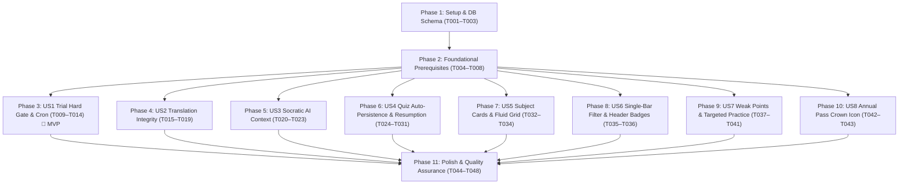

# Tasks: UI Modernization and Diagnostic Learning Enhancements

**Input**: Design documents from `/specs/002-ui-and-learning-enhancements/` (`spec.md`, `plan.md`, `research.md`, `data-model.md`, `contracts/`, `quickstart.md`)  
**Prerequisites**: `spec.md`, `plan.md`, `data-model.md`, `contracts/`, `quickstart.md`, `.specify/memory/constitution.md`  
**Tests**: Unit tests, contract verification, and end-to-end user scenario validation are included across all phases per `quickstart.md`.  
**Organization**: Tasks are grouped into Setup, Foundational, 8 User Story phases (P1 through P5), and Polish & Quality Assurance to enable independent implementation, testing, and delivery.

## Format: `[TaskID] [P?] [Story?] Description with file path`

- **[P]**: Can run in parallel (different files, no blocking dependencies)
- **[Story]**: Maps task to specific user story (`[US1]` through `[US8]`) for end-to-end traceability
- Every task includes exact project-relative file paths in its description

---

## Phase 1: Setup & Environment (Shared Infrastructure)

**Purpose**: Database schema alignment and development environment configuration.

- [x] T001 Update Prisma schema in `prisma/schema.prisma` to add `activeQuestionIndex Int @default(0)` and index `@@index([userId, completedAt, createdAt])` to `QuizSession`, and add index `@@index([userId, kind])` to `ReminderNotice`.
- [x] T002 Apply database migration sync and regenerate client via `npx prisma db push` and `npx prisma generate` in `prisma/schema.prisma`.
- [x] T003 [P] Verify environment variable declarations in `.env.example` adding `CRON_SECRET` and optional `RESEND_API_KEY` configurations.

---

## Phase 2: Foundational Prerequisites (Blocking Infrastructure)

**Purpose**: Core infrastructure, shared types, modular email transport, and tier guardrails that MUST be complete before user stories begin.

**⚠️ CRITICAL**: Foundational tasks establish the typed contracts, validation schemas, and transport services needed by all user stories.

- [x] T004 [P] Create modular email transport service in `features/billing/services/email-service.ts` supporting Resend API in production with console logger fallback for local development.
- [x] T005 [P] Define shared curriculum domain and filter types in `features/curriculum/types/curriculum.types.ts` (`WeakPointTopic`, `SubjectWeakPointsResult`, `CatalogFilterState`, `SubjectCardPresentation`, `TranslatableQuizQuestion`).
- [x] T006 [P] Define quiz session persistence and resumption types in `features/curriculum/types/quiz-session.types.ts` (`ActiveQuizSessionInfo`, `SaveQuizProgressInput`, `ActiveQuizSessionSummary`).
- [x] T007 [P] Define Zod validation schemas for translations, filters, and weak points in `features/curriculum/schemas/curriculum.schemas.ts`.
- [x] T008 Update 30-day hard gate access logic in `features/curriculum/utils/tier-guardrails.ts` (`canAccessLesson`) to strictly lock lessons, quizzes, and AI tutor for expired trialists without active subscriptions.

**Checkpoint**: Core foundation ready — User Story implementation can proceed in parallel or prioritized sequence.

---

## Phase 3: User Story 1 (Priority: P1) - 30-Day Free Trial Hard Gate & 7-Day Expiration Notice 🎯 MVP

**Goal**: Enforce a strict access hard gate on expired trialists (blocking lesson reading, quiz runs, and AI tutoring while preserving catalog/dashboard discovery) and provide an automated, idempotent 7-day expiration reminder notice via `/api/cron/trial-reminders`.  
**Independent Test**: Simulate an account older than 30 days without subscription: verify immediate paywall blocking on lesson/quiz/AI tutor access. Simulate an account 23 days old: verify `/api/cron/trial-reminders` dispatches an email notice and persists `ReminderNotice` with 0 duplicates on second run.

### Tests for User Story 1

- [x] T009 [P] [US1] Write unit tests for 30-day hard gate access control and 7-day expiration eligibility in `tests/unit/trialGuardrailsAndCron.test.ts`.

### Implementation for User Story 1

- [x] T010 [US1] Implement `/api/cron/trial-reminders` route in `app/api/cron/trial-reminders/route.ts` validating Bearer `CRON_SECRET`, scanning 23-day accounts, dispatching emails via `email-service.ts`, and persisting `ReminderNotice` records for idempotency.
- [x] T011 [US1] Enforce server-side `canAccessLesson` hard-gate verification in `features/curriculum/actions/lesson-material.actions.ts` returning `TRIAL_EXPIRED` error code when trial is expired.
- [x] T012 [US1] Enforce server-side trial status verification in `createQuizSessionAction` in `features/curriculum/actions/quiz-session.actions.ts` blocking study and exam quiz starts for expired trialists with `TRIAL_EXPIRED`.
- [x] T013 [US1] Enforce server-side trial verification in `askTutorAction` in `features/curriculum/actions/curriculum.actions.ts` rejecting AI tutoring requests for expired trialists with `TRIAL_EXPIRED`.
- [x] T014 [US1] Integrate client-side paywall interceptor in `features/curriculum/components/LessonList.tsx`, `QuizRunner.tsx`, and `AITutorDrawer.tsx` to automatically trigger `openUpgradeModal` upon catching `TRIAL_EXPIRED`.

**Checkpoint**: User Story 1 is fully functional and independently verifiable against SC-001 and SC-002.

---

## Phase 4: User Story 2 (Priority: P1) - Language Translation Integrity

**Goal**: Guarantee that when a student switches quiz language to a Philippine dialect (Taglish, Cebuano, Ilocano), only question stems and explanations are translated, while multiple-choice options (A, B, C, D) remain 100% in original English with KaTeX mathematical formulas uncorrupted.  
**Independent Test**: Select Taglish or Cebuano on a STEM quiz: verify question stem and explanation are translated, while options A, B, C, D remain untouched in English with valid LaTeX delimiters.

### Tests for User Story 2

- [x] T015 [P] [US2] Write unit tests for translation integrity, English option preservation, and LaTeX syntax protection in `tests/unit/translationIntegrity.test.ts`.

### Implementation for User Story 2

- [x] T016 [US2] Refactor `batchTranslateQuizQuestion` in `features/curriculum/api/gemini-service.ts` to instruct Gemini to translate ONLY stem and explanation while strictly preserving options A, B, C, D in 100% English.
- [x] T017 [US2] Add LaTeX delimiter count parity validation (`$...$`, `$$...$$`) and in-memory caching (`${language}:${question}`) in `features/curriculum/api/gemini-service.ts`.
- [x] T018 [US2] Update `batchTranslateAction` in `features/curriculum/actions/curriculum.actions.ts` to validate inputs using `batchTranslateQuizInputSchema` and return verified translated items.
- [x] T019 [US2] Integrate translated question rendering into `features/curriculum/components/QuizRunner.tsx` ensuring KaTeX expressions render without errors for both translated stems and English options.

**Checkpoint**: User Stories 1 and 2 are independently functional and verified against SC-003 and SC-004.

---

## Phase 5: User Story 3 (Priority: P2) - Question-Level Socratic AI Context

**Goal**: Anchor AI tutoring prompts specifically to the active quiz question's numbers, variables, and competency, guiding the student step-by-step without giving away answers and dynamically shifting focus as questions advance.  
**Independent Test**: In Study Mode on question #3, click "Give me a hint": verify the AI response references question #3's specific variables and competency without reciting broad subject lectures or revealing the answer letter.

### Tests for User Story 3

- [x] T020 [P] [US3] Write unit tests for Socratic prompt construction and active question anchoring in `tests/unit/socraticPrompt.test.ts`.

### Implementation for User Story 3

- [x] T021 [US3] Refactor `buildTutorSystemPrompt` in `features/curriculum/api/gemini-service.ts` to anchor strictly to active question numbers, variables, and competency, enforcing Socratic hints and prohibiting revealing correct answers.
- [x] T022 [US3] Update `features/curriculum/components/AITutorDrawer.tsx` to add dynamic active question banner (`Anchored to Question #{activeQuestionIndex + 1}`), question snippet preview, and question-specific quick action prompt buttons.
- [x] T023 [US3] Update question transition listener in `features/curriculum/components/QuizRunner.tsx` to pass active question index and details into `AITutorDrawer` whenever the student navigates between questions.

**Checkpoint**: User Stories 1, 2, and 3 are functional and independently verifiable against SC-005.

---

## Phase 6: User Story 4 (Priority: P2) - Quiz State Auto-Persistence & Resumption ('Continue Quiz')

**Goal**: Incrementally persist student answers and question cursor to PostgreSQL as they progress through a quiz, and display a dual-surface "Continue Quiz" resumption banner on the Dashboard and Subject page allowing 1-click resumption or discarding.  
**Independent Test**: Start a 15-question quiz, answer questions 1–6, and close/reload tab: verify resumption banner appears on `/dashboard` and `/curriculum/[slug]` showing "6 of 15 answered", and clicking "Resume Quiz" restores answers and cursor position.

### Tests for User Story 4

- [x] T024 [P] [US4] Write unit tests for quiz progress auto-persistence, cursor resumption, and session discard in `tests/unit/quizPersistence.test.ts`.

### Implementation for User Story 4

- [x] T025 [US4] Implement `saveQuizProgressAction` in `features/curriculum/actions/quiz-session.actions.ts` with Zod validation, user ownership verification, and active cursor + userAnswers JSON updates.
- [x] T026 [US4] Implement `getActiveQuizSessionAction` and `discardQuizSessionAction` in `features/curriculum/actions/quiz-session.actions.ts` with 14-day recency window and answer counting logic.
- [x] T027 [US4] Update `getQuizSessionAction` in `features/curriculum/actions/quiz-session.actions.ts` to restore `activeQuestionIndex` and `userAnswers`, while keeping correct answers and explanations hidden in incomplete Exam Mode.
- [x] T028 [P] [US4] Create `ActiveQuizResumptionCard.tsx` component in `features/curriculum/components/ActiveQuizResumptionCard.tsx` displaying mode, lesson title, progress count, Resume button, and Discard button.
- [x] T029 [US4] Integrate auto-save debouncing (300ms) and initial cursor/answers restoration into `features/curriculum/components/QuizRunner.tsx`.
- [x] T030 [US4] Embed `ActiveQuizResumptionCard` on Student Dashboard in `app/(student)/dashboard/page.tsx`.
- [x] T031 [US4] Embed `ActiveQuizResumptionCard` on Subject Curriculum page in `app/(student)/curriculum/[slug]/page.tsx`.

**Checkpoint**: User Stories 1 through 4 are functional and independently verifiable against SC-006.

---

## Phase 7: User Story 5 (Priority: P3) - Responsive Subject Cards UI Overhaul & Fluid Grid

**Goal**: Redesign subject catalog cards with smooth elevation shadows (`hover:shadow-md` / `dark:hover:shadow-xl`), zero vertical translation (`translate-y: 0px`), structured Job-Card hierarchy (monogram, term pill, title, academic tags, lesson metrics), and a fluid responsive grid (1, 2, 3, 4 columns).  
**Independent Test**: Hover over subject cards on viewports from 360px to 1920px: verify smooth shadow transitions without vertical jump, correct internal layout alignment, and fluid column wrapping (1 col mobile, 2 col tablet, 3 col desktop, 4 col ultra-wide).

### Implementation for User Story 5

- [x] T032 [P] [US5] Implement modernized subject card component with zero Y-translation, smooth Tailwind v4 shadow elevation (`hover:shadow-md dark:hover:shadow-xl`), and job-card header/body/footer structure in `features/curriculum/components/SubjectCatalog.tsx`.
- [x] T033 [US5] Implement fluid responsive grid container (1 col mobile, 2 col tablet, 3 col desktop, 4 col ultra-wide up to `max-w-[1600px]`) in `features/curriculum/components/SubjectCatalog.tsx`.
- [x] T034 [US5] Verify subject discipline monograms, term pills, academic tags (Grade, Track, MATATAG), and lesson metrics baselines across cards in `features/curriculum/components/SubjectCatalog.tsx`.

**Checkpoint**: User Story 5 is independently functional and verified against SC-007 and SC-008.

---

## Phase 8: User Story 6 (Priority: P3) - Streamlined Catalog Filtering & Decluttered Badges

**Goal**: Consolidate multi-row catalog filtering into a single compact sticky toolbar (level switch, contextual popover selects, search, active filter count, 1-click reset) reducing height by >50%, and declutter subject detail headers into academic eyebrow typography with a single access badge.  
**Independent Test**: Check `/curriculum` filter area: verify unified sticky toolbar with contextual JHS Quarter and SHS Semester/Strand selectors and instant search. Check `/curriculum/[slug]` header: verify clean typographic metadata eyebrow with a single access/trial status badge.

### Implementation for User Story 6

- [x] T035 [P] [US6] Consolidate multi-row filter bar into a single-row sticky toolbar with segmented level toggle (`All`, `JHS`, `SHS`), contextual dropdown popovers (JHS Quarters, SHS Semesters/Strands), integrated search input, active filter counter, and 1-click reset in `features/curriculum/components/SubjectCatalog.tsx`.
- [x] T036 [US6] Declutter subject detail header in `features/curriculum/components/LessonList.tsx` by replacing the 4-badge row with academic eyebrow metadata typography (`CODE • Level • Grade — Term`) and reserving the badge container exclusively for single access/trial status.

**Checkpoint**: User Story 6 is independently functional and verified against SC-009.

---

## Phase 9: User Story 7 (Priority: P4) - Diagnostic 'Weak Points' by Topic & Targeted Practice

**Goal**: Evaluate students' latest quiz attempts under DepEd DO 015 s. 2026 standards (< 75% passing threshold), rendering lesson title, achieved score, and sub-topic Key Concept tags in a dedicated diagnostic card with 1-click targeted practice that clears upon passing retake.  
**Independent Test**: Complete a quiz with score < 75%: verify "Weak Points" diagnostic card displays on `/curriculum/[slug]` with Key Concept tags and "Practice This Topic" button. Retake quiz with score ≥ 75%: verify topic is immediately cleared from weak points.

### Tests for User Story 7

- [x] T037 [P] [US7] Write unit tests for DepEd DO 015 s. 2026 transmutation, Latest Attempt Rule deduplication, and weak points detection in `tests/unit/weakPoints.test.ts`.

### Implementation for User Story 7

- [x] T038 [US7] Implement `getSubjectWeakPointsAction` in `features/curriculum/actions/curriculum.actions.ts` evaluating the most recent quiz attempt per lesson topic, checking against the < 75% transmuted passing threshold, and extracting sub-topic keyConcepts.
- [x] T039 [US7] Implement `createTargetedPracticeAction` in `features/curriculum/actions/curriculum.actions.ts` to configure an immediate 10-question Study Mode remedial quiz session for a flagged weak topic.
- [x] T040 [P] [US7] Create `SubjectWeakPointsCard.tsx` in `features/curriculum/components/SubjectWeakPointsCard.tsx` rendering topic title, score badge, sub-topic keyConcepts tags, 1-click "Practice This Topic" CTA, and an encouraging zero-weak-points state.
- [x] T041 [US7] Embed `SubjectWeakPointsCard` into the Subject Detail Page in `app/(student)/curriculum/[slug]/page.tsx` and verify that passing retakes (≥75%) immediately clear the topic from weak points.

**Checkpoint**: User Story 7 is independently functional and verified against SC-010.

---

## Phase 10: User Story 8 (Priority: P5) - Annual Pass Brand Icon Upgrade

**Goal**: Upgrade the Annual Pass card header in `CheckoutModal.tsx` from `<Sparkles>` to prestigious `<Crown>` styled in gold/amber, reinforcing its VIP status and ₱1,089 savings.  
**Independent Test**: Open the checkout modal from any paywall trigger: verify Annual Unlimited card renders the `<Crown>` icon with gold/amber styling distinct from the Monthly Pass.

### Implementation for User Story 8

- [x] T042 [P] [US8] Update `features/billing/components/CheckoutModal.tsx` to replace the `<Sparkles>` icon with `<Crown>` from `lucide-react`, styled in prestigious gold/amber (`text-amber-500 fill-amber-500/20`), on the Annual Unlimited Pass card.
- [x] T043 [US8] Verify visual tier distinction and savings badge (`Save ₱1,089`) between Monthly and Annual cards in `features/billing/components/CheckoutModal.tsx`.

**Checkpoint**: All 8 User Stories are fully implemented and functional.

---

## Phase 11: Polish, Quality Assurance & Verification

**Purpose**: Cross-cutting verification, typechecks, linting, test suites, and documentation logging.

- [x] T044 [P] Run strict TypeScript typecheck (`npx tsc --noEmit`) and fix any type discrepancies across all feature files.
- [x] T045 [P] Run ESLint linter (`npm run lint`) and resolve any code style, unused variable, or formatting warnings.
- [x] T046 [P] Execute automated Jest test suite (`npm test`) ensuring all unit tests pass cleanly with 100% success.
- [x] T047 Validate all 9 verification scenarios in `specs/002-ui-and-learning-enhancements/quickstart.md`.
- [x] T048 Document task completion summary and log entry in `docs/backlog.md`.

---

## Dependencies & Execution Order

### Phase Dependencies

### User Story Dependencies

- **US1 (P1 - Trial Gate & Cron)**: Depends on Phase 2 (T004 email service, T008 tier guardrails). Independent of other user stories.
- **US2 (P1 - Translation Integrity)**: Depends on Phase 2 (T005 domain types, T007 schemas). Independent of other user stories.
- **US3 (P2 - Socratic AI Context)**: Depends on Phase 2 (T005 domain types). Integrates with `QuizRunner` question navigation.
- **US4 (P2 - Quiz Auto-Persistence)**: Depends on Phase 1 (T001 schema) and Phase 2 (T006 session types). Independent of other user stories.
- **US5 (P3 - Subject Cards & Grid)**: Depends on Phase 2 (T005 card presentation types). Independent of backend logic.
- **US6 (P3 - Single-Bar Filter & Badges)**: Depends on Phase 2 (T005 filter types). Pairs with US5 in `SubjectCatalog.tsx`.
- **US7 (P4 - Weak Points Diagnostic)**: Depends on Phase 2 (T005 domain types, T007 schemas). Independent of quiz persistence.
- **US8 (P5 - Crown Icon Upgrade)**: Depends on Phase 2. Self-contained in `CheckoutModal.tsx`.

---

## Parallel Execution Opportunities

### Within Setup & Foundational
- T003 (`.env.example`), T004 (`email-service.ts`), T005 (`curriculum.types.ts`), T006 (`quiz-session.types.ts`), and T007 (`curriculum.schemas.ts`) can run completely in parallel.

### User Story Independence
Once Phase 2 is complete:
- **Stream A (Backend & Security)**: US1 (Trial Hard Gate & Cron) + US4 (Quiz Persistence & Resumption) + US7 (Weak Points Action).
- **Stream B (AI & Pedagogy)**: US2 (Translation Integrity) + US3 (Socratic Question Anchoring).
- **Stream C (Frontend & UI Modernization)**: US5 (Subject Cards & Fluid Grid) + US6 (Filter Toolbar & Eyebrow Typography) + US8 (Annual Pass Crown Icon).

### Tests Within Each Story
- All unit test files (T009, T015, T020, T024, T037) can be written and verified to fail prior to feature implementation.

---

## Implementation Strategy

### MVP First (User Story 1 & User Story 2)
1. Complete Phase 1: Setup & DB Schema (`activeQuestionIndex` and `ReminderNotice`).
2. Complete Phase 2: Foundational Prerequisites (modular email transport, domain types, tier guardrails).
3. Complete Phase 3: User Story 1 (Trial Hard Gate & 7-Day Expiration Cron).
4. Complete Phase 4: User Story 2 (Language Translation Integrity).
5. **STOP and VALIDATE**: Verify SC-001, SC-002, SC-003, and SC-004. Deploy/demo MVP increment.

### Incremental Delivery Sequence
1. **Increment 1 (MVP)**: Trial Hard Gate & Translation Integrity (US1 + US2).
2. **Increment 2 (Core Learning)**: Socratic AI Question Anchoring & Quiz Resumption (US3 + US4).
3. **Increment 3 (Modern UI)**: Subject Cards Fluid Grid, Single-Bar Filter, and Header Typography (US5 + US6).
4. **Increment 4 (Diagnostic & Polish)**: Weak Points by Topic, Annual Pass Crown Icon, and QA (US7 + US8 + Phase 11).
