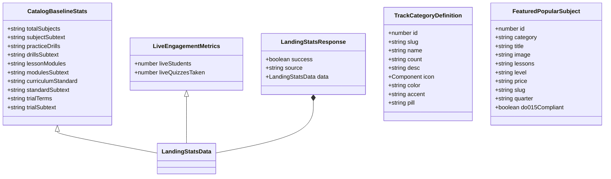

# Data Model & Schema Definitions: Landing Page Overhaul

**Feature Branch**: `005-landing-page-overhaul`  
**Date**: 2026-11-03  
**Status**: Completed  
**Spec Reference**: `specs/005-landing-page-overhaul/spec.md`

---

## 1. Overview

This document specifies the TypeScript domain models, Zod validation schemas, and constant data structures supporting the Landing Page Overhaul. All types adhere strictly to Feature-Driven Architecture (FDA) under `features/landing/types/` and `features/landing/schemas/`.

---

## 2. Landing Page Stats Domain Model

### 2.1 TypeScript Interfaces (`features/landing/types/landing.types.ts`)

```typescript
import type React from "react";

/**
 * Authoritative static baseline statistics derived from the verified DepEd MATATAG curriculum.
 */
export interface CatalogBaselineStats {
  readonly totalSubjects: string;       // e.g. "75+"
  readonly subjectSubtext: string;      // e.g. "8 JHS Core + 67 SHS Strands"
  readonly practiceDrills: string;      // e.g. "1,800+"
  readonly drillsSubtext: string;       // e.g. "24 verified drills per subject"
  readonly lessonModules: string;       // e.g. "600+"
  readonly modulesSubtext: string;      // e.g. "8 structured lessons per subject"
  readonly curriculumStandard: string;  // e.g. "100% DepEd DO 015 s. 2026"
  readonly standardSubtext: string;     // e.g. "Official MATATAG Transmutation"
  readonly trialTerms: string;          // e.g. "30-Day Free Pass"
  readonly trialSubtext: string;        // e.g. "₱0 upfront • No card required"
}

/**
 * Live platform engagement metrics dynamically queried from PostgreSQL via Prisma.
 */
export interface LiveEngagementMetrics {
  liveStudents: number;
  liveQuizzesTaken: number;
}

/**
 * Combined landing statistics payload returned by Server Action and TanStack Query.
 */
export interface LandingStatsData extends CatalogBaselineStats {
  liveStudents?: number;
  liveQuizzesTaken?: number;
}

/**
 * Standard Server Action response wrapping landing statistics.
 */
export interface LandingStatsResponse {
  success: boolean;
  source: "live" | "catalog_fallback";
  data: LandingStatsData;
  error?: string;
}

/**
 * Presentation model for individual stat cards in StatsBar.tsx.
 */
export interface LandingStatCardItem {
  icon: React.ComponentType<{ className?: string }>;
  value: string;
  label: string;
  sub: string;
  color: string;
}
```

### 2.2 Zod Validation Schemas (`features/landing/schemas/landing-stats.schema.ts`)

```typescript
import { z } from "zod";

export const CatalogBaselineStatsSchema = z.object({
  totalSubjects: z.string().min(1),
  subjectSubtext: z.string().min(1),
  practiceDrills: z.string().min(1),
  drillsSubtext: z.string().min(1),
  lessonModules: z.string().min(1),
  modulesSubtext: z.string().min(1),
  curriculumStandard: z.string().min(1),
  standardSubtext: z.string().min(1),
  trialTerms: z.string().min(1),
  trialSubtext: z.string().min(1),
});

export const LandingStatsDataSchema = CatalogBaselineStatsSchema.extend({
  liveStudents: z.number().int().nonnegative().optional(),
  liveQuizzesTaken: z.number().int().nonnegative().optional(),
});

export const LandingStatsResponseSchema = z.object({
  success: z.boolean(),
  source: z.enum(["live", "catalog_fallback"]),
  data: LandingStatsDataSchema,
  error: z.string().optional(),
});

export type LandingStatsDataValidated = z.infer<typeof LandingStatsDataSchema>;
export type LandingStatsResponseValidated = z.infer<typeof LandingStatsResponseSchema>;
```

---

## 3. Curriculum Categories & Track Presentation Model

### 3.1 Track Category Model (`CategorySection.tsx` & `TrackDetail.tsx`)

```typescript
import type React from "react";

export interface TrackCategoryDefinition {
  id: number;
  slug:
    | "junior-high-core"
    | "stem-strand"
    | "abm-strand"
    | "humss-strand"
    | "shs-core"
    | "gas-strand"
    | "tvl-track";
  name: string;
  count: string;
  desc: string;
  icon: React.ComponentType<{ className?: string }>;
  color: string;
  accent: string;
  pill: string;
}

/**
 * DepEd-verified Category Catalog:
 * - Junior High Core: 8 Core Subjects (32 Grade-Level Offerings across Grades 7–10)
 * - SHS Core Subjects: 15 DepEd Core Subjects (icon: GraduationCap, retiring Code)
 * - STEM Strand: 11 Specialized Subjects
 * - ABM Strand: 9 Specialized Subjects
 * - HUMSS Strand: 9 Specialized Subjects
 * - GAS Strand: 7 Specialized Subjects
 * - TVL Track: 9 Specialized Subjects
 */
```

---

## 4. Popular Subjects Presentation Model

### 4.1 Featured Popular Subject (`PopularSubjectsSection.tsx`)

```typescript
export interface FeaturedPopularSubject {
  id: number;
  category: "SHS CORE" | "STEM STRAND" | "JUNIOR HIGH CORE" | "APPLIED ACADEMIC" | "ABM STRAND" | "HUMSS STRAND";
  title: string;
  image: string;
  lessons: string;             // Standardized: "8 Lessons • 24 Practice Drills"
  level: string;               // e.g. "Grade 11 • Semester 1" or "Grade 10 • Quarter 1" (No "Trimester")
  price: string;               // "FREE TRIAL"
  slug: string;                // e.g. "g11-s1-genmath", "g10-q1-sci" (replaced g10-t1-sci)
  quarter: string;             // e.g. "Quarter 1", "Semester 1"
  do015Compliant: boolean;     // true
}
```

### 4.2 Featured Subjects Catalog Constant

| ID | Title | Category | Slug | Grade & Term | Modules & Drills | Transmutation |
|---|---|---|---|---|---|---|
| 1 | General Mathematics | SHS CORE | `g11-s1-genmath` | Grade 11 • Semester 1 | 8 Lessons • 24 Practice Drills | DepEd DO 015 Aligned |
| 2 | Pre-Calculus & Analytical Geometry | STEM STRAND | `g11-s1-precalc` | Grade 11 STEM • Semester 1 | 8 Lessons • 24 Practice Drills | DepEd DO 015 Aligned |
| 3 | Earth and Life Science | SHS CORE | `g11-s1-earthsci` | Grade 11 • Semester 1 | 8 Lessons • 24 Practice Drills | DepEd DO 015 Aligned |
| 4 | Grade 10 Science: Physics & Biology | JUNIOR HIGH CORE | `g10-q1-sci` | Grade 10 • Quarter 1 | 8 Lessons • 24 Practice Drills | DepEd DO 015 Aligned |
| 5 | English for Academic Purposes (EAPP) | APPLIED ACADEMIC | `g11-s1-eapp` | Grade 11 • Semester 1 | 8 Lessons • 24 Practice Drills | DepEd DO 015 Aligned |

---

## 5. Trial Terms & Microcopy Constants

```typescript
export const TRIAL_AND_PRICING_POLICY = {
  trialDays: 30,
  trialPricePhp: 0,
  isCreditCardRequired: false,
  postTrialMonthlyPhp: 299,
  paymentMethods: ["GCash", "Maya", "Card"],
  cancelPolicy: "Cancel anytime with zero fees",
  microcopy: "₱0 upfront • No credit card required • Cancel anytime",
  primaryCtaLabel: "Start 30-Day Free Trial",
  primaryCtaHref: "/login",
} as const;
```

---

## 6. Entity Relationship & Data Flow Diagram


