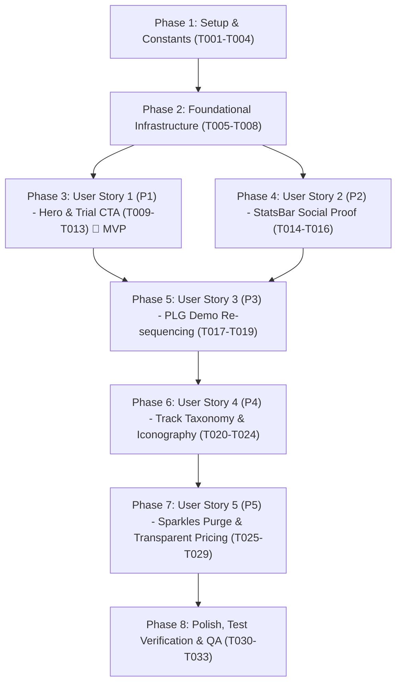

# Tasks: Landing Page Overhaul & Conversion Optimization

**Input**: Design documents from `specs/005-landing-page-overhaul/` ([spec.md](./spec.md), [plan.md](./plan.md), [data-model.md](./data-model.md), [contracts/](./contracts/), [quickstart.md](./quickstart.md))  
**Task Tracking**: `docs/tasks/TASK-028-landing-page-overhaul.md`  
**Branch**: `005-landing-page-overhaul`  
**Status**: Completed (100% Tasks Verified)  

---

## Format: `[ID] [P?] [Story] Description with file path`

- **[P]**: Can run in parallel (different files, no dependencies on incomplete tasks)
- **[Story]**: Which user story this task belongs to (`[US1]`, `[US2]`, `[US3]`, `[US4]`, `[US5]`)
- Setup, Foundational, and Polish phases have NO story label
- User Story phases MUST include their story label
- Every task includes explicit file paths and acceptance criteria

---

## Skills Allocation Matrix

| Skill | Purpose & Assigned Tasks |
|---|---|
| **`design-taste-frontend`** | Visual hierarchy, typography scale, color token contrast (dark/light HSL), thumb-zone ergonomics, and mobile layout discipline in `HeroSection.tsx`, `StatsBar.tsx`, `CategorySection.tsx`, and `TrialNoticeSection.tsx` (Tasks: T010, T012, T015, T016, T022, T026). |
| **`frontend-ui-engineering`** | Component architecture, Radix UI composition, responsive grid/flex layouts, zero-layout-shift hydration, and clean semantic icon swapping (`GraduationCap`, `Bot`, `ShieldCheck`, `CheckCircle2`) (Tasks: T010, T014, T017, T019, T022, T024, T025, T027, T028). |
| **`seo`** | Heading hierarchy audit (`H1` in Hero -> `H2` in Sections -> `H3` in Cards), OpenGraph and JSON-LD structured data preservation, and canonical link integrity in `app/page.tsx` and `HeroSection.tsx` (Tasks: T011, T017, T032). |
| **`test-driven-development`** | Unit test creation and assertion suites for Server Action contracts, catalog constants fallback resilience, track counts integrity, and quarter slug generation in `tests/unit/` (Tasks: T008, T009, T020, T021, T031). |
| **`atomic-commit`** | Logical, conventional git commits per functional phase (`feat(landing): ...`, `fix(landing): ...`, `test(landing): ...`). |
| **`task-implementation`** | Step-by-step task tracking in `docs/tasks/TASK-028-landing-page-overhaul.md` and final logging in `docs/backlog.md` (Task: T033). |

---

## Phase 1: Setup & Constants

**Purpose**: Initialize directory structure, domain type definitions, and authoritative static catalog constants representing verified DepEd MATATAG curriculum structures.

- [x] T001 Initialize Feature-Driven Architecture (FDA) directories for landing module: `features/landing/actions/`, `features/landing/constants/`, `features/landing/hooks/`, `features/landing/schemas/`, and `features/landing/types/`
- [x] T002 [P] Create TypeScript domain interfaces (`CatalogBaselineStats`, `LiveEngagementMetrics`, `LandingStatsData`, `LandingStatsResponse`, `LandingStatCardItem`, `TrackCategoryDefinition`, `FeaturedPopularSubject`) in `features/landing/types/landing.types.ts`
- [x] T003 [P] Implement verified DepEd MATATAG baseline catalog constants (`CATALOG_BASELINE_STATS` with `totalSubjects: "75+"`, `practiceDrills: "1,800+"`, `lessonModules: "600+"`, `curriculumStandard: "100% DepEd DO 015 s. 2026"`) and trial policy constants (`TRIAL_AND_PRICING_POLICY` with 30 days, ₱0 upfront, no card required, ₱299/mo) in `features/landing/constants/catalog-stats.ts`
- [x] T004 [P] Implement featured popular subjects catalog constant (`FEATURED_POPULAR_SUBJECTS` with 5 verified subjects, 8 lessons, 24 drills, DepEd Quarter 1 metadata, and DO 015 alignment) in `features/landing/constants/popular-subjects.ts`

---

## Phase 2: Foundational Infrastructure (Blocking Prerequisites)

**Purpose**: Build and unit-test the data access layer, Zod validation schemas, Server Action, and TanStack Query hook before UI components integrate with them.

**CRITICAL**: No user story work can begin until this foundational phase is complete.

- [x] T005 [P] Implement Zod validation schemas (`CatalogBaselineStatsSchema`, `LiveEngagementMetricsSchema`, `LandingStatsDataSchema`, `LandingStatsResponseSchema`) enforcing non-empty string and non-negative integer constraints in `features/landing/schemas/landing-stats.schema.ts`
- [x] T006 Implement Next.js Server Action `getLandingStatsAction` in `features/landing/actions/get-landing-stats.action.ts` querying PostgreSQL via `prisma.user.count` (active students) and `prisma.quizAttempt.count` (completed quizzes) with resilient fallback to `CATALOG_BASELINE_STATS` on query failure or zero counts
- [x] T007 Implement TanStack Query hook `useLandingStatsQuery` in `features/landing/hooks/use-landing-stats.ts` consuming `getLandingStatsAction` with queryKey `['landing', 'stats']`, 5-minute stale time, and SSR `initialData` support to eliminate Cumulative Layout Shift (CLS = 0)
- [x] T008 [P] Implement unit tests for landing stats contracts, Zod schema validation, and fallback resilience in `tests/unit/landing-stats.test.ts`

**Checkpoint**: Foundational data layer and fallback pipeline verified - user story implementation can begin.

---

## Phase 3: User Story 1 - Outcome-Driven Hero Experience & Frictionless Free Trial Conversion (Priority: P1) 🎯 MVP

**Goal**: Deliver an outcome-driven hero experience above the fold tailored specifically for Philippine high schoolers passing DepEd DO 015 s. 2026 quarterly exams, featuring a non-empty eyebrow badge, primary PLG trial CTA ("Start 30-Day Free Trial"), explicit friction-reducing microcopy ("₱0 upfront • No credit card required • Cancel anytime"), and authentic floating preview cards.

**Independent Test**: Load `/` on desktop (1440px) and mobile (375px); verify eyebrow badge renders DepEd MATATAG text with `GraduationCap` icon; verify headline passes specificity test; verify primary CTA reads "Start 30-Day Free Trial" linking to `/login` with adjacent friction-reducing microcopy; verify floating cards display authentic high school data with zero sparkles.

### Tests for User Story 1

- [x] T009 [P] [US1] Create unit test in `tests/unit/hero-section.test.tsx` verifying rendered hero eyebrow text, primary CTA label, friction-reducing microcopy presence, and zero `Sparkles` icon occurrences

### Implementation for User Story 1

- [x] T010 [US1] Populate top eyebrow badge in `features/landing/components/HeroSection.tsx` with `"DepEd Order No. 015, s. 2026 Aligned • Philippine K-12 MATATAG Companion"` and academic icon `GraduationCap`, replacing the empty container div
- [x] T011 [US1] Refine hero headline and subtitle copy in `features/landing/components/HeroSection.tsx` to communicate specific DepEd quarterly exam mastery with 8 structured lessons, 24 practice drills, and 75+ subjects
- [x] T012 [US1] Update primary CTA button to `"Start 30-Day Free Trial"` linking to `/login` with `ArrowRight` icon and add prominent friction-reducing microcopy (`"₱0 upfront • No credit card required • Cancel anytime"`) in `features/landing/components/HeroSection.tsx`
- [x] T013 [US1] Update floating interactive preview cards in `features/landing/components/HeroSection.tsx` to render authentic learning data (General Math 75% progress, Socratic Taglish AI assistant hint "Bakit Mali Ito?", Earth & Life Science quarterly exam in 3 days, DO 015 88% transmuted quarter mastery) without decorative sparkles

**Checkpoint**: User Story 1 fully functional and independently verifiable as the core conversion MVP.

---

## Phase 4: User Story 2 - Verifiable Social Proof & Real Catalog Metrics (StatsBar) (Priority: P2)

**Goal**: Eliminate fabricated vanity numbers (15,000+ students, 98.2% pass rate, 130+ subjects, 12 / 24 lessons) in `StatsBar.tsx` and replace them with proof-stacked, mathematically verifiable curriculum metrics (75+ DepEd Subjects, 1,800+ Practice Drills, 600+ Lesson Modules, 100% DepEd DO 015 s. 2026 Aligned) powered by TanStack Query with zero layout shift.

**Independent Test**: Inspect the StatsBar section on `/`; verify 4 stat cards render authoritative catalog counts (75+ Subjects, 1,800+ Drills, 600+ Modules, 100% DO 015); verify live student counts merge seamlessly when available; assert 100% absence of "15,000+", "98.2%", "130+", and "12 / 24"; verify zero Cumulative Layout Shift (CLS = 0).

### Implementation for User Story 2

- [x] T014 [US2] Connect `features/landing/components/StatsBar.tsx` to `useLandingStatsQuery` hook with `CATALOG_BASELINE_STATS` passed as fallback `initialData`
- [x] T015 [US2] Replace fabricated vanity metrics in `features/landing/components/StatsBar.tsx` with 4 proof-stacked curriculum cards: "75+ DepEd Subjects" (sub: "8 JHS Core + 67 SHS Strands"), "1,800+ Practice Drills" (sub: "24 verified drills per subject"), "600+ Lesson Modules" (sub: "8 structured lessons per subject"), and "100% DepEd DO 015 s. 2026" (sub: "Official MATATAG Transmutation")
- [x] T016 [US2] Implement responsive layout and theme-aware HSL color tokens (`bg-card/90`, `text-card-foreground`, `border-border`) in `features/landing/components/StatsBar.tsx` ensuring zero layout shift across desktop (4-column grid) and mobile (2-column grid)

**Checkpoint**: User Stories 1 and 2 operate harmoniously; hero converts while stats build authentic social proof.

---

## Phase 5: User Story 3 - Immediate Product Preview Before Signup Wall (app/page.tsx re-sequencing) (Priority: P3)

**Goal**: Re-sequence the landing page scroll narrative in `app/page.tsx` so `AcademicWorkflowDemo` renders at Section 4 immediately after `AboutSection` and before `HowToUseAppSection`, `CategorySection`, `PopularSubjectsSection`, and `TrialNoticeSection`, honoring the PLG mandate: "Show the product before the signup wall".

**Independent Test**: Inspect the root route `app/page.tsx` section sequence; assert Section 1 is `HeroSection`, Section 2 is `StatsBar`, Section 3 is `AboutSection`, and Section 4 is `AcademicWorkflowDemo`; interact with quiz choices, step-by-step Socratic hints in Taglish, and teacher gradebook without logging in or encountering a signup barrier.

### Implementation for User Story 3

- [x] T017 [US3] Re-sequence section component order in `app/page.tsx` to position `<AcademicWorkflowDemo />` at Section 4 immediately following `<AboutSection />` and preceding `<HowToUseAppSection />`, maintaining SEO structured metadata and server session redirect guards
- [x] T018 [US3] Update copy in `features/landing/components/AboutSection.tsx` line 105 from legacy "standardized 12-lesson modules" to "standardized 8-lesson modules and 24 assessments" to match catalog realities
- [x] T019 [US3] Audit and verify `features/landing/components/AcademicWorkflowDemo.tsx` to ensure instant client-side interactivity, unauthenticated Socratic Taglish hints ("Bakit Mali Ito?"), and authentic DepEd DO 015 gradebook calculations (60–100 scale, ≥ 75% passing)

**Checkpoint**: Conversion narrative re-sequenced; visitors experience the interactive product before encountering onboarding, categories, or pricing walls.

---

## Phase 6: User Story 4 - Accurate Academic Track Taxonomy, Semantic Iconography, and DepEd Quarter Standards (Priority: P4)

**Goal**: Align all track categories, badge counts, and icons with official DepEd K-12 MATATAG curriculum structures across `CategorySection.tsx`, `PopularSubjectsSection.tsx`, and `TrackDetail.tsx`: replace `<Code>` icon on SHS Core with `GraduationCap`, correct subject counts across all 7 tracks, eliminate fake star ratings in `PopularSubjectsSection.tsx`, and replace legacy non-DepEd "Trimester" with official "Quarter".

**Independent Test**: Inspect `CategorySection.tsx`, `PopularSubjectsSection.tsx`, and `TrackDetail.tsx`; assert all 7 track cards match verified counts (8 JHS Core / 32 offerings, 15 SHS Core, 11 STEM, 9 ABM, 9 HUMSS, 7 GAS, 9 TVL); assert SHS Core renders `GraduationCap`; assert popular subjects display genuine curriculum badges (Grade, Quarter, 8 Lessons & 24 Drills, DO 015 badge) with zero stars/reviews; assert Grade 10 Science uses `g10-q1-sci` ("Grade 10 • Quarter 1").

### Tests for User Story 4

- [x] T020 [P] [US4] Update unit tests in `tests/unit/tracks-data.test.ts` to assert all 7 tracks (including `shs-core`, `gas-strand`, `tvl-track`), verified badge counts, and graduation cap icon on SHS Core
- [x] T021 [P] [US4] Update unit tests in `tests/unit/curriculum-data.test.ts` to assert official DepEd Quarter slug conventions (`g10-q1-sci`), Quarter 1 metadata, and complete absence of "Trimester"

### Implementation for User Story 4

- [x] T022 [US4] Overhaul `features/landing/components/CategorySection.tsx`: replace `<Code>` icon on SHS Core with `GraduationCap`; update badge counts across all 7 tracks (Junior High Core: "8 Core Subjects (32 Grade-Level Offerings)", SHS Core: "15 DepEd Core Subjects", STEM: "11 Specialized Subjects", ABM: "9 Specialized Subjects", HUMSS: "9 Specialized Subjects", GAS: "7 Specialized Subjects", TVL: "9 Specialized Subjects"); update section copy to reflect 8 lesson modules
- [x] T023 [US4] Overhaul `features/landing/components/TrackDetail.tsx`: replace `<Code>` icon on SHS Core with `GraduationCap`; update subject counts and module counts across `TRACKS_DATA` to reflect real DepEd curriculum counts; purge legacy 12-lesson references
- [x] T024 [US4] Overhaul `features/landing/components/PopularSubjectsSection.tsx`: purge fake star ratings (4.9★, 4.8★) and review counts (2.4K, 1.8K); render genuine curriculum metadata (Grade Level, DepEd Quarter 1, 8 Lessons & 24 Practice Drills, DO 015 transmutation badge); replace `g10-t1-sci` ("Trimester 1") with `g10-q1-sci` ("Quarter 1"); update header link to `"View All 75+ DepEd Subjects"`

**Checkpoint**: Academic tracks and popular subjects 100% compliant with DepEd MATATAG taxonomy and free of artificial review data.

---

## Phase 7: User Story 5 - Clean Design Discipline (Complete purge of `Sparkles` icon) & Transparent Pricing (Priority: P5)

**Goal**: Enforce strict design discipline by purging the `Sparkles` icon from every landing page component in favor of clean semantic Lucide icons (`GraduationCap`, `BookOpen`, `Bot`, `ShieldCheck`, `ArrowRight`, `CheckCircle2`), and communicating 100% transparent pricing in `TrialNoticeSection.tsx` and `CtaBanner.tsx` (30 days free, ₱0 upfront, no credit card required, ₱299/mo via GCash/Maya, cancel anytime).

**Independent Test**: Execute PowerShell grep scan asserting 0 occurrences of `Sparkles` across `features/landing/components/*.tsx`; verify `TrialNoticeSection.tsx` states 30 days free, ₱0 upfront, no card required, ₱299/mo; verify `CtaBanner.tsx` reflects 75+ subjects, 8 modules, 24 drills, with primary CTA "Start 30-Day Free Trial".

### Implementation for User Story 5

- [x] T025 [P] [US5] Purge `Sparkles` icon from `features/landing/components/HowToUseAppSection.tsx` (line 87), replacing with `GraduationCap` or `BookOpen`, and verify all 4 onboarding step cards use purposeful semantic icons
- [x] T026 [P] [US5] Purge `Sparkles` icon from `features/landing/components/TrialNoticeSection.tsx` (line 132), replacing with `ShieldCheck` or `CheckCircle2`; update trial terms copy to explicitly detail 30 days of unrestricted access to all 75+ subjects, 600+ lesson modules, and 1,800+ drills for ₱0 upfront, no credit card required, followed by ₱299/month with GCash and Maya options
- [x] T027 [P] [US5] Purge `Sparkles` icon from `features/landing/components/TrackDetail.tsx` (lines 603, 695), replacing with `CheckCircle2` and `Bot` for AI tutor capabilities
- [x] T028 [P] [US5] Purge `Sparkles` icon from `features/landing/components/HowItWorks.tsx` and `features/landing/components/TermsOfService.tsx`, replacing with `Bot` / `ShieldCheck`, and updating curriculum references from 130+ to 75+ subjects
- [x] T029 [US5] Overhaul `features/landing/components/CtaBanner.tsx` to reflect 75+ DepEd subjects, 8 structured lessons, 24 practice drills, with primary CTA `"Start 30-Day Free Trial"` and friction-reducing microcopy `"₱0 upfront • No credit card required • Cancel anytime"`

**Checkpoint**: Zero AI visual cliches remain; subscription pricing and free trial terms are 100% transparent and consistent across the page.

---

## Phase 8: Polish, Test-Driven Verification & Quality Assurance

**Purpose**: Execute automated verification audits, run Jest unit tests, validate quickstart scenarios, and ensure clean Next.js build and lint passes with zero regressions.

- [x] T030 Execute automated PowerShell codebase integrity scans from `specs/005-landing-page-overhaul/quickstart.md`: verify 0 occurrences of `Sparkles`, 0 occurrences of `<Code>` icon in categories, 0 occurrences of `Trimester`, and 0 occurrences of vanity numbers (`15,000` or `98.2%`) across `features/landing/components/*.tsx`
- [x] T031 Execute unit test suite via `npm test -- tests/unit/tracks-data.test.ts tests/unit/landing-stats.test.ts tests/unit/curriculum-data.test.ts` and verify 100% test pass with zero failures
- [x] T032 Execute full production build and linting verification (`npm run build` and `npm run lint`) asserting zero TypeScript errors, zero lint warnings/errors, and zero SEO regressions
- [x] T033 [P] Update task tracking checklist in `docs/tasks/TASK-028-landing-page-overhaul.md` and append change log entry in `docs/backlog.md`

---

## Dependencies & Execution Order

### Phase Dependencies



### User Story Dependencies

- **User Story 1 (P1 - Hero Experience)**: Depends on Foundational Phase (Phase 2). Can be deployed immediately as the conversion MVP.
- **User Story 2 (P2 - StatsBar Metrics)**: Depends on Foundational Phase (Phase 2). Can be developed in parallel with US1.
- **User Story 3 (P3 - Demo Re-sequencing)**: Depends on US1 and US2 (ensures Hero and StatsBar are stabilized before scroll sequence is locked).
- **User Story 4 (P4 - Track Taxonomy & Quarters)**: Can start after Phase 2; touches `CategorySection`, `PopularSubjectsSection`, and `TrackDetail`.
- **User Story 5 (P5 - Sparkles Purge & Pricing)**: Touches `TrialNoticeSection`, `HowToUseAppSection`, `TrackDetail`, `HowItWorks`, and `CtaBanner`.
- **Phase 8 (Polish & QA)**: Depends on all user stories being completed.

---

## Parallel Opportunities

### Phase 1 & 2 (Setup & Foundation)

```bash
# Can run concurrently in separate files:
T002: Create TypeScript domain interfaces in features/landing/types/landing.types.ts
T003: Implement catalog stats constants in features/landing/constants/catalog-stats.ts
T004: Implement popular subjects constants in features/landing/constants/popular-subjects.ts
T005: Implement Zod validation schemas in features/landing/schemas/landing-stats.schema.ts
```

### User Story 4 & 5 (Taxonomy & Clean Design)

```bash
# Can run concurrently across independent components:
T020: Update unit test tests/unit/tracks-data.test.ts
T021: Update unit test tests/unit/curriculum-data.test.ts
T025: Purge Sparkles in features/landing/components/HowToUseAppSection.tsx
T026: Purge Sparkles and update pricing in features/landing/components/TrialNoticeSection.tsx
T027: Purge Sparkles in features/landing/components/TrackDetail.tsx
T028: Purge Sparkles in features/landing/components/HowItWorks.tsx & TermsOfService.tsx
```

---

## Implementation Strategy

### MVP First (User Story 1 Only)

1. Complete **Phase 1: Setup & Constants** (T001–T004)
2. Complete **Phase 2: Foundational Infrastructure** (T005–T008)
3. Complete **Phase 3: User Story 1** (T009–T013)
4. **STOP and VALIDATE**: Verify Hero section headline specificity, populated eyebrow badge, primary CTA ("Start 30-Day Free Trial"), and friction-reducing microcopy on desktop and mobile.
5. Deploy/demo the high-converting Hero MVP.

### Incremental Delivery (P1 -> P2 -> P3 -> P4 -> P5 -> Polish)

1. **Increment 1 (MVP)**: Outcome-Driven Hero Section + 30-Day Free Trial CTA + Microcopy (US1)
2. **Increment 2**: Proof-Stacked Real Catalog StatsBar (US2)
3. **Increment 3**: Section Re-sequencing: Interactive Demo at Section 4 before signup wall (US3)
4. **Increment 4**: Accurate Track Taxonomy (7 tracks), `GraduationCap` icon, and DepEd Quarters (US4)
5. **Increment 5**: Complete purge of `Sparkles` icon and transparent GCash/Maya pricing (US5)
6. **Increment 6**: Automated PowerShell integrity scans, Jest test passes, production build, and task completion logging (Phase 8)
