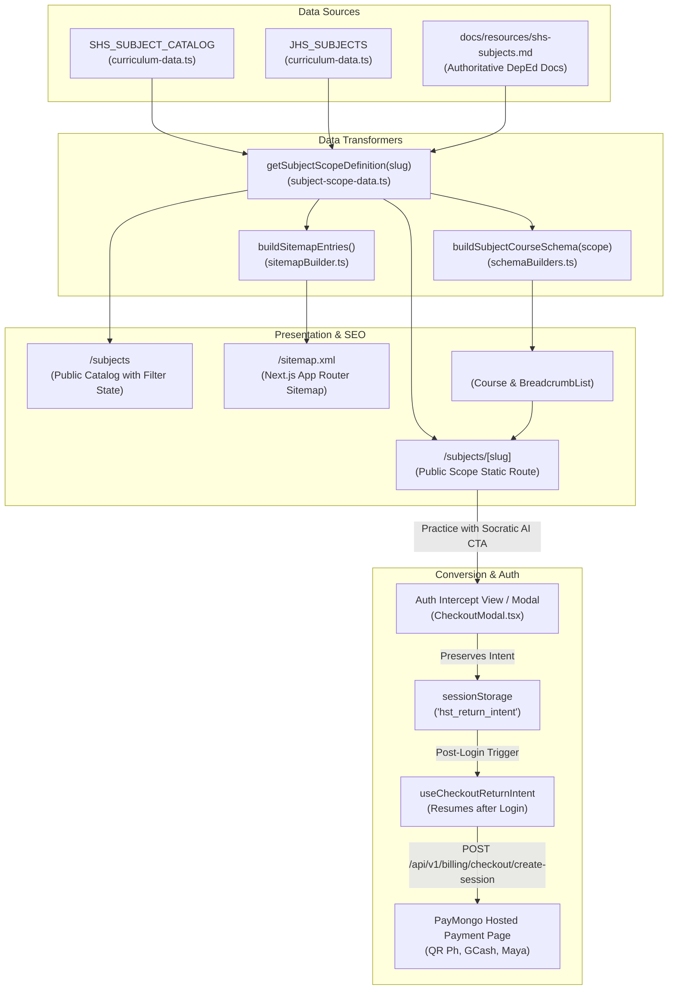

# Phase 1 Data Model: Authentic Filipino Hero Imagery, Frictionless Subscription Availment, DepEd MATATAG Scope Pages & Expanded Curriculum Catalog

**Feature**: `006-filipino-hero-subscription-scope-catalog`  
**Date**: 2026-11-03  
**Status**: Completed  
**Author**: Antigravity (Advanced Agentic Coding)

---

## 1. Entities & Data Models

### 1.1 ReturnIntent (Client Ephemeral State)

Represents preserved user intent when an unauthenticated guest clicks to subscribe, upgrade, or initiate checkout from marketing surfaces or dialogs:

```typescript
export interface ReturnIntent {
  /** Selected subscription tier: Monthly pass or Annual unlimited */
  planId: "MONTHLY" | "ANNUAL";
  /** Preserved affiliate or referral attribution code (if valid) */
  referralCode?: string;
  /** Optional subject slug the user was viewing or intending to practice */
  targetSubjectSlug?: string;
  /** Originating URL route where checkout was initiated */
  sourceUrl: string;
  /** Epoch timestamp in milliseconds when intent was persisted */
  timestamp: number;
}
```

#### Lifecycle & Validation Rules
- **Storage Mechanism**: Persisted in browser `sessionStorage` under key `hst_return_intent`.
- **Query Parameter Fallback**: If `sessionStorage` throws or is disabled (e.g. strict incognito / cookie-blocked sandbox), intent is serialized to base64 or URL query parameters: `/login?callbackUrl=/dashboard&returnPlan=ANNUAL&returnRef=...`.
- **Expiration Threshold**: Max TTL is 2 hours (`1000 * 60 * 60 * 2` ms). Intents older than 2 hours are discarded.
- **Consumption (One-Time Execution)**: Once detected and executed post-authentication, `hst_return_intent` MUST be immediately removed from `sessionStorage` before triggering checkout redirect to prevent infinite redirect loops.

---

### 1.2 SubjectScopeDefinition (DepEd MATATAG Curriculum Scope)

Authoritative educational metadata model used to render public scope pages (`/subjects/[slug]`) and generate Schema.org `Course` JSON-LD structured data:

```typescript
export interface SubjectScopeDefinition {
  /** Unique kebab-case slug (e.g., "g11-s1-genmath", "g7-q1-math") */
  slug: string;
  /** Official DepEd Subject Code (e.g., "GENMATH", "TVL-CSS1") */
  code: string;
  /** Complete official course title */
  name: string;
  /** Academic level classification */
  level: "Junior High School" | "Senior High School";
  /** Grade level designation (e.g., "Grade 7", "Grade 11") */
  grade: string;
  /** Academic period designation (e.g., "Semester 1", "Quarter 1") */
  term: string;
  /** High-level track categorization (e.g., "Core", "Applied", "Academic", "TVL", "Arts and Design", "Sports") */
  track: string;
  /** Strand or specialization sector (e.g., "STEM", "ABM", "HUMSS", "GAS", "Agri-Fishery Arts", "Industrial Arts", "Home Economics", "ICT", "Arts & Design", "Sports") */
  strand: string;
  /** Official prescribed time allotment */
  timeAllotment: string;
  /** Explicit list of prerequisite subject titles or codes (empty array if none) */
  prerequisites: string[];
  /** Optional concurrent corequisite subjects */
  corequisites?: string[];
  /** Official DepEd curriculum guide course description derived from docs/resources/shs-subjects.md */
  description: string;
  /** Key learning competencies aligned with DepEd DO 015, s. 2026 */
  competencies: string[];
  /** Optional TESDA National Certificate level for TVL specializations (e.g., "NC I", "NC II", "NC III", "Non-NC") */
  tesdaNcLevel?: string | null;
  /** Optional certifying agency (e.g., "TESDA", "Philippine Red Cross", "National Sports Associations") */
  certifyingAgency?: string | null;
  /** Number of structured lessons on the platform */
  lessonsCount: number;
  /** Number of verified practice quizzes available */
  quizzesCount: number;
}
```

---

### 1.3 Expanded ShsSubjectDefinition & Subject

Updated definitions in `features/curriculum/types/curriculum.types.ts` and `features/curriculum/utils/curriculum-data.ts`:

```typescript
export type ShsStrand =
  | "Core"
  | "Applied"
  | "STEM"
  | "ABM"
  | "HUMSS"
  | "GAS"
  | "TVL"
  | "Arts & Design"
  | "Sports";

export interface ShsSubjectDefinition {
  abbr: string;
  name: string;
  grade: 11 | 12;
  semester: 1 | 2;
  strand: ShsStrand;
}

export type Subject = {
  code: string;
  slug: string;
  name: string;
  grade: string;
  term: string;
  level: "Junior High School" | "Senior High School";
  strand?: string;
  track?: string;
};

export type DistinctSubject = {
  id: string;
  code: string;
  name: string;
  level: "Junior High School" | "Senior High School";
  grade: string;
  term: string;
  defaultSlug: string;
  isJhsCore?: boolean;
  abbr?: string;
  strand?: string;
  track?: string;
};
```

---

### 1.4 Expanded TrackData (in `TrackDetail.tsx`)

Data model for academic tracks and strands on the marketing and public track pages:

```typescript
export interface TrackData {
  id: string;
  name: string;
  badge: string;
  headline: string;
  overview: string;
  grades: string;
  icon: React.ComponentType<{ className?: string }>;
  color: string;
  accent: string;
  pill: string;
  subjectsCount: string;
  learningGoals: string[];
  featuredSubjects: {
    code: string;
    title: string;
    description: string;
    modules: number;
  }[];
  careerPathways: string[];
  aiTutorCapabilities: string[];
}
```

#### New Registrations in `TRACKS_DATA`
1. **`arts-design-track`**:
   - `id`: `"arts-design-track"`
   - `name`: `"Arts and Design Track"`
   - `badge`: `"Specialized Secondary Arts Curriculum"`
   - `headline`: `"Fostering Filipino Identity, Creative Mastery, and Industry Craft"`
   - `icon`: `Palette`
   - `subjectsCount`: `"6 General + 5 Specializations"`
   - `grades`: `"Grades 11 and 12"`
2. **`sports-track`**:
   - `id`: `"sports-track"`
   - `name`: `"Sports Track"`
   - `badge`: `"Athletic Leadership & Sports Science Curriculum"`
   - `headline`: `"Scientific Athletic Coaching, Officiating, and Human Movement"`
   - `icon`: `Trophy`
   - `subjectsCount`: `"9 Specialized Subjects"`
   - `grades`: `"Grades 11 and 12"`

---

### 1.5 SubjectFilterState (Public Catalog Interactive State)

Ephemeral client filter state used on `app/subjects/page.tsx` (`PublicSubjectCatalog.tsx`):

```typescript
export interface SubjectFilterState {
  level: "all" | "Junior High School" | "Senior High School";
  strand: "all" | ShsStrand;
  grade: "all" | "Grade 7" | "Grade 8" | "Grade 9" | "Grade 10" | "Grade 11" | "Grade 12";
  searchQuery: string;
}
```

---

## 2. Entity Relationships & Data Flow


