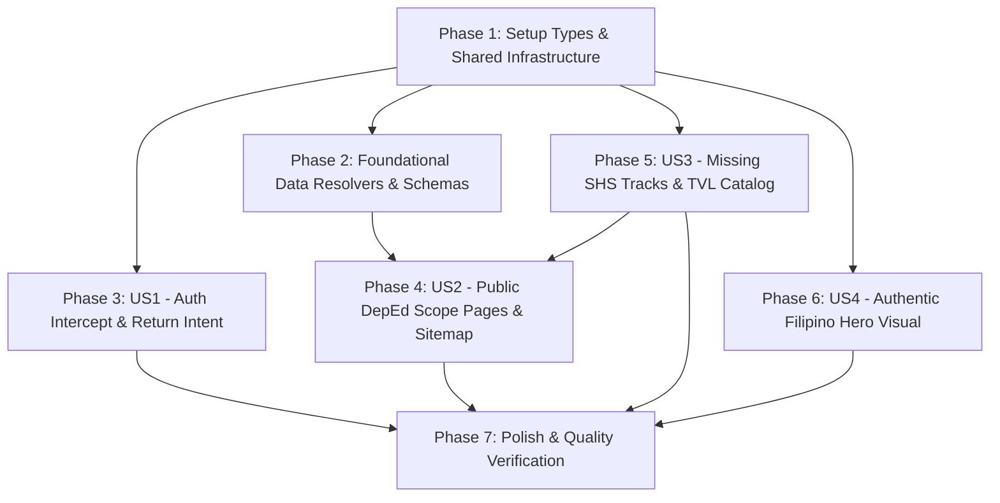

# Tasks: Authentic Filipino Hero Imagery, Frictionless Subscription Availment, DepEd MATATAG Scope Pages & Expanded Curriculum Catalog

**Branch**: `006-filipino-hero-subscription-scope-catalog` | **Date**: 2026-11-03 | **Spec**: [spec.md](./spec.md) | **Plan**: [plan.md](./plan.md)

---

## Task List Overview

This task list breaks down the implementation of **TASK-029** into 7 structured phases with strict dependency ordering, explicit file paths, and test-driven validation.

- **Phase 1: Setup (Types & Shared Infrastructure)**: Tasks [TSK-001] to [TSK-004]
- **Phase 2: Foundational (Blocking Prerequisites)**: Tasks [TSK-005] to [TSK-007]
- **Phase 3: User Story 1 (P1 - Auth Intercept & Return Intent Resumption)**: Tasks [TSK-008] to [TSK-012]
- **Phase 4: User Story 2 (P2 - Public DepEd MATATAG Scope Pages & Sitemap)**: Tasks [TSK-013] to [TSK-017]
- **Phase 5: User Story 3 (P3 - Complete Missing SHS Tracks & TVL Specializations)**: Tasks [TSK-018] to [TSK-024]
- **Phase 6: User Story 4 (P4 - Authentic Filipino Hero Visual & 4:5 Aspect Ratio)**: Tasks [TSK-025] to [TSK-028]
- **Phase 7: Polish, Quality Assurance & Verification**: Tasks [TSK-029] to [TSK-032]

---

## Phase 1: Setup (Types & Shared Infrastructure)

*Prerequisite types and schema foundations across billing, curriculum, and SEO modules.*

- [x] [TSK-001] [P1] [Setup] Define `ReturnIntent` interface and payload contracts in `features/billing/types/billingTypes.ts`
- [x] [TSK-002] [P2] [Setup] Create `SubjectScopeDefinition` and `SubjectFilterState` types in `features/curriculum/types/subjectScope.types.ts`
- [x] [TSK-003] [P3] [Setup] Update `CatalogShsStrand` and `ShsStrand` unions in `features/curriculum/types/curriculum.types.ts` to include `"Arts & Design"` and `"Sports"`
- [x] [TSK-004] [P2] [Setup] Verify and expand SEO structured data interfaces for `SchemaCourse` and `SchemaBreadcrumbList` in `features/seo/types/index.ts`

---

## Phase 2: Foundational (Blocking Prerequisites)

*Core data resolvers and schema builders required by subsequent user stories.*

- [x] [TSK-005] [P2] [Foundational] Implement `getSubjectScopeDefinition(slug)` and `getAllSubjectScopeSlugs()` resolver mapping canonical slugs to official DepEd descriptions, hours, prerequisites, and competencies in `features/curriculum/utils/subject-scope-data.ts`
- [x] [TSK-006] [P2] [Foundational] Create unit test suite `tests/unit/subject-scope.test.ts` verifying `getSubjectScopeDefinition` resolves accurate metadata, hours (80h/20h/TVL), and prerequisite chains for all tracks
- [x] [TSK-007] [P2] [Foundational] Implement `buildSubjectCourseSchema(subject)` and `buildSubjectBreadcrumbSchema(subject)` helper functions in `features/seo/utils/schemaBuilders.ts`

---

## Phase 3: User Story 1 (P1 - Auth Intercept & Return Intent Resumption in `features/billing/`)

*Goal: Eliminate 401 Unauthorized errors during checkout for unauthenticated visitors by intercepting guests, saving return intent in `sessionStorage`, and automatically resuming PayMongo checkout post-login.*

- [x] [TSK-008] [P1] [US1] Create unit test suite `tests/unit/auth-intercept.test.ts` verifying return intent persistence, 2-hour TTL expiration, one-time consumption idempotency, and URL fallback parsing
- [x] [TSK-009] [P1] [US1] Create reactive intent resumption hook `features/billing/hooks/useCheckoutReturnIntent.ts` to detect `hst_return_intent` upon session activation, purge storage, and initiate PayMongo session redirect
- [x] [TSK-010] [P1] [US1] Create modular Auth Intercept component or view state `features/billing/components/AuthInterceptDialog.tsx` displaying plan badge, pricing, domestic payment rails, and Google/Email auth buttons
- [x] [TSK-011] [P1] [US1] Update `features/billing/components/CheckoutModal.tsx` to add client session preflight check (`!user`), suppress raw API mutation, store `ReturnIntent` to `sessionStorage`, and render the Auth Intercept view with zero error toasts
- [x] [TSK-012] [P1] [US1] Mount `useCheckoutReturnIntent` in the global application shell `app/layout.tsx` (or `providers/`) to handle automatic checkout resumption across any page entry point

---

## Phase 4: User Story 2 (P2 - Public DepEd MATATAG Scope Pages & Sitemap in `app/subjects/` and `features/seo/`)

*Goal: Deliver public, SEO-indexed curriculum catalog (`/subjects`) and dynamic scope pages (`/subjects/[slug]`) pre-rendered with `generateStaticParams()`, Schema.org `Course` JSON-LD, and dynamic XML sitemap.*

- [x] [TSK-013] [P2] [US2] Create client-side interactive catalog component `features/curriculum/components/PublicSubjectCatalog.tsx` with search filter, academic level toggle, strand dropdown, and subject cards
- [x] [TSK-014] [P2] [US2] Create public catalog route `app/subjects/page.tsx` rendering SEO metadata, Schema.org `BreadcrumbList`, and embedding `PublicSubjectCatalog.tsx`
- [x] [TSK-015] [P2] [US2] Create subject scope visual component `features/curriculum/components/SubjectScopeView.tsx` rendering official subject title, code, hours, prerequisites, DepEd description, competencies table, and high-conversion Socratic AI practice CTA
- [x] [TSK-016] [P2] [US2] Create dynamic scope route `app/subjects/[slug]/page.tsx` with `generateStaticParams()` pre-rendering, `generateMetadata({ params })` with OpenGraph tags, Next.js `notFound()` handling, and Schema.org `Course` + `BreadcrumbList` JSON-LD injection
- [x] [TSK-017] [P2] [US2] Update `features/seo/utils/sitemapBuilder.ts` and `app/sitemap.ts` to dynamically enumerate `/subjects` (priority 0.9, daily) and all canonical `/subjects/[slug]` routes (priority 0.8, weekly)

---

## Phase 5: User Story 3 (P3 - Complete Missing SHS Tracks & TVL Specializations in `features/curriculum/utils/curriculum-data.ts`, `TrackDetail.tsx`, and `tests/unit/tracks-data.test.ts`)

*Goal: Complete 100% DepEd MATATAG SHS catalog coverage by adding the Arts and Design Track, Sports Track, and core TVL specializations (AFA, IA, HE, ICT) with accurate hours and prerequisites.*

- [x] [TSK-018] [P3] [US3] Add 6 Arts and Design general subjects (`AD-CI1`, `AD-CI2`, `AD-PPD`, `AD-DFI`, `AD-IEP`, `AD-LM`) and 5 specialization streams to `SHS_SUBJECT_CATALOG` in `features/curriculum/utils/curriculum-data.ts`
- [x] [TSK-019] [P3] [US3] Add 9 Sports Track specialized subjects (`SP-SFA`, `SP-HM`, `SP-FC`, `SP-SOAM`, `SP-FSRL`, `SP-PASE`, `SP-FTEP`, `SP-PRAC`, `SP-APPR`) to `SHS_SUBJECT_CATALOG` in `features/curriculum/utils/curriculum-data.ts`
- [x] [TSK-020] [P3] [US3] Add core DepEd TVL specializations across Agri-Fishery Arts, Industrial Arts, Home Economics, and ICT with official TESDA NC hours and prerequisites to `SHS_SUBJECT_CATALOG` in `features/curriculum/utils/curriculum-data.ts`
- [x] [TSK-021] [P3] [US3] Register `arts-design-track` into `TRACKS_DATA` in `features/landing/components/TrackDetail.tsx` with `Palette` icon, learning goals, career pathways, and 8-module featured subjects
- [x] [TSK-022] [P3] [US3] Register `sports-track` into `TRACKS_DATA` in `features/landing/components/TrackDetail.tsx` with `Trophy` icon, learning goals, career pathways, and 8-module featured subjects
- [x] [TSK-023] [P3] [US3] Update `tvl-track` in `features/landing/components/TrackDetail.tsx` to detail all 4 core sectors (AFA, IA, HE, ICT) with expanded career pathways and learning goals
- [x] [TSK-024] [P3] [US3] Update test suite `tests/unit/tracks-data.test.ts` to assert all 9 tracks (`arts-design-track`, `sports-track`, `tvl-track`, etc.), verifying required metadata, learning goals, and 8-module standardized subjects

---

## Phase 6: User Story 4 (P4 - Authentic Filipino Hero Visual & 4:5 Aspect Ratio in `features/landing/components/HeroSection.tsx`)

*Goal: Replace foreign stock photo with an authentic high-resolution photograph of a local Filipino high school student in Philippine uniform with a 4:5 vertical portrait aspect ratio and optimized Next.js Image configuration.*

- [x] [TSK-025] [P4] [US4] Update central hero image source in `features/landing/components/HeroSection.tsx` to reference authentic Filipino student in uniform (`/images/filipino-student-writing.jpg` or updated `/images/hero-student.jpg`)
- [x] [TSK-026] [P4] [US4] Apply strict 4:5 vertical portrait aspect ratio container classes (`aspect-[4/5]`) with `object-cover` and `object-top` positioning in `features/landing/components/HeroSection.tsx`
- [x] [TSK-027] [P4] [US4] Configure Next.js `Image` component attributes in `features/landing/components/HeroSection.tsx`: set descriptive `alt="Filipino high school student studying DepEd MATATAG curriculum with HighSchool Tutor"`, `priority`, and responsive `sizes`
- [x] [TSK-028] [P4] [US4] Verify and fine-tune layout coordinates for floating preview cards (General Mathematics 75%, AI Socratic Taglish tutor, Assessment alert) in `features/landing/components/HeroSection.tsx` ensuring zero facial occlusion on mobile (360px-375px) and desktop viewports

---

## Phase 7: Polish, Quality Assurance & Verification

*Final verification, strict type checking, production build validation, and documentation synchronization.*

- [x] [TSK-029] [P1] [Polish] Run TypeScript strict type verification (`npx tsc --noEmit`) and resolve any type discrepancies across curriculum, billing, and SEO modules
- [x] [TSK-030] [P1] [Polish] Execute full automated unit test suite (`npx jest tests/unit/tracks-data.test.ts tests/unit/subject-scope.test.ts tests/unit/auth-intercept.test.ts`) ensuring 100% passing tests
- [x] [TSK-031] [P1] [Polish] Execute Next.js production build (`npm run build`) to verify zero hydration mismatches, zero SSR build warnings, and successful static pre-rendering of `/subjects` and all `/subjects/[slug]` pages
- [x] [TSK-032] [P1] [Polish] Synchronize verification checklist in `docs/tasks/TASK-029-filipino-hero-subscription-scope-and-catalog.md` and append entry to `docs/backlog.md`

---

## Dependencies & Execution Order

### Critical Path & User Story Dependencies
1. **Phase 1 (Setup)** unblocks all subsequent phases.
2. **Phase 2 (Foundational)** provides `subject-scope-data.ts` and SEO schema builders required by **Phase 4 (US2 Scope Pages)**.
3. **Phase 5 (US3 Catalog Expansion)** enriches `curriculum-data.ts` with Arts, Sports, and TVL subjects, which allows **Phase 4 (US2 Scope Pages)** to pre-render the complete set of 85+ subject pages.
4. **Phase 3 (US1 Auth Intercept)** is completely decoupled from curriculum routes and can be developed independently or in parallel.
5. **Phase 6 (US4 Hero Visual)** touches only `HeroSection.tsx` and can be implemented in parallel with any other story.

---

## Parallel Execution Opportunities

Developers or autonomous agents can work on distinct pillars concurrently without merge conflicts:

| Stream | Tasks | Primary Files |
| :--- | :--- | :--- |
| **Stream A (Billing & Auth Intercept)** | [TSK-008] to [TSK-012] | `features/billing/components/CheckoutModal.tsx` `features/billing/hooks/useCheckoutReturnIntent.ts` `features/billing/components/AuthInterceptDialog.tsx` |
| **Stream B (Curriculum Catalog Expansion)** | [TSK-018] to [TSK-024] | `features/curriculum/utils/curriculum-data.ts` `features/landing/components/TrackDetail.tsx` `tests/unit/tracks-data.test.ts` |
| **Stream C (DepEd Scope Pages & SEO)** | [TSK-005] to [TSK-007], [TSK-013] to [TSK-017] | `features/curriculum/utils/subject-scope-data.ts` `features/curriculum/components/SubjectScopeView.tsx` `app/subjects/` `features/seo/` |
| **Stream D (Hero Visual & Design)** | [TSK-025] to [TSK-028] | `features/landing/components/HeroSection.tsx` |

---

## Implementation Strategy (MVP First)

To minimize risk and maximize early business impact, execution adheres to an MVP-first strategy:

1. **MVP Target (P1 - User Story 1: Auth Intercept & Return Intent)**:
   - Delivering Phase 1 ([TSK-001]) and Phase 3 ([TSK-008] to [TSK-012]) immediately eliminates the 401 Unauthorized conversion blocker on all live marketing pricing cards.
   - High-intent visitors can immediately subscribe without encountering error toasts.
2. **Incremental Delivery 2 (P2 & P3 - Scope Pages & Catalog Expansion)**:
   - Delivers Phase 2, Phase 4, and Phase 5, creating 85+ static public SEO routes and complete DepEd MATATAG curriculum coverage across all 9 tracks.
3. **Incremental Delivery 3 (P4 - Hero Visual Grounding & Polish)**:
   - Delivers Phase 6 and Phase 7, completing cultural grounding with the authentic Filipino student portrait and running full production build and test suites.
