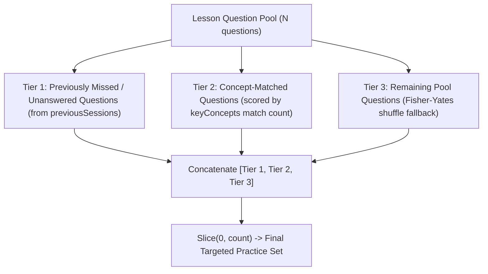
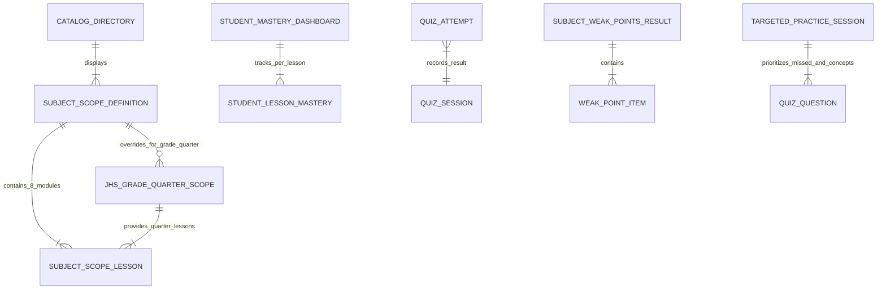

# Phase 1 Data Model: Subject Scope Syllabus, Catalog Deduplication, and Landing Page Entities

**Feature**: `007-scope-dedup-landing-fixes`  
**Date**: 2026-11-04  
**Status**: Completed  
**Branch**: `007-scope-dedup-landing-fixes`  

---

## 1. Domain Entities & Type Definitions

### 1.1 `SubjectScopeLesson`
Represents an individual instructional lesson module within a DepEd DO 015, s. 2026 MATATAG subject scope. Each subject contains exactly 8 sequential lessons.

```typescript
// features/curriculum/types/subjectScope.types.ts

export interface SubjectScopeLesson {
  /**
   * Sequential lesson number (1 through 8).
   */
  lessonNumber: number;

  /**
   * Descriptive, domain-accurate lesson title.
   * e.g., "Functions, Rational Functions, and Domain Restrictions"
   */
  title: string;

  /**
   * 2–3 sentence pedagogical summary describing the concepts covered,
   * real-world context, and DepEd MATATAG learning objectives.
   */
  summary: string;

  /**
   * Array of 3 to 5 key concept and subtopic tags.
   * e.g., ["Domain & Range", "Vertical Asymptotes", "Rational Inequalities"]
   */
  keyConcepts: string[];

  /**
   * Number of verified practice drills linked to this lesson.
   * Standardized to 3 per lesson (totaling 24 drills across 8 lessons).
   */
  practiceDrillsCount: number;
}
```

---

### 1.2 `SubjectScopeDefinition` (Extended)
Represents the comprehensive curriculum scope displayed on the public `/subjects/[slug]` page and catalog cards.

```typescript
// features/curriculum/types/subjectScope.types.ts

export interface SubjectScopeDefinition {
  /** Canonical slug (e.g., "g7-q1-eng", "g11-s1-genmath") */
  slug: string;

  /** DepEd subject code (e.g., "JHS-ENG", "G11-S1-GENMATH") */
  code: string;

  /** Full display name (e.g., "English", "General Mathematics") */
  name: string;

  /** Academic division */
  level: "Junior High School" | "Senior High School";

  /** Grade designation (e.g., "Grades 7–10" for catalog JHS cards, or "Grade 7") */
  grade: string;

  /** Term designation (e.g., "Quarters 1–4" for catalog JHS cards, or "Quarter 1") */
  term: string;

  /** DepEd Track (e.g., "Junior High School Core", "Academic Track", "TVL Track") */
  track: string;

  /** Specific Strand or Core group (e.g., "Core", "STEM", "ABM", "HUMSS", "GAS", "TVL") */
  strand: string;

  /** Prescribed weekly or semester hours under DO 015 s. 2026 */
  timeAllotment: string;

  /** Array of prerequisite subjects */
  prerequisites: string[];

  /** Array of optional corequisite subjects */
  corequisites?: string[];

  /** Official curriculum description */
  description: string;

  /** Prescribed DepEd MATATAG learning competencies */
  competencies: string[];

  /** TESDA National Certificate level if applicable (e.g., "NC II") */
  tesdaNcLevel?: string | null;

  /** Higher education degree programs and career opportunities */
  careerPathways?: string[];

  /** Total lesson count (standardized to 8) */
  featuredModulesCount?: number;

  /**
   * Ordered list of 8 structured lesson syllabus items.
   * Mandatory on all resolved subject scopes.
   */
  lessons: SubjectScopeLesson[];

  /** Flag indicating whether the subject is one of the 8 JHS Core subjects */
  isJhsCore?: boolean;

  /** Subject abbreviation code (e.g., "MATH", "SCI", "ENG", "GENMATH") */
  abbr?: string;
}
```

---

### 1.3 `JhsGradeQuarterScope`
Represents grade-specific (Grades 7–10) and quarter-specific (Quarters 1–4) curriculum overrides for the 8 Junior High School Core subjects.

```typescript
// features/curriculum/types/subjectScope.types.ts

export interface JhsGradeQuarterScope {
  /** Grade level (7, 8, 9, or 10) */
  grade: "Grade 7" | "Grade 8" | "Grade 9" | "Grade 10";

  /** Grading period (1, 2, 3, or 4) */
  quarter: "Quarter 1" | "Quarter 2" | "Quarter 3" | "Quarter 4";

  /** Canonical slug for this specific grade and quarter (e.g., "g8-q2-math") */
  slug: string;

  /** Grade- and quarter-specific curriculum description */
  description: string;

  /** Grade- and quarter-specific DepEd MATATAG competencies */
  competencies: string[];

  /** Grade- and quarter-specific 8-lesson syllabus breakdown */
  lessons: SubjectScopeLesson[];
}
```

---

### 1.4 `StudentLessonMastery` & `StudentMasteryDashboardData`
Replaces the unimplemented teacher LMS roster table in `features/landing/components/AcademicWorkflowDemo.tsx` with authentic per-student, per-lesson mastery tracking.

```typescript
// features/landing/types/workflowDemo.types.ts

export type MasteryStatus = "Mastered" | "Practice Proficient" | "Practice Passed" | "Needs Review";

export interface StudentLessonMastery {
  /** Lesson identifier and title (e.g., "Lesson 1: Functions & Domain") */
  lessonTitle: string;

  /** DepEd Competency covered */
  competency: string;

  /** Drills completed out of total (e.g., "3 / 3") */
  drillsDone: string;

  /** Transmuted score under DepEd DO 015 s. 2026 scale (e.g., "94.0%") */
  transmutedGrade: string;

  /** Evaluated mastery status badge */
  status: MasteryStatus;

  /** Timestamp or relative time of last practice */
  lastPracticed: string;
}

export interface StudentMasteryDashboardData {
  /** Overall student DO 015 transmuted average across completed drills */
  overallTransmutedScore: string;

  /** DepEd descriptive equivalent (e.g., "Outstanding", "Very Satisfactory") */
  descriptor: string;

  /** Per-lesson mastery breakdown rows */
  lessons: StudentLessonMastery[];

  /** Diagnostic AI insight highlighting weak-point topics */
  diagnosticInsight: {
    weakTopics: string;
    description: string;
    remediationAction: string;
  };
}
```

---

### 1.5 `LessonProgressStatus` (Mastery-First Taxonomy)
Extends the lesson progress lifecycle in `features/curriculum/types/curriculum.types.ts` to support mastery-first framing while retaining backward compatibility for stored records.

```typescript
// features/curriculum/types/curriculum.types.ts

export type LessonProgressStatus =
  | "Not Started"
  | "In Progress"
  | "Needs Review"
  | "Practice Passed"       // Legacy alias for score >= 75%
  | "Practice Proficient"   // Mastery-first label for score >= 75%
  | "Mastered";             // Fully mastered competency
```

---

### 1.6 `SubjectWeakPointsResult` (Diagnostic Attempt-Aware Model)
Return signature of `getSubjectWeakPointsAction` in `features/curriculum/actions/curriculum.actions.ts`.

```typescript
// features/curriculum/actions/curriculum.actions.ts

export interface SubjectWeakPointsResult {
  success: boolean;
  subjectSlug: string;
  weakPoints: Array<{
    lessonNumber: number;
    lessonTitle: string;
    rawScore: number;
    total: number;
    transmutedScore: number;
    status: "Needs Review";
    keyConcepts: string[];
    lastAttemptDate: Date;
  }>;
  totalWeakPoints: number;
  /**
   * Total number of distinct lessons attempted by the user in this subject.
   * If 0, SubjectWeakPointsCard returns null and remains completely hidden.
   */
  totalAttemptedLessons: number;
  /** Official DepEd DO 015 mastery threshold (75) */
  passingThreshold: number;
  error?: string;
}
```

---

### 1.7 `TargetedPracticeQuestionSelectionParams` & Prioritization Model
Parameters and logic for `selectTargetedPracticeQuestions` in `features/curriculum/utils/quiz-sampler.ts`.

```typescript
// features/curriculum/utils/quiz-sampler.ts

export interface TargetedPracticeSelectionParams {
  /** Full available question pool for the target lesson */
  pool: QuizQuestion[];
  /** Desired session length (default: 10) */
  count: number;
  /** Up to 5 most recent QuizSessions for this user, subject, and lesson */
  previousSessions?: Array<{
    questions: QuizQuestion[];
    userAnswers?: Record<string, string> | null;
  }>;
  /** Diagnostic key concepts for the lesson to match against questions */
  keyConcepts?: string[];
}
```

#### Prioritization Tiers:


---

### 1.8 Clean Better Auth Client Model
Clean auth client instantiation in `features/auth/lib/auth-client.ts` with Sentinel infrastructure plugin removed.

```typescript
// features/auth/lib/auth-client.ts
import { createAuthClient } from "better-auth/react";

export const authClient = createAuthClient({});

export const { signIn, signOut, signUp, useSession } = authClient;
```

---

## 2. Deduplicated Catalog Structure (108 Subjects)

The public catalog at `/subjects` renders exactly **108 unique subjects**, computed as follows:

| Group | Count | Details | Sample Canonical Code / Slug |
|---|---|---|---|
| **Junior High Core** | 8 | English, Filipino, Mathematics, Science, Araling Panlipunan, EsP, MAPEH, TLE. Displayed as single cards representing Grades 7–10 • Quarters 1–4. | `JHS-ENG` (`g7-q1-eng`), `JHS-MATH` (`g7-q1-math`) |
| **SHS Core** | 15 | All 15 required general education subjects across Grades 11–12. | `G11-S1-ORALCOMM`, `G11-S1-GENMATH` |
| **SHS Applied** | 7 | Common applied track subjects (EAPP, Practical Research 1 & 2, Entrep, etc.). | `G11-S1-EAPP`, `G12-S2-ENTREP` |
| **STEM Specialized** | 11 | Advanced math and science specializations. | `G11-S1-PRECALC`, `G11-S2-BASCALC`, `G12-S1-PHYS1` |
| **ABM Specialized** | 9 | Business, marketing, economics, and accounting specializations. | `G11-S1-BUSMATH`, `G11-S2-FABM1`, `G12-S1-BUSFIN` |
| **HUMSS Specialized** | 9 | Social sciences, politics, world religions, and creative writing. | `G11-S1-CREATWRITE`, `G11-S1-DISS` |
| **GAS Specialized** | 7 | General academic electives and humanities electives. | `G11-S1-HUM1`, `G12-S2-APLECO` |
| **Arts & Design Track** | 7 | Visual arts, performing arts, media arts, and apprenticeships. | `G11-S1-CREATIND`, `G12-S1-APPRARTS` |
| **Sports Track** | 7 | Sports science, fitness testing, coaching, and safety. | `G11-S1-FITTEST`, `G12-S1-COACH` |
| **TVL Track Specializations**| 20 | TESDA NC II aligned technical and livelihood specializations. | `G11-S1-CSS1`, `G11-S1-COOK1`, `G12-S1-EIM2` |
| **Total Catalog Offerings** | **108** | **8 JHS Core + 100 SHS Subjects** | Clean, non-redundant catalog display |

---

## 3. Entity Relationships & Data Flow



---

## 4. Invariants & Business Logic Rules

1. **8-Lesson Invariant**:
   Every `SubjectScopeDefinition` returned by `getSubjectScopeDefinition(slug)` or `getAllSubjectScopeDefinitions()` MUST have `lessons.length === 8`.
2. **24-Drill Invariant**:
   The sum of `practiceDrillsCount` across all 8 lessons in any subject MUST equal 24.
3. **Canonical Catalog Deduplication**:
   `getAllSubjectScopeDefinitions()` MUST return exactly 108 records. It MUST NOT include redundant per-quarter JHS cards or any legacy trimester cards.
4. **Canonical Pre-Rendering Slugs**:
   `getAllSubjectScopeSlugs()` MUST return exactly 228 slugs (128 JHS Quarters + 100 SHS Semesters). Zero legacy `g*-t*-*` slugs shall be included in static parameter generation or sitemaps.
5. **Backwards Route Resolution**:
   `getSubjectScopeDefinition(slug)` MUST gracefully resolve canonical quarter slugs (`g8-q2-math`), base JHS slugs (`jhs-math`), and legacy trimester slugs (`g8-t2-math` -> normalized to Quarter 2 without 404).
6. **Mastery Target Invariant**:
   The official DepEd DO 015 s. 2026 mastery benchmark is strictly `transmutedGrade >= 75%`. The UI MUST display `"Mastery Target ≥ 75%"` and MUST NOT label it as `"Passing Grade ≥ 75%"`.
7. **Diagnostic Card Visibility Invariant**:
   If `totalAttemptedLessons === 0`, `SubjectWeakPointsCard` MUST return `null` and remain hidden. It MUST NEVER display `"Diagnostic Mastery Achieved"` to a user with 0 attempts.
8. **Targeted Practice Prioritization Invariant**:
   Questions in a targeted practice session MUST be assembled in priority order:
   - Priority 1: Questions missed or unanswered in the user's prior sessions for that lesson.
   - Priority 2: Questions matching the lesson's diagnostic `keyConcepts`.
   - Priority 3: Remaining unattempted questions from the lesson pool.
9. **Zero Sentinel Logs Invariant**:
   The auth client initialization MUST NOT register `sentinelClient()`, guaranteeing zero `[Sentinel]` warnings in console logs.
