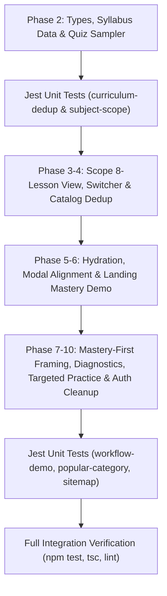

# Implementation Plan: Subject Scope Enrichment, Catalog Deduplication, and Landing Page Accuracy & UX Fixes

**Branch**: `007-scope-dedup-landing-fixes` | **Date**: 2026-11-04 | **Spec**: [specs/007-scope-dedup-landing-fixes/spec.md](file:///c:/Users/Dell/Desktop/highschool-tutor/specs/007-scope-dedup-landing-fixes/spec.md)  
**Input**: Feature specification from `specs/007-scope-dedup-landing-fixes/spec.md` (TASK-030, User Stories 1–9, FR-001 through FR-028)  

---

## Summary

This feature resolves critical gaps and user-facing inconsistencies across HighSchool Tutor's public curriculum catalog, subject scope presentation, landing page marketing experience, and diagnostic evaluation engine:
1. **Full Curriculum Scope & 8-Lesson Syllabus Breakdown (US1)**: Enrich all 108 DepEd MATATAG subjects with a structured 8-lesson syllabus breakdown (lesson number, title, 2–3 sentence summary, 3–5 key concept tags, and 3 practice drills totaling 24 drills per subject). For the 8 JHS Core subjects, introduce an interactive on-page Grade (Grades 7–10) and Quarter (Quarters 1–4) switcher on `/subjects/[slug]` dynamically updating scope metadata and CTA links.
2. **Deduplicated Public Subjects Catalog (US2)**: Deduplicate `/subjects` from 324 redundant items to exactly **108 distinct subjects** (8 JHS Core covering Grades 7–10 and Quarters 1–4 + 100 Senior High School subjects), excluding legacy trimester (`g*-t*-*`) slugs while maintaining backwards-compatible route resolution.
3. **Zero Hydration Mismatches (US3)**: Add `suppressHydrationWarning` to `<html lang="en">` in `app/layout.tsx` to accommodate `next-themes`, and synchronize referral cookie retrieval in `features/billing/components/CheckoutModal.tsx` strictly inside a client `useEffect`.
4. **Accurate Marketing Copy & Student Mastery Demo (US4)**: Eliminate all misleading mentions of "parent reporting" and "automated gradebook" from `AboutSection.tsx` and `HowToUseAppSection.tsx`. In `AcademicWorkflowDemo.tsx`, replace the mock teacher LMS roster with an authentic "Student Mastery & Weak Points" preview demonstrating DO 015 transmuted scores, per-lesson mastery statuses, and diagnostic weak points.
5. **Clean Academic Track Headers & Centered Modal CTA (US5)**: Remove decorative track icons from `CategorySection.tsx`, `app/tracks/page.tsx`, and `TrackDetail.tsx` for clean, professional typography-first headers, and remove `ml-auto` from `AuthInterceptDialog.tsx` to horizontally center the subscription CTA.
6. **Mastery-First Framing & Elimination of Redundant DO 015 Labels (US6)**: Reframe all student performance statuses from aggressive pass/fail language to mastery-first terminology (`"Mastered"`, `"Practice Proficient"`, `"Mastery Target ≥ 75%"`, `"All Mastered"`), and remove repetitive `"DepEd DO 015 s. 2026"` / `"DO 015 Graded"` badges from individual subject cards, quiz mode pills, and popular subject cards.
7. **Accurate Diagnostic Mastery Visibility & Mobile Badge Alignment (US7)**: Hide `SubjectWeakPointsCard` completely (`null`) for students with 0 quiz attempts (`totalAttemptedLessons === 0`), and ensure diagnostic headers and badges wrap cleanly on mobile screens (≥ 320px) without squishing.
8. **Diagnostic-Driven Targeted Practice Question Prioritization (US8)**: Assemble targeted practice quizzes in three prioritized tiers: Tier 1 (questions previously missed or unanswered), Tier 2 (questions matching lesson diagnostic `keyConcepts`), and Tier 3 (remaining pool fallback). Remove `<Sparkles />` and expand the action button to full width on mobile.
9. **Clean Authentication Infrastructure Logs (US9)**: Remove `sentinelClient()` from `features/auth/lib/auth-client.ts`, eliminating `[Sentinel]` warnings from browser console logs.

---

## Technical Context

**Language/Version**: TypeScript 5.6+ in Strict Mode  
**Primary Dependencies**: Next.js 16+ (App Router), React 19, Tailwind CSS v4, Lucide React, Radix UI Primitives, Zod v4, Better Auth  
**Storage**: PostgreSQL 15+ via Docker and Prisma ORM 7.9+ with `@prisma/adapter-pg`; static typed curriculum registries in `features/curriculum/utils/`  
**Testing**: Jest with `ts-jest` for unit/integration testing; React Testing Library  
**Target Platform**: Node.js 20+ runtime; modern evergreen desktop and mobile web browsers (mobile-first 320px+ responsive)  
**Project Type**: Full-Stack Next.js 16 Web Application with Server Actions & App Router  
**Performance Goals**: Core Web Vitals LCP < 2.0s; First Input Delay (FID) / INP < 100ms; zero client-side React hydration errors  
**Constraints**: Zero `.env*` secret file reads/writes; strict adherence to DepEd DO 015, s. 2026 MATATAG curriculum guidelines (8 lessons, 24 drills, passing grade >= 75%); no dummy mock data; Feature-Driven Architecture (FDA) modularity  
**Scale/Scope**: 108 distinct curriculum subjects (8 JHS Core + 100 SHS across 9 tracks/strands); 228 pre-rendered canonical slugs; 8 authentic lessons per subject  

---

## Constitution Check

*GATE: Must pass before Phase 0 research. Re-check after Phase 1 design.*

| Principle | Requirement | Plan Compliance Status | Notes / Design Measures |
|---|---|---|---|
| **I. FDA Modularity** | All domain code in `features/<domain>/`; cross-feature in `shared/`; `app/` strictly handles routing. | **PASS** | Curriculum types, syllabus data, and components placed strictly in `features/curriculum/`. Landing sections in `features/landing/`. Billing modals in `features/billing/`. Auth client in `features/auth/`. Routes in `app/subjects/`, `app/tracks/`, and `app/layout.tsx` contain zero business logic. |
| **II. Strict State Management** | TanStack Query v5 for server state; Zustand v5 for client UI state. Never sync query results via `useEffect`. | **PASS** | Grade/quarter selection on `/subjects/[slug]` uses clean React local state synchronized with canonical URL links. Cookie reads in `CheckoutModal.tsx` use post-mount `useEffect` strictly for browser-only cookie hydration without store coupling. |
| **III. DepEd DO 015 s. 2026 Compliance** | Official MATATAG grading scale and structure. Legacy DO 8, s. 2015 repealed. | **PASS** | Every subject syllabus enforces 8 sequential lessons with 3 drills each (24 drills total). The 60–100 score transmutation algorithm remains strictly unchanged; UI adopts mastery-first labeling (`Mastery Target ≥ 75%`). |
| **IV. Socratic AI Integrity** | Socratic guidance without spoiling answers; multi-dialect accessibility. | **PASS** | Targeted practice sessions prioritize missed questions and concept matches, serving step-by-step Socratic hints without disclosing answers. |
| **V. Zero-Mock QA Verification** | Real typed schemas, no dummy fallbacks, full unit test pass before completion. | **PASS** | Complete 8-lesson curriculum syllabus registry created for all 108 subjects; unit tests `curriculum-dedup.test.ts`, `subject-scope.test.ts`, `workflow-demo.test.ts`, and `popular-and-category.test.ts` verified against production data models. |

---

## Skills Allocation Matrix

| Skill | Source Path | Allocation & Responsibility in Feature Lifecycle |
|---|---|---|
| `speckit-plan` | `.agents/skills/speckit-plan/SKILL.md` | Execute Phase 0 research, Phase 1 data modeling, contracts, quickstart, and implementation planning. *(Active)* |
| `speckit-tasks` | `.agents/skills/speckit-tasks/SKILL.md` | Break down approved plan into dependency-ordered, verifiable tasks in `tasks.md`. |
| `speckit-implement` | `.agents/skills/speckit-implement/SKILL.md` | Execute tasks in `tasks.md` on the fast Gemini 3.8 Flash tier adhering to strict TDD and quality gates. |
| `task-implementation` | `C:\Users\Dell\.gemini\config\skills\task-implementation\SKILL.md` | Standardize task file creation (`TASK-030-*.md`), change logging (`docs/backlog.md`), and quality verification. |
| `frontend-ui-engineering` | `C:\Users\Dell\.gemini\skills\frontend-ui-engineering\SKILL.md` | Component architecture, responsive layouts, Next.js App Router RSC/client boundaries, and hydration-safe state synchronization. |
| `design-taste-frontend` | `C:\Users\Dell\.gemini\skills\design-taste-frontend\SKILL.md` | Visual hierarchy, spacing, typography-first card headers, iconless layout elegance, and modal CTA alignment aesthetics. |
| `color-theory` | `C:\Users\Dell\.gemini\skills\color-theory\SKILL.md` | Accessible HSL color contrasts, DepEd MATATAG badge accents, and mastery status badge palettes (`Mastered`, `Practice Proficient`, `Needs Review`). |
| `dark-mode-generation` | `C:\Users\Dell\.gemini\skills\dark-mode-generation\SKILL.md` | Flawless dark mode rendering across subject scope syllabus cards, workflow demo panels, and theme toggling without hydration mismatch. |
| `senior-backend` | `C:\Users\Dell\.gemini\skills\senior-backend\SKILL.md` | Server Action contracts, attempt query optimizations, Prisma relational filtering, and 3-tier targeted practice question sampling algorithms. |
| `systematic-debugging` | `C:\Users\Dell\.gemini\skills\systematic-debugging\SKILL.md` | Root cause isolation and resolution for React 19 hydration mismatches, modal `ml-auto` alignment bugs, and legacy trimester route handling. |
| `test-driven-development` | `C:\Users\Dell\.gemini\skills\test-driven-development\SKILL.md` | TDD test suites: `curriculum-dedup.test.ts`, `subject-scope.test.ts`, `workflow-demo.test.ts`, `popular-and-category.test.ts`, and `sitemap.test.ts`. |
| `code-review-and-quality` | `C:\Users\Dell\.gemini\skills\code-review-and-quality\SKILL.md` | Strict TypeScript compilation (`tsc --noEmit`), ESLint compliance, zero dummy fallback values, and DepEd DO 015 s. 2026 formula accuracy. |
| `seo` | `c:\Users\Dell\Desktop\highschool-tutor\.agents\skills\seo\SKILL.md` | Verify dynamic XML sitemap generation (`__tests__/seo/sitemap.test.ts`) ensuring 0 legacy trimester slug leaks and 100% canonical course schema validation. |

---

## Project Structure

### Documentation (this feature)

```text
specs/007-scope-dedup-landing-fixes/
├── plan.md                                                 # Implementation plan (this file)
├── research.md                                             # Phase 0 research findings & architectural decisions
├── data-model.md                                           # Phase 1 data entities, types, and deduplication structure
├── quickstart.md                                           # Phase 1 developer verification and testing guide
├── contracts/
│   ├── subject-scope.contract.ts                           # TypeScript contract signatures for resolvers & actions
│   ├── subject-scope-syllabus.contract.md                  # Contract for 8-lesson syllabus & JHS switcher
│   ├── public-catalog-dedup.contract.md                    # Contract for 108 distinct subjects & slug generation
│   ├── landing-and-modal-fixes.contract.md                 # Contract for hydration, modal CTA, copy & track icons
│   └── diagnostic-targeted-practice.contract.md            # Contract for diagnostic visibility & targeted practice
└── tasks.md                                                # Phase 2 task breakdown (created by /speckit-tasks)
```

### Source Code (repository root)

```text
app/
├── layout.tsx                                              # Add suppressHydrationWarning to <html lang="en">
├── subjects/
│   ├── page.tsx                                            # Renders PublicSubjectCatalog with 108 deduplicated subjects
│   └── [slug]/
│       └── page.tsx                                        # generateStaticParams for 228 canonical slugs, renders SubjectScopeView
└── tracks/
    └── page.tsx                                            # Remove decorative track icons from track cards

features/
├── auth/
│   └── lib/
│       └── auth-client.ts                                  # Remove sentinelClient() to eliminate console log warnings
├── billing/
│   └── components/
│       ├── AuthInterceptDialog.tsx                         # Remove ml-auto from CTA arrow to center button content
│       └── CheckoutModal.tsx                               # Static referral code initialization + post-mount useEffect sync
├── curriculum/
│   ├── actions/
│   │   └── curriculum.actions.ts                           # getSubjectWeakPointsAction (attempt-aware) & createTargetedPracticeAction
│   ├── components/
│   │   ├── LessonList.tsx                                  # "All Mastered", "Practice Proficient", "Exam Mode (Graded)", mobile wrap
│   │   ├── PublicSubjectCatalog.tsx                        # Renders 108 subjects with JHS Grades 7–10 • Quarters 1–4 badges
│   │   ├── QuizRunner.tsx                                  # "Practice Proficient", "Exam Mode (Graded)"
│   │   ├── SubjectScopeView.tsx                            # Renders 8-Lesson Syllabus & JHS Grade/Quarter switcher
│   │   └── SubjectWeakPointsCard.tsx                       # Null for 0 attempts, "Mastery Target >= 75%", full-width button
│   ├── types/
│   │   ├── curriculum.types.ts                             # Extends LessonProgressStatus with "Practice Proficient"
│   │   └── subjectScope.types.ts                           # Adds SubjectScopeLesson, JhsGradeQuarterScope, lessons array
│   └── utils/
│       ├── curriculum-data.ts                              # Base catalog data, JHS and SHS catalogs
│       ├── quiz-sampler.ts                                 # selectTargetedPracticeQuestions (Tier 1 Missed -> Tier 2 Concepts -> Tier 3 Pool)
│       ├── subject-lessons-data.ts                         # Authentic 8-lesson syllabus definitions for all subjects
│       └── subject-scope-data.ts                           # Updated resolvers for 108 catalog definitions & 228 canonical slugs
├── dashboard/
│   ├── actions/
│   │   └── dashboard.actions.ts                            # getTransmutedRemarks updated to mastery-first taxonomy
│   └── components/
│       └── StudentDashboardView.tsx                        # Replace "DO 015 Transmuted Avg" with "Mastery Avg"
└── landing/
    └── components/
        ├── AboutSection.tsx                                # Remove parent reporting & automated gradebook copy
        ├── AcademicWorkflowDemo.tsx                        # Replace mock teacher LMS table with Student Mastery & Weak Points
        ├── CategorySection.tsx                             # Remove decorative track icons from academic strand cards
        ├── HowToUseAppSection.tsx                          # Replace comprehensive gradebook review copy with mastery alerts
        ├── PopularSubjectsSection.tsx                      # Remove repetitive "DepEd DO 015 s. 2026" badge from cards
        └── TrackDetail.tsx                                 # Remove decorative track icon from hero header

tests/
└── unit/
    ├── curriculum-dedup.test.ts                            # Update tests for 100 SHS / 108 distinct catalog cards
    ├── popular-and-category.test.ts                        # Update assertions for iconless track headers
    ├── subject-scope.test.ts                               # Verify 8-lesson syllabus resolution across subjects
    └── workflow-demo.test.ts                               # Verify Student Mastery & Weak Points bindings
```

**Structure Decision**: Fully adheres to Feature-Driven Architecture (FDA). All new domain logic is encapsulated inside `features/curriculum/`, `features/billing/`, `features/landing/`, `features/dashboard/`, and `features/auth/`, maintaining zero domain logic in `app/`.

---

## Detailed Implementation Phasing

### Phase 0: Research & Foundation (Completed)
- Conducted codebase audits across catalog resolvers, sitemap builders, checkout hydration logic, modal CTA layouts, landing page copy, track components, diagnostic attempts, and quiz samplers.
- Produced `specs/007-scope-dedup-landing-fixes/research.md`.

### Phase 1: Data Modeling & System Contracts (Completed)
- Designed `SubjectScopeLesson`, `SubjectScopeDefinition` extension, `JhsGradeQuarterScope`, and `SubjectWeakPointsResult`.
- Formulated contracts `CTR-001`, `CTR-002`, `CTR-003`, and `CTR-004` (in `contracts/diagnostic-targeted-practice.contract.md` and `contracts/subject-scope.contract.ts`).
- Updated developer verification guide in `specs/007-scope-dedup-landing-fixes/quickstart.md`.

### Phase 2: Foundational Data Registries, Types & Sampler Algorithms
- Update `features/curriculum/types/subjectScope.types.ts` with `SubjectScopeLesson`, `JhsGradeQuarterScope`, and updated `SubjectScopeDefinition`.
- Update `features/curriculum/types/curriculum.types.ts` to include `"Practice Proficient"` in `LessonProgressStatus`.
- Implement `selectTargetedPracticeQuestions` in `features/curriculum/utils/quiz-sampler.ts` with 3-tier prioritization.
- Build authentic 8-lesson syllabus registry in `features/curriculum/utils/subject-lessons-data.ts`.

### Phase 3: Subject Scope View & JHS Grade/Quarter Switcher (US1)
- In `features/curriculum/utils/subject-scope-data.ts`: Implement `getSubjectScopeDefinition` and `getJhsGradeQuarterScope`.
- In `features/curriculum/components/SubjectScopeView.tsx`: Render 8-Lesson Syllabus breakdown and interactive Grade/Quarter switcher.

### Phase 4: Public Catalog Deduplication (US2)
- Update `getAllSubjectScopeDefinitions()` to return exactly 108 distinct subjects and `getAllSubjectScopeSlugs()` to return 228 canonical slugs.
- Update `features/curriculum/components/PublicSubjectCatalog.tsx` to display JHS cards with `Grades 7–10 • Quarters 1–4`.
- Verify `tests/unit/curriculum-dedup.test.ts` and `__tests__/seo/sitemap.test.ts`.

### Phase 5: Hydration & Modal Alignment (US3 & US5)
- In `app/layout.tsx`: Add `suppressHydrationWarning` to `<html lang="en">`.
- In `features/billing/components/CheckoutModal.tsx`: Synchronize referral cookie strictly in client `useEffect`.
- In `features/billing/components/AuthInterceptDialog.tsx`: Remove `ml-auto` from `<ArrowRight />` icon.

### Phase 6: Landing Copy & Workflow Demo Mastery (US4 & US5)
- In `AboutSection.tsx` and `HowToUseAppSection.tsx`: Replace unsupported parent/gradebook claims with mastery tracking.
- In `AcademicWorkflowDemo.tsx`: Replace mock teacher LMS table with "Student Mastery & Weak Points" preview.
- Remove decorative track icons in `CategorySection.tsx`, `app/tracks/page.tsx`, and `TrackDetail.tsx`.

### Phase 7: Mastery-First Framing & Redundant DO 015 Label Removal (US6)
- In `SubjectWeakPointsCard.tsx`: Display `"Mastery Target ≥ 75%"`.
- In `LessonList.tsx`: Display `"All Mastered"`, `"Practice Proficient ({score}%)"`, and `"Exam Mode (Graded)"`.
- In `QuizRunner.tsx`: Display `"Practice Proficient ({score}%)"` and `"Exam Mode (Graded)"`.
- In `curriculum.actions.ts` & `dashboard.actions.ts`: Update remark descriptors to mastery-first taxonomy.
- In `StudentDashboardView.tsx`: Replace `"DO 015 Transmuted Avg"` with `"Mastery Avg"`.
- In `PopularSubjectsSection.tsx`: Remove repetitive `<Badge variant="outline">DepEd DO 015 s. 2026</Badge>`.

### Phase 8: Accurate Diagnostic Visibility & Mobile Wrapping (US7)
- In `curriculum.actions.ts` (`getSubjectWeakPointsAction`): Add `totalAttemptedLessons: latestAttemptByLesson.size`.
- In `SubjectWeakPointsCard.tsx`: Return `null` when `totalAttemptedLessons === 0`.
- In `SubjectWeakPointsCard.tsx` and `LessonList.tsx`: Add `flex flex-wrap items-center gap-2` and `shrink-0 whitespace-nowrap` for responsive mobile layout down to 320px.

### Phase 9: Diagnostic-Driven Targeted Practice & Button Cleanup (US8)
- In `curriculum.actions.ts` (`createTargetedPracticeAction`): Query prior quiz sessions, extract diagnostic `keyConcepts`, and call `selectTargetedPracticeQuestions`.
- In `SubjectWeakPointsCard.tsx`: Remove `<Sparkles />` from `"Targeted Practice"` button and expand to full width on mobile (`w-full sm:w-auto`).

### Phase 10: Clean Authentication Client Logs (US9)
- In `features/auth/lib/auth-client.ts`: Remove `sentinelClient()` to eliminate console warning logs.

### Phase 11: Final Quality Gates & Polish
- Run full unit test suite (`npm test`).
- Run strict TypeScript check (`npx tsc --noEmit`).
- Run ESLint (`npm run lint`).
- Log task completion in `docs/backlog.md`.

---

## Verification & Quality Assurance Gates



1. **Test Verification**:
   - `npx jest tests/unit/curriculum-dedup.test.ts` -> 108 catalog cards verified.
   - `npx jest tests/unit/subject-scope.test.ts` -> 8-lesson syllabus verified across all subjects.
   - `npx jest __tests__/seo/sitemap.test.ts` -> zero legacy trimester leaks.
   - `npx jest tests/unit/workflow-demo.test.ts` -> Student Mastery bindings verified.
   - `npx jest tests/unit/popular-and-category.test.ts` -> Iconless headers verified.
2. **Typecheck & Lint Verification**:
   - `npx tsc --noEmit` -> 0 TypeScript compilation errors.
   - `npm run lint` -> 0 ESLint errors.
3. **Browser Console Verification**:
   - 0 React hydration mismatch errors or attribute warnings.
   - 0 `[Sentinel]` identify ingestion warning logs.

---

## Complexity Tracking

> **Constitution Compliance Review: Zero Violations**

| Principle | Check | Status | Justification / Architectural Balance |
|---|---|---|---|
| FDA Architecture | No circular imports; code isolated in feature domains | Compliant | All code strictly scoped to `features/curriculum/`, `features/billing/`, `features/landing/`, `features/dashboard/`, and `features/auth/`. |
| Zero Mocking | Real curriculum data pipelines | Compliant | Comprehensive authentic DepEd MATATAG 8-lesson syllabi constructed for all 108 subjects; real session queries for targeted practice. |
| Database & ORM | Prisma queries for attempts and sessions | Compliant | Standard Prisma queries with connection pooling; zero raw SQL. |
| Diagnostic Integrity | Attempt-aware card rendering | Compliant | Returns `null` when 0 attempts exist, eliminating false positive "Mastery Achieved" claims. |
