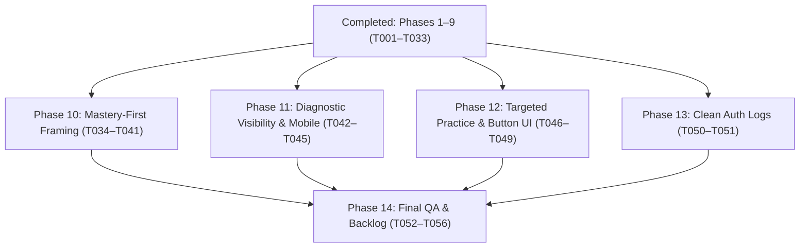

# Tasks: Subject Scope Enrichment, Catalog Deduplication, and Landing Page Accuracy & UX Fixes

**Input**: Design documents from `specs/007-scope-dedup-landing-fixes/` (`spec.md`, `plan.md`, `research.md`, `data-model.md`, `contracts/`, `quickstart.md`)  
**Prerequisites**: `plan.md` (required), `spec.md` (required for user stories), `research.md`, `data-model.md`, `contracts/`  
**Tests**: Unit tests are included for curriculum deduplication, subject scope resolvers, SEO sitemap generation, academic workflow demo bindings, weak-point diagnostics, quiz sampling tiers, and auth client configuration per TDD discipline.  
**Organization**: Tasks are grouped by user story to enable independent implementation and testing of each story.

## Format: `[ID] [P?] [Story] Description with file path`

- **[P]**: Can run in parallel (different files, no dependencies on incomplete tasks)
- **[Story]**: Which user story this task belongs to (`[US1]`, `[US2]`, `[US3]`, `[US4]`, `[US5]`, `[US6]`, `[US7]`, `[US8]`, `[US9]`)
- Every task includes an exact file path and clear implementation actions

---

## Phase 1: Setup (Shared Infrastructure & Tracking)

**Purpose**: Task tracking initialization and workspace governance alignment per `task-implementation` rules.

- [x] T001 Create task tracking file in `docs/tasks/TASK-030-subject-scope-dedup-landing-fixes.md` with Skills Allocation Matrix, feature description, and verification checklist

---

## Phase 2: Foundational (Blocking Prerequisites)

**Purpose**: Core curriculum data schemas and authentic 8-lesson syllabus registries that MUST be complete before ANY user story can be implemented.

**⚠️ CRITICAL**: No user story work can begin until this foundational phase is complete.

- [x] T002 [P] Extend curriculum TypeScript interfaces in `features/curriculum/types/subjectScope.types.ts` with `SubjectScopeLesson` (`lessonNumber: number`, `title: string`, `summary: string`, `keyConcepts: string[]`, `practiceDrillsCount: number`), `JhsGradeQuarterScope`, and update `SubjectScopeDefinition` with `lessons: SubjectScopeLesson[]`, `isJhsCore?: boolean`, and `abbr?: string`
- [x] T003 [P] Create comprehensive DepEd DO 015, s. 2026 MATATAG 8-lesson syllabus registry in `features/curriculum/utils/subject-lessons-data.ts` containing authentic 8 sequential lessons for all 8 JHS Core subjects across Grades 7–10 and Quarters 1–4 (16 grade×quarter variations per subject) and all 100 Senior High School subjects

**Checkpoint**: Foundation ready — user story implementation can now begin.

---

## Phase 3: User Story 1 - Explore Full Curriculum Scope & 8-Lesson Syllabus Breakdown (Priority: P1) 🎯 MVP

**Goal**: Deliver a rich, structured 8-lesson syllabus breakdown on `/subjects/[slug]` for all 108 subjects, plus an interactive Grade (7–10) and Quarter (1–4) switcher for JHS Core subjects that updates metadata, competencies, and practice CTA links in real time.

**Independent Test**: Navigate to `/subjects/g7-q1-math` and `/subjects/g11-s1-genmath`: verify that all 8 lessons render with titles, summaries, concept tags, and 3 drills each; verify that toggling Grade 8 and Quarter 2 updates the displayed syllabus and points the primary CTA to `/curriculum/g8-q2-math`.

### Tests for User Story 1 ⚠️
- [x] T004 [P] [US1] Write unit tests in `tests/unit/subject-scope.test.ts` asserting that `getSubjectScopeDefinition` returns 8 lessons for both JHS and SHS subjects and that `getJhsGradeQuarterScope` resolves grade- and quarter-specific lesson breakdowns

### Implementation for User Story 1
- [x] T005 [US1] Update `getSubjectScopeDefinition(slug)` and implement `getJhsGradeQuarterScope(abbr, grade, quarter)` in `features/curriculum/utils/subject-scope-data.ts` to attach authentic 8-lesson syllabi from `subject-lessons-data.ts` and resolve grade/quarter overrides
- [x] T006 [US1] Implement the 8-Lesson Syllabus & Topic Breakdown section and interactive Grade (Grades 7–10) & Quarter (Quarters 1–4) switcher with dynamic `/curriculum/` CTA links in `features/curriculum/components/SubjectScopeView.tsx`

**Checkpoint**: User Story 1 MVP is fully testable and operational on `/subjects/[slug]`.

---

## Phase 4: User Story 2 - Browse a Deduplicated, Non-Redundant Subjects Catalog (Priority: P1)

**Goal**: Deduplicate the public `/subjects` catalog from 324 redundant items to exactly **108 distinct subjects** (8 JHS Core covering Grades 7–10 • Quarters 1–4 + 100 SHS subjects), excluding legacy trimester (`g*-t*-*`) slugs while maintaining backwards-compatible route resolution.

**Independent Test**: Load `/subjects` and verify that the results counter states "Showing 108 DepEd MATATAG curriculum subjects", the JHS filter displays exactly 8 distinct cards, the SHS filter displays 100 cards, and zero `g*-t*-*` legacy trimester cards appear.

### Tests for User Story 2 ⚠️
- [x] T007 [P] [US2] Update unit tests in `tests/unit/curriculum-dedup.test.ts` to assert that `getDistinctShsSubjects()` returns 100 subjects and `totalCatalogCards` equals 108 (8 JHS + 100 SHS)

### Implementation for User Story 2
- [x] T008 [US2] Update `getAllSubjectScopeDefinitions()` to return exactly 108 distinct subjects and `getAllSubjectScopeSlugs()` to return 228 canonical slugs (excluding legacy `g*-t*-*` trimester slugs) in `features/curriculum/utils/subject-scope-data.ts`
- [x] T009 [US2] Update JHS subject card presentation in `features/curriculum/components/PublicSubjectCatalog.tsx` to display `Grades 7–10 • Quarters 1–4` and `JHS-${ABBR}` badges, linking to canonical default slugs
- [x] T010 [P] [US2] Verify dynamic XML sitemap generation and zero legacy trimester slug leaks in `__tests__/seo/sitemap.test.ts`

**Checkpoint**: User Story 2 is fully operational with a clean, deduplicated 108-subject catalog and clean sitemap generation.

---

## Phase 5: User Story 3 - Experience a Hydration-Error-Free Landing Page & Global Shell (Priority: P2)

**Goal**: Eliminate all React 19 server/client hydration mismatch warnings and development error badges caused by dynamic theme attributes on `<html>` and cookie evaluations during SSR.

**Independent Test**: Open the browser Developer Tools console, set an affiliate referral cookie (`document.cookie = "affiliate_ref=EDUCORE2026; path=/"`), refresh `/`, `/subjects`, and toggle Light/Dark/System themes, confirming 0 hydration mismatch warnings or attribute divergence errors.

### Implementation for User Story 3
- [x] T011 [P] [US3] Add `suppressHydrationWarning` to the root `<html lang="en">` tag in `app/layout.tsx` to eliminate hydration warnings from `next-themes` dynamic class/style injection
- [x] T012 [P] [US3] Refactor `referralInput` and `showReferralInput` in `features/billing/components/CheckoutModal.tsx` to initialize statically as `""` and `false` during SSR and synchronize with `getClientReferralCookie()` exclusively inside a client-side `React.useEffect` after mount

**Checkpoint**: User Story 3 is verified with 0 console hydration warnings across all themes and cookie states.

---

## Phase 6: User Story 4 - Read Accurate Feature Claims & Student Mastery Preview on the Landing Page (Priority: P2)

**Goal**: Remove all unsupported claims of "parent reporting", "automated gradebook", and "comprehensive gradebook review across all subjects", and transform the demo step 3 tab into an authentic "Student Mastery & Weak Points" preview with DO 015 transmuted scores and diagnostic skill recaps.

**Independent Test**: Inspect `#about`, `#how-to-use`, and `#demo` on `/`: verify 0 occurrences of "parent reporting" or "automated gradebook", and verify that the workflow demo step 3 tab showcases Student Mastery Breakdown rows, DO 015 average, and AI diagnostic insights.

### Tests for User Story 4 ⚠️
- [x] T013 [P] [US4] Update unit tests in `tests/unit/workflow-demo.test.ts` to assert Student Mastery & Weak Points bindings, DO 015 transmuted scores, and diagnostic insight descriptions

### Implementation for User Story 4
- [x] T014 [P] [US4] Remove unsupported claims of "automated gradebook and parent reporting" from benefit checklist item 4 in `features/landing/components/AboutSection.tsx` and replace with DepEd DO 015 s. 2026 score transmutation and per-subject mastery tracking
- [x] T015 [P] [US4] Remove "Comprehensive gradebook review across all subjects" from Step 04 highlights in `features/landing/components/HowToUseAppSection.tsx` and replace with real-time DO 015 transmuted scores, subject mastery tracking, and diagnostic weak-point alerts
- [x] T016 [US4] Replace the mock teacher LMS table in `features/landing/components/AcademicWorkflowDemo.tsx` with a "Student Mastery & Weak Points" tab displaying per-lesson DO 015 transmuted scores, mastery status badges (`Mastered`, `Practice Passed`, `Needs Review`), and AI diagnostic weak-point recommendations for the active subject

**Checkpoint**: User Story 4 delivers 100% accurate marketing copy and an authentic Student Mastery workflow demo.

---

## Phase 7: User Story 5 - Clean Academic Track Cards & Centered Subscription Modal CTA (Priority: P3)

**Goal**: Remove arbitrary decorative track icons across `/`, `/tracks`, and `/tracks/[id]` to present clean typography-first headers, and center the `Continue to Sign In / Sign Up` primary action button in the subscription intercept modal.

**Independent Test**: Scroll to `#categories` on `/`, `/tracks`, and `/tracks/[id]`, confirming 0 decorative track icons are rendered; open the subscription intercept modal and verify that the leading icon, text label, and trailing arrow are centered together.

### Tests for User Story 5 ⚠️
- [x] T017 [P] [US5] Update unit tests in `tests/unit/popular-and-category.test.ts` asserting clean iconless track card headers in `CategorySection.tsx`

### Implementation for User Story 5
- [x] T018 [P] [US5] Remove `ml-auto` from the `<ArrowRight />` icon in `features/billing/components/AuthInterceptDialog.tsx` so the leading `<LogIn />` icon, text label, and arrow are horizontally centered together
- [x] T019 [P] [US5] Remove decorative track icons and icon badge containers from the 9 academic track cards in `features/landing/components/CategorySection.tsx`
- [x] T020 [P] [US5] Remove decorative track icons and icon containers from track cards in `app/tracks/page.tsx`
- [x] T021 [P] [US5] Remove decorative track hero icon box from `features/landing/components/TrackDetail.tsx`

**Checkpoint**: User Story 5 is verified with clean track cards across all pages and a perfectly centered modal CTA button.

---

## Phase 8: Post-Review Polish & UI/UX Bug Fixes (Priority: P1)

**Goal**: Address 4 specific UI/UX issues identified during interactive user review:
1. Reconcile level and strand filters in `PublicSubjectCatalog.tsx` to prevent empty result sets and wrap buttons cleanly on all screen sizes; support query-string pre-filtering (`/subjects?level=JHS`, `/subjects?track=STEM`).
2. Add missing `slug` properties to `tracks-data.ts` and deep-link `/tracks/[id]` buttons directly to filtered `/subjects` views.
3. Remove outer `gap-12 sm:gap-16 pb-12` wrapper in `app/page.tsx` and standardize vertical padding to `py-12 sm:py-16 lg:py-20` across all 9 landing sections.
4. Replace floating `<` and `>` chevron buttons in `PopularSubjectsSection.tsx` with smooth touch-snap swiping and desktop mouse drag-to-scroll.

### Tests for Post-Review Bug Fixes
- [x] T022 [P] Update `tests/unit/popular-and-category.test.ts` to assert:
  - Popular subjects section has zero chevron buttons and is natively swipable / draggable
  - All landing sections follow standardized `py-12 sm:py-16 lg:py-20` spacing
  - `app/page.tsx` has zero outer flex gap margin
  - `PublicSubjectCatalog.tsx` uses responsive wrapping (`flex-wrap`)
  - All `featuredSubjects` across all tracks have valid `slug` properties resolving to authentic subject scopes

### Implementation for Post-Review Bug Fixes
- [x] T023 [P] Implement level/strand filter auto-reconciliation, deep-link search params, and responsive button wrapping in `PublicSubjectCatalog.tsx` and `app/subjects/page.tsx`
- [x] T024 [P] Populate all 15 missing `slug` properties in `features/landing/constants/tracks-data.ts`
- [x] T025 [P] Implement `TRACK_SUBJECTS_URL_MAP` deep-linking and responsive badge wrapping in `features/landing/components/TrackDetail.tsx`
- [x] T026 [P] Remove `gap-12 sm:gap-16 pb-12` outer wrapper in `app/page.tsx`
- [x] T027 [P] Standardize vertical section padding to `py-12 sm:py-16 lg:py-20` and container gutters across `HeroSection.tsx`, `StatsBar.tsx`, `AboutSection.tsx`, `AcademicWorkflowDemo.tsx`, `HowToUseAppSection.tsx`, `CategorySection.tsx`, `PopularSubjectsSection.tsx`, `TrialNoticeSection.tsx`, and `CtaBanner.tsx`
- [x] T028 [P] Remove `ChevronLeft` / `ChevronRight` buttons and add mouse drag-to-scroll and touch swiping to `features/landing/components/PopularSubjectsSection.tsx`

---

## Phase 9: Mid-Flight Quality Assurance

- [x] T029 Execute complete automated Jest test suite across all 40 test suites (253 tests passing)
- [x] T030 Run strict TypeScript compilation check (`npx tsc --noEmit`) to verify 0 compilation errors
- [x] T031 Run ESLint validation (`npm run lint`) to guarantee 0 errors and 0 warnings
- [x] T032 Verify Next.js production build (`npm run build`) generates all 276 static pages cleanly
- [x] T033 Log mid-flight feature progress and verification results in `docs/backlog.md`

---

## Phase 10: User Story 6 — Mastery-First Framing & Removal of Redundant DO 015 Badges (Priority: P1)

**Goal**: Reframe student performance language across all components, actions, and dashboard metrics from pass/fail testing to mastery-first terminology (`"Mastered"`, `"Practice Proficient"`, `"Mastery Target ≥ 75%"`, `"All Mastered"`), and remove repetitive `"DepEd DO 015 s. 2026"` / `"DO 015 Graded"` badges from individual subject cards, quiz mode pills, and popular subject cards while preserving the official 60–100 score transmutation engine.

**Independent Test**:
1. Open `/curriculum/g11-s1-genmath`: verify lesson cards with score ≥ 75% render `"Mastered"` or `"Practice Proficient ({score}%)"` instead of `"Practice Passed"`.
2. Verify summary states `"All Mastered"` when all attempted lessons are proficient.
3. Verify exam mode pill states `"Exam Mode (Graded)"` instead of `"DO 015 Graded"`.
4. In `PopularSubjectsSection.tsx`, verify repetitive `<Badge variant="outline">DepEd DO 015 s. 2026</Badge>` is removed from every card.
5. In `StudentDashboardView.tsx`, verify metric card states `"Mastery Avg"` instead of `"DO 015 Transmuted Avg"`.

### Implementation for User Story 6
- [x] T034 [P] [US6] Add `"Practice Proficient"` to `LessonProgressStatus` in `features/curriculum/types/curriculum.types.ts` while retaining `"Practice Passed"` as a backward-compatible alias
- [x] T035 [P] [US6] Update remark descriptors in `features/curriculum/actions/curriculum.actions.ts` (`getUserQuizAttemptsAction`) to `"Mastered (Outstanding)"`, `"Mastered (Very Satisfactory)"`, `"Proficient (Satisfactory)"`, `"Competency Met"`, and `"Needs Review (<75%)"`
- [x] T036 [P] [US6] Update `getTransmutedRemarks` in `features/dashboard/actions/dashboard.actions.ts` to return mastery-first descriptors (`"Mastered (Outstanding)"`, `"Very Satisfactory"`, `"Satisfactory"`, `"Competency Met"`, `"Needs Review"`)
- [x] T037 [P] [US6] Update `features/curriculum/components/SubjectWeakPointsCard.tsx`: replace `"DepEd DO 015 Passing Grade ≥ 75%"` with `"Mastery Target ≥ 75%"`, replace threshold description with `"All attempted competencies for this subject currently meet or exceed the 75% mastery benchmark..."`, and replace weak points description with `"Based on your latest attempt per lesson, these topics scored below the 75% mastery benchmark..."`
- [x] T038 [P] [US6] Update `features/curriculum/components/LessonList.tsx`: replace `"All Passed"` with `"All Mastered"`, replace `"Practice Passed ({stat.transmutedGrade}%)"` with `"Practice Proficient ({stat.transmutedGrade}%)"`, and replace `"DO 015 Graded"` with `"Exam Mode (Graded)"`
- [x] T039 [P] [US6] Update `features/curriculum/components/QuizRunner.tsx`: replace `"Practice Passed ({transmuted}%)"` with `"Practice Proficient ({transmuted}%)"`, and replace `"Exam Mode (DO 015 Graded)"` with `"Exam Mode (Graded)"`
- [x] T040 [P] [US6] Update `features/dashboard/components/StudentDashboardView.tsx`: replace `"DO 015 Transmuted Avg"` with `"Mastery Avg"` in the metrics bar
- [x] T041 [P] [US6] Remove repetitive `<Badge variant="outline">DepEd DO 015 s. 2026</Badge>` from individual cards in `features/landing/components/PopularSubjectsSection.tsx`, update subtitle in `features/landing/components/HowToUseAppSection.tsx` to `"Mastery target ≥ 75%"`, and align status tags in `features/landing/components/AcademicWorkflowDemo.tsx`

**Checkpoint**: User Story 6 delivers clean, mastery-first framing across all student and marketing touchpoints with zero redundant bureaucratic badges.

---

## Phase 11: User Story 7 — Accurate Diagnostic Mastery Visibility & Mobile Badge Alignment (Priority: P1)

**Goal**: Hide `SubjectWeakPointsCard` completely (`null`) for students with 0 quiz attempts (`totalAttemptedLessons === 0`), only display `"Diagnostic Mastery Achieved"` when `totalAttemptedLessons > 0 && weakPoints.length === 0`, and implement responsive mobile wrapping (`flex-wrap items-center gap-2` with `shrink-0 whitespace-nowrap` on badges) for `SubjectWeakPointsCard.tsx` and `LessonList.tsx` down to 320px viewports.

**Independent Test**:
1. Log in as a student with 0 quiz attempts in a subject: confirm `SubjectWeakPointsCard` is completely unmounted (`null`), displaying zero false "Diagnostic Mastery Achieved" banners.
2. Complete 1 lesson with score ≥ 75%: confirm `"Diagnostic Mastery Achieved"` appears with `"Mastery Target ≥ 75%"`.
3. Resize viewport to 320px: confirm heading and badge wrap without truncation or squished vertical columns, and confirm `"Curriculum Lessons (X)"` header row in `LessonList.tsx` wraps cleanly.

### Tests for User Story 7 ⚠️
- [x] T042 [P] [US7] Write unit tests in `tests/unit/weakPoints.test.ts` asserting that `getSubjectWeakPointsAction` returns `totalAttemptedLessons: number`, and verifying `SubjectWeakPointsCard` renders `null` when `totalAttemptedLessons === 0` and renders `"Diagnostic Mastery Achieved"` only when `totalAttemptedLessons > 0 && weakPoints.length === 0`

### Implementation for User Story 7
- [x] T043 [US7] Update `getSubjectWeakPointsAction` in `features/curriculum/actions/curriculum.actions.ts` to return `totalAttemptedLessons: latestAttemptByLesson.size` (and `0` for unauthenticated/error states)
- [x] T044 [US7] Update `features/curriculum/components/SubjectWeakPointsCard.tsx`: return `null` when `!data || data.totalAttemptedLessons === 0` (hiding card completely for zero-attempt subjects); only render `"Diagnostic Mastery Achieved"` when `data.totalAttemptedLessons > 0 && data.weakPoints.length === 0`; apply `flex flex-wrap items-center gap-2` on heading and `shrink-0 whitespace-nowrap` on `"Mastery Target ≥ 75%"` badge
- [x] T045 [P] [US7] Update `features/curriculum/components/LessonList.tsx` `"Curriculum Lessons (X)"` header row to use `flex flex-wrap items-center justify-between gap-2` for responsive mobile wrapping

**Checkpoint**: User Story 7 ensures 100% accurate diagnostic visibility with zero false-positives and responsive mobile alignment down to 320px.

---

## Phase 12: User Story 8 — Diagnostic-Driven Targeted Practice Question Selection & Mobile Weak-Point UI (Priority: P1)

**Goal**: Assemble targeted practice quizzes in three prioritized tiers (Tier 1: previously missed/unanswered questions from prior sessions -> Tier 2: questions matching lesson diagnostic `keyConcepts` -> Tier 3: remaining pool fallback with Fisher-Yates shuffle), remove `<Sparkles />` from the `"Targeted Practice"` button in `SubjectWeakPointsCard.tsx`, and make the button full-width on mobile (`w-full sm:w-auto`).

**Independent Test**:
1. In a lesson quiz, deliberately answer Questions 1 and 3 incorrectly.
2. Launch a Targeted Practice session for that lesson: inspect session questions and verify Questions 1 and 3 appear first, followed by questions matching the lesson's diagnostic `keyConcepts`.
3. Inspect `SubjectWeakPointsCard.tsx` on a mobile screen (< 640px): verify the `"Targeted Practice"` button has no sparkles icon and expands to full width (`w-full`).

### Tests for User Story 8 ⚠️
- [x] T046 [P] [US8] Write unit tests in `tests/unit/quiz-sampler.test.ts` asserting that `selectTargetedPracticeQuestions` prioritizes Tier 1 (missed/unanswered questions from prior sessions), Tier 2 (questions matching `keyConcepts` keywords), and Tier 3 (remaining pool fallback), deduplicating properly and clamping to `count`

### Implementation for User Story 8
- [x] T047 [US8] Implement `selectTargetedPracticeQuestions` in `features/curriculum/utils/quiz-sampler.ts` with 3-tier prioritization logic and Fisher-Yates pool fill
- [x] T048 [US8] Update `createTargetedPracticeAction` in `features/curriculum/actions/curriculum.actions.ts` to query previous `QuizSession` records for the user (`take: 5`, ordered by `createdAt: "desc"`), retrieve lesson `keyConcepts` via `getLessonsAction`, and invoke `selectTargetedPracticeQuestions`
- [x] T049 [US8] Update `features/curriculum/components/SubjectWeakPointsCard.tsx`: remove `<Sparkles />` icon from `"Targeted Practice"` button, apply `flex flex-wrap items-start sm:items-center justify-between gap-2` and `shrink-0 whitespace-nowrap` on `{data.totalWeakPoints} ... Under 75%` badge in CardHeader, and set button width to `w-full sm:w-auto justify-center` for responsive mobile touch sizing

**Checkpoint**: User Story 8 delivers intelligent, deficit-targeted remediation drills with a clean, touch-friendly mobile UI.

---

## Phase 13: User Story 9 — Eliminate `[Sentinel]` Better Auth Infrastructure Log Warning (Priority: P2)

**Goal**: Remove the unconfigured `sentinelClient()` plugin from `features/auth/lib/auth-client.ts`, completely eliminating `[Sentinel] Default global identify ingestion is active but not recommended...` warning logs in development and production consoles.

**Independent Test**: Open DevTools Console on `http://localhost:3000/`, perform a page reload and sign-in check, and verify zero `[Sentinel]` log entries are emitted.

### Tests for User Story 9 ⚠️
- [x] T050 [P] [US9] Write unit test in `tests/unit/auth-client.test.ts` verifying that `authClient` initializes without `sentinelClient` and without emitting `[Sentinel]` log warnings

### Implementation for User Story 9
- [x] T051 [US9] Remove `@better-auth/infra/client` import and `plugins: [sentinelClient()]` from `features/auth/lib/auth-client.ts`, leaving clean `export const authClient = createAuthClient({});`

**Checkpoint**: User Story 9 guarantees clean, warning-free browser console logs.

---

## Phase 14: Final Verification, Regression Suite & Backlog Logging

**Purpose**: Strict end-to-end regression validation, static typechecking, linting, production build verification, and single-source-of-truth backlog logging.

- [x] T052 [P] Execute complete automated Jest test suite across all curriculum, diagnostic, sitemap, demo, and auth tests (`npm test`)
- [x] T053 Run strict TypeScript compilation check (`npx tsc --noEmit`) to verify 0 compilation errors across all workspace files
- [x] T054 Run ESLint validation (`npm run lint`) to guarantee 0 errors and 0 warnings
- [x] T055 Verify Next.js production build (`npm run build`) generates all 276 static pages cleanly with zero hydration warnings
- [x] T056 Append comprehensive completion entry to `docs/backlog.md` and check off all completed items in `docs/tasks/TASK-030-subject-scope-dedup-landing-fixes.md`

---

## Dependencies & Execution Order

### Phase Dependencies
- **Phases 1–9**: Already completed and verified (`[x] T001` through `[x] T033`).
- **Phase 10 (User Story 6 - Mastery-First Framing)**: Can start immediately. `T034` (types) unblocks `T035–T041`.
- **Phase 11 (User Story 7 - Diagnostic Visibility & Mobile Alignment)**: Depends on `T043` (`getSubjectWeakPointsAction`), which unblocks `T044` (`SubjectWeakPointsCard.tsx`). `T042` (test) and `T045` (LessonList header) can run in parallel.
- **Phase 12 (User Story 8 - Targeted Practice Prioritization)**: `T046` (test) and `T047` (`quiz-sampler.ts`) can run in parallel. `T048` (`createTargetedPracticeAction`) depends on `T047`. `T049` (`SubjectWeakPointsCard.tsx` UI) can run in parallel.
- **Phase 13 (User Story 9 - Auth Sentinel Warning)**: Completely independent of curriculum and diagnostic work. Can run in parallel with Phases 10–12.
- **Phase 14 (Final QA & Backlog)**: Depends on completion of all implementation tasks (`T034` through `T051`).

---

## Parallel Execution Examples

- **Concurrent Story Implementation**:
  - `T051` (`auth-client.ts`) touches authentication only and can run concurrently with curriculum tasks.
  - `T047` (`quiz-sampler.ts`) touches curriculum utility logic and can run concurrently with `T037` (`SubjectWeakPointsCard.tsx` copy) and `T040` (`StudentDashboardView.tsx`).
  - `T045` (`LessonList.tsx` header wrapping) can run concurrently with `T041` (`PopularSubjectsSection.tsx`).
- **Concurrent Test Authoring**:
  - `T042` (`weakPoints.test.ts`), `T046` (`quiz-sampler.test.ts`), and `T050` (`auth-client.test.ts`) touch distinct test files and can run in parallel.

---

## Implementation Strategy

1. **Foundational Types & Utilities First**: Complete `T034` (types), `T043` (action signature), and `T047` (`selectTargetedPracticeQuestions`) to establish the data contracts.
2. **Mastery-First UI Sweep**: Update `SubjectWeakPointsCard.tsx`, `LessonList.tsx`, `QuizRunner.tsx`, `StudentDashboardView.tsx`, and `PopularSubjectsSection.tsx` to align all copy, badges, and remark descriptors.
3. **Diagnostic & Remediation Integration**: Wire `createTargetedPracticeAction` to `selectTargetedPracticeQuestions`, update `SubjectWeakPointsCard.tsx` to return `null` when `totalAttemptedLessons === 0`, and polish mobile button sizing.
4. **Auth Warning Cleanup**: Remove `sentinelClient()` from `auth-client.ts`.
5. **Full Quality Gate Verification**: Run `npm test`, `tsc --noEmit`, `npm run lint`, and `npm run build` before committing and logging to `docs/backlog.md`.
